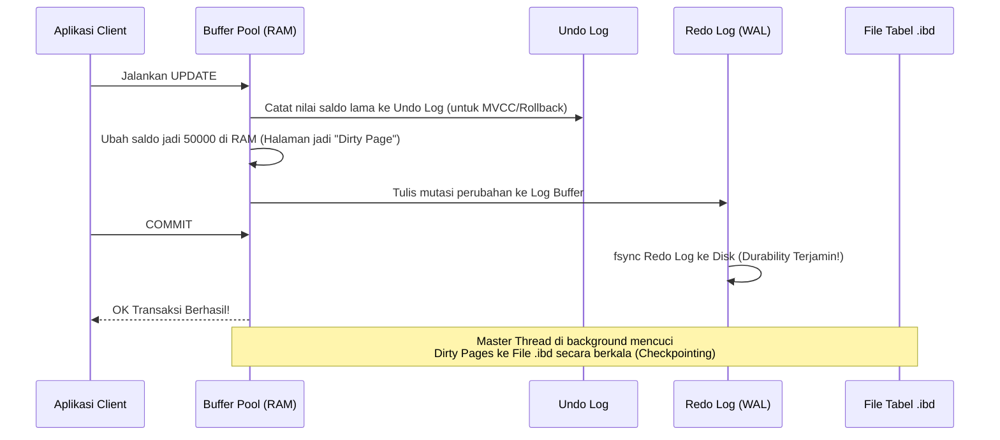

# 🐬 MySQL - Modul 02: Storage Engines & Arsitektur Internal InnoDB

Keunikan arsitektur MySQL dibandingkan RDBMS lain seperti PostgreSQL atau Oracle adalah konsep **Pluggable Storage Engine**. MySQL Server menangani koneksi, parsing SQL, optimasi query, dan authentication, sedangkan urusan pembacaan dan penulisan byte fisik ke disk diserahkan sepenuhnya ke storage engine.

---

## 1. Perbandingan Storage Engines MySQL

| Fitur | 👑 **InnoDB** (Default) | 📦 **MyISAM** (Legacy) | ⚡ **Memory (HEAP)** |
|---|---|---|---|
| **Dukungan Transaksi (ACID)** | ✅ Penuh (Commit & Rollback) | ❌ Tidak Ada | ❌ Tidak Ada |
| **Tingkat Penguncian (Locking)**| ✅ **Row-Level Locking** | ❌ **Table-Level Locking** (Seluruh tabel terkunci!) | ❌ Table-Level Locking |
| **Foreign Key Constraints** | ✅ Ya | ❌ Tidak | ❌ Tidak |
| **Crash Recovery Otomatis** | ✅ Ya (via Redo Log & Doublewrite) | ❌ Tidak (Tabel rawan *corrupt*, butuh `myisamchk`) | ❌ Data hilang saat restart server |
| **Struktur Penyimpanan Data** | Clustered Index (B+Tree) | Heap File + Non-clustered Index | In-Memory Hash Index / B-Tree |
| **Kasus Penggunaan Ideal** | Aplikasi OLTP modern, e-commerce, web | Read-only archive usang | Caching tabel referensi kecil sementara |

---

## 2. Arsitektur Internal InnoDB

InnoDB adalah mesin database modern yang mengimplementasikan metodologi **Write-Ahead Logging (WAL)**. Modifikasi data di RAM tidak langsung ditulis ke file tabel utama saat itu juga, melainkan dicatat terlebih dahulu ke log sekuensial yang sangat cepat.

```mermaid
flowchart TD
    subgraph RAM["In-Memory Structures (RAM)"]
        BP["InnoDB Buffer Pool (16KB Pages)<br/>• LRU List (Young vs Old Sublist)<br/>• Flush List (Dirty Pages)<br/>• Free List"]
        CB["Change Buffer (Buffer penulisan secondary index)"]
        AHI["Adaptive Hash Index (Auto cache query B+Tree)"]
        LB["Log Buffer (Menampung Redo Log sebelum fsync)"]
    end

    subgraph Disk["On-Disk Structures (Storage Disk)"]
        DWB[("Doublewrite Buffer (Cegah Partial Page Write)")]
        FPT[("File-Per-Table Tablespaces (*.ibd)")]
        Redo[("Redo Log (#innodb_redo / ib_logfile)")]
        Undo[("Undo Tablespaces (MVCC & Rollback Segments)")]
    end

    RAM <-->|Checkpointing & Flushing (Master Thread)| Disk
```

### A. Struktur In-Memory (RAM)
1. **InnoDB Buffer Pool**:
   - Komponen memori paling penting di server MySQL.
   - Menyimpan cache halaman (*Pages*) data tabel dan indeks sebesar **16KB**.
   - Dikelola dengan algoritma **Modified LRU (Least Recently Used)**: dibagi menjadi *Young Sublist* (5/8 teratas) dan *Old Sublist* (3/8 terbawah) untuk mencegah query besar (*table scan*) membuang cache halaman penting.
2. **Log Buffer**:
   - Menampung catatan transaksi sebelum ditulis ke disk Redo Log. Ukuran default 16MB.
3. **Change Buffer**:
   - Menampung perubahan pada *Secondary Index* saat halaman target belum ada di Buffer Pool, sehingga menghemat I/O disk acak.
4. **Adaptive Hash Index (AHI)**:
   - InnoDB otomatis membangun hash index di RAM untuk halaman B-Tree yang sangat sering diakses, mengubah pencarian $O(\log N)$ menjadi $O(1)$!

### B. Struktur On-Disk (Storage)
1. **Redo Log (Write-Ahead Log)**:
   - File log melingkar (*circular buffer*) yang mencatat semua mutasi fisik yang dilakukan pada halaman data.
   - Jika server mati listrik mendadak, data yang masih ada di Buffer Pool dan belum sempat ditulis ke file tabel akan diputar ulang (*Redo Phase*) dari Redo Log saat server menyala kembali.
2. **Undo Log**:
   - Menyimpan nilai lama sebelum data diubah. Digunakan untuk:
     - Membatalkan transaksi (*Rollback*).
     - Menyediakan konsistensi pembacaan data tanpa mengunci baris (**MVCC** - Multi-Version Concurrency Control).
3. **Doublewrite Buffer**:
   - Menghindari bencana **Partial Page Write** (kondisi di mana sistem operasi atau disk mati di tengah proses penulisan halaman 16KB sehingga halaman rusak separuh). Data ditulis ke area Doublewrite sekuensial terlebih dahulu sebelum ditulis ke lokasi aslinya di file `.ibd`.
4. **Tablespace (`.ibd`)**:
   - Dengan parameter `innodb_file_per_table = ON` (default), setiap tabel memiliki file penyimpanan tersendiri: `nama_tabel.ibd`.

---

## 3. Alur Eksekusi Penulisan Data (The Write Lifecycle)

Ketika aplikasi Anda menjalankan `UPDATE users SET saldo = 50000 WHERE id = 1;`:



1. Nilai lama dicatat ke **Undo Log**.
2. Halaman memori di Buffer Pool diubah (kini berstatus **Dirty Page**).
3. Perubahan ditulis ke **Redo Log Buffer**.
4. Saat `COMMIT`, Redo Log di-flush ke disk secara aman (`fsync`).
5. Transaksi selesai dan client mendapat respons sukses **tanpa harus menunggu file `.ibd` selesai ditulis**. File `.ibd` akan dicuci (*flushed*) di latar belakang secara asinkron oleh thread *Page Cleaner*.

---

## 4. Mekanisme Crash Recovery Otomatis

Jika server tiba-tiba mati mendadak (misal pod Kubernetes di-kill atau power loss):
1. **Analisis Fase**: InnoDB memeriksa *Checkpoint LSN* (Log Sequence Number) terakhir di header Redo Log.
2. **Redo Phase (Roll-Forward)**: Semua halaman yang tercatat di Redo Log sejak checkpoint terakhir hingga titik crash diputar ulang ke memori. Semua transaksi yang sudah ter-commit dikembalikan secara utuh.
3. **Undo Phase (Roll-Back)**: InnoDB memeriksa Undo Log untuk menemukan transaksi yang statusnya masih aktif (*Uncommitted*) saat crash terjadi, lalu membatalkan perubahannya agar database kembali ke keadaan konsisten $100\%$.
