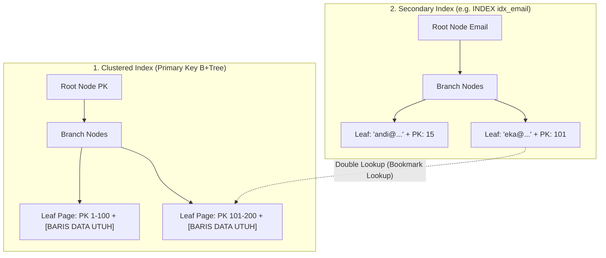

# 🐬 MySQL - Modul 04: Indexing Mendalam & Optimasi Query

Sebuah query yang lambat di database hampir selalu bermuara pada satu masalah: **kesalahan perancangan indeks**. Memahami bagaimana struktur data **B+Tree** bekerja di dalam InnoDB adalah pembeda antara developer biasa dengan arsitek database kelas atas.

---

## 1. Anatomi B+Tree: Clustered vs Secondary Index

Di InnoDB, **semua tabel adalah Index-Organized Table**.



### A. Clustered Index (Primary Key)
- Daun (*Leaf nodes*) dari Clustered Index **berisi baris data aktual secara utuh**.
- Hanya bisa ada **1 Clustered Index** per tabel.
- Jika Anda tidak mendefinisikan `PRIMARY KEY`, InnoDB akan mencari kolom `UNIQUE NOT NULL` pertama. Jika tidak ada juga, InnoDB diam-diam membuat kolom 6-byte tersembunyi (`ROW_ID`) yang tidak bisa Anda optimasi.

### B. Secondary Index
- Daun dari Secondary Index **TIDAK menyimpan baris data utuh**.
- Daun hanya menyimpan: **Kolom yang diindeks + Nilai Primary Key**.
- **Double Lookup Penalty**: Jika Anda menjalankan query `SELECT alamat, no_hp FROM users WHERE email = 'eka@...';`, InnoDB pertama kali mencari `email` di Secondary Index untuk mendapatkan nilai `PK: 101`, lalu melakukan lompatan kedua ke Clustered Index untuk mengambil kolom `alamat` dan `no_hp`!

---

## 2. Senjata Pamungkas: Covering Index

Bagaimana cara menghilangkan penalti Double Lookup? Gunakan **Covering Index**!

Covering Index adalah kondisi di mana **semua kolom yang diminta oleh query (`SELECT`, `WHERE`, `ORDER BY`) sudah tersedia seluruhnya di dalam daun Secondary Index**.

```sql
-- Buat composite index mencakup email dan nama:
CREATE INDEX idx_users_email_nama ON users (email, nama);

-- Query ini 100% COVERING:
-- Tidak perlu membaca baris tabel fisik (Clustered Index) sama sekali!
SELECT email, nama FROM users WHERE email = 'eka@dev.local';
```

Saat Anda menjalankan `EXPLAIN`, kolom `Extra` akan bertuliskan **`Using index`** (tanda hijau efisiensi maksimum).

---

## 3. Aturan Sakti: The Leftmost Prefix Rule

Pada Composite Index (indeks multi-kolom), urutan deklarasi kolom bersifat **harga mati**.

Misal kita memiliki indeks:
$$\mathbf{CREATE\ INDEX\ idx\_abc\ ON\ orders\ (status,\ customer\_id,\ order\_date);}$$

| Bentuk Kondisi `WHERE` | Apakah Indeks Dipakai? | Penjelasan |
|---|---|---|
| `WHERE status = 'PAID'` | ✅ **YA** (Menggunakan kolom ke-1) | Awalan paling kiri terpenuhi. |
| `WHERE status = 'PAID' AND customer_id = 5` | ✅ **YA** (Menggunakan kolom ke-1 & 2) | Sangat optimal. |
| `WHERE status = 'PAID' AND order_date = '...'`| ⚠️ **Sebagian** | Hanya kolom `status` yang masuk filter indeks; `order_date` disaring belakangan. |
| `WHERE customer_id = 5` | ❌ **TIDAK** (Full Table Scan!) | Melewati kolom paling kiri (`status`). Indeks tidak bisa digunakan! |
| `WHERE order_date = '...'` | ❌ **TIDAK** (Full Table Scan!) | Melewati kolom pertama dan kedua. |

---

## 4. Fitur Indeks Khusus MySQL 8.0+

### A. Invisible Index (Uji Drop Indeks Tanpa Risiko)
Sebelum menghapus indeks besar yang dicurigai tidak terpakai, jadikan invisible terlebih dahulu. Optimizer MySQL akan mengabaikannya, tetapi struktur B+Tree tetap di-update di latar belakang:
```sql
-- Sembunyikan dari optimizer:
ALTER TABLE orders ALTER INDEX idx_lama INVISIBLE;

-- Jika performa server drop/bermasalah, kembalikan instan dalam 1 detik:
ALTER TABLE orders ALTER INDEX idx_lama VISIBLE;

-- Jika aman berhari-hari, baru hapus permanen:
DROP INDEX idx_lama ON orders;
```

### B. Functional / Expression Index
Mengindeks hasil evaluasi fungsi (misal pencarian case-insensitive):
```sql
CREATE INDEX idx_users_lower_email ON users ((LOWER(email)));

-- Sekarang query ini memanfaatkan B+Tree!
SELECT * FROM users WHERE LOWER(email) = 'eka@dev.local';
```

### C. Full-Text Search (FTS) Index
Untuk pencarian kata kunci artikel atau produk:
```sql
ALTER TABLE articles ADD FULLTEXT INDEX fts_konten (judul, isi);

-- Pencarian Boolean Mode:
SELECT * FROM articles 
WHERE MATCH(judul, isi) AGAINST('+mysql -oracle +"database"' IN BOOLEAN MODE);
```

---

## 5. Membedah Query Plan dengan EXPLAIN & EXPLAIN ANALYZE

```sql
EXPLAIN FORMAT=TREE SELECT * FROM orders WHERE status = 'PENDING' ORDER BY id DESC LIMIT 10;
```

### Hirarki Tipe Akses (`type`) dari Terbaik ke Terburuk:
$$\text{system} > \text{const} > \text{eq\_ref} > \text{ref} > \text{range} > \text{index} > \mathbf{ALL\ (Full\ Table\ Scan)}$$

1. **`const`**: Mengakses tepat 1 baris via Primary Key atau Unique Index (`WHERE id = 5`).
2. **`eq_ref`**: Join 1-to-1 menggunakan Primary Key dari tabel kedua.
3. **`ref`**: Menggunakan indeks non-unique yang mengembalikan beberapa baris.
4. **`range`**: Scan rentang nilai indeks (`WHERE umur BETWEEN 20 AND 30`, `<`, `>`, `IN(...)`).
5. **`index`**: Memindai seluruh daun pohon B+Tree index dari kiri ke kanan.
6. **`ALL`**: **Bencana!** Memindai seluruh baris tabel fisik dari awal sampai akhir (*Full Table Scan*).

### EXPLAIN ANALYZE (MySQL 8.0+)
`EXPLAIN` biasa hanya memberikan **estimasi tebakan statistik**. `EXPLAIN ANALYZE` **benar-benar mengeksekusi query** dan mencatat waktu aktual milidetik serta jumlah baris nyata:

```sql
EXPLAIN ANALYZE SELECT * FROM users WHERE saldo > 1000000;
-- Output:
-- -> Filter: (users.saldo > 1000000.00)  (cost=105.25 rows=350) (actual time=0.082..1.240 rows=312 loops=1)
--    -> Table scan on users  (cost=105.25 rows=1000) (actual time=0.065..0.980 rows=1000 loops=1)
```
Lihat `actual time=1.240ms` dan `Table scan`: ini bukti konkret query membutuhkan indeks pada kolom `saldo`!
