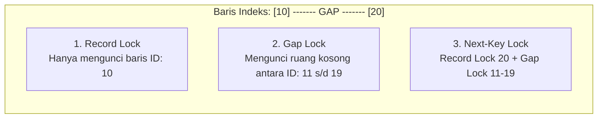

# 🐬 MySQL - Modul 05: Transaksi, Locking & Analisis Deadlock

Dalam sistem e-commerce atau perbankan dengan ribuan transaksi per detik, mengelola akses bersamaan (*concurrency*) ke baris data yang sama adalah hal yang sangat kritis. InnoDB menggunakan kombinasi **MVCC (Multi-Version Concurrency Control)** untuk pembacaan non-locking dan **Row-Level Locking** untuk penulisan atomik.

---

## 1. 4 Tingkat Isolasi Transaksi di MySQL

Tingkat isolasi default di MySQL InnoDB adalah **`REPEATABLE READ`**.

| Isolation Level | Dirty Read | Non-Repeatable Read | Phantom Read | Mekanisme InnoDB |
|---|---|---|---|---|
| **`READ UNCOMMITTED`** | ❌ Terjadi | ❌ Terjadi | ❌ Terjadi | Membaca langsung tanpa konsistensi. |
| **`READ COMMITTED`** | ✅ Dicegah | ❌ Terjadi | ❌ Terjadi | Setiap `SELECT` membuat snapshot baru dari data yang sudah di-commit. |
| **`REPEATABLE READ`** (Default)| ✅ Dicegah | ✅ Dicegah | ✅ **Dicegah** | Snapshot pembacaan dikunci sejak `SELECT` pertama transaksi dibuka via MVCC + Next-Key Lock. |
| **`SERIALIZABLE`** | ✅ Dicegah | ✅ Dicegah | ✅ Dicegah | Setiap `SELECT` implisit diubah menjadi `FOR SHARE` (Sangat lambat!). |

```sql
-- Mengatur tingkat isolasi untuk sesi saat ini:
SET SESSION TRANSACTION ISOLATION LEVEL READ COMMITTED;

-- Cek tingkat isolasi global & sesi:
SELECT @@transaction_isolation;
```

---

## 2. Jenis-Jenis Penguncian (Locking) di InnoDB

### A. Shared (S) vs Exclusive (X) Locks
- **Shared Lock (`FOR SHARE`)**: Mengizinkan transaksi lain membaca, namun melarang transaksi lain memodifikasi baris tersebut.
  ```sql
  SELECT * FROM users WHERE id = 10 FOR SHARE;
  ```
- **Exclusive Lock (`FOR UPDATE`)**: Mengunci baris secara eksklusif. Transaksi lain tidak boleh membaca dengan lock maupun memodifikasi baris ini hingga transaksi selesai.
  ```sql
  SELECT saldo FROM accounts WHERE user_id = 101 FOR UPDATE;
  ```

### B. 3 Pola Row-Level Locking InnoDB



1. **Record Lock**: Mengunci record index spesifik (misal `WHERE id = 10` pada primary key).
2. **Gap Lock**: Mengunci celah ruang kosong di antara dua entri indeks. Mencegah transaksi lain menyelipkan (*insert*) baris baru di antara rentang tersebut!
3. **Next-Key Lock**: Kombinasi Record Lock + Gap Lock sebelum record tersebut. Inilah mekanisme ajaib yang membuat InnoDB **kebal dari Phantom Read** pada level `REPEATABLE READ`!

> [!CAUTION]
> Jika Anda menjalankan `UPDATE users SET status = 'ACTIVE' WHERE nama = 'Budi';` dan kolom `nama` **TIDAK memiliki indeks**, InnoDB akan melakukan Full Table Scan dan **mengunci SELURUH baris dan gap tabel**! Seluruh aplikasi akan macet total (*hung*). Selalu pastikan klausa `UPDATE` dan `DELETE` menggunakan kolom berindeks!

---

## 3. Bedah Deadlock: Deteksi & Pencegahan

**Deadlock** terjadi ketika dua transaksi saling menunggu kunci yang dipegang oleh transaksi lainnya dalam pola siklus melingkar (*circular dependency*).

```mermaid
sequenceDiagram
    participant Tx1 as Transaksi 1
    participant DB as MySQL InnoDB
    participant Tx2 as Transaksi 2

    Tx1->>DB: 1. UPDATE accounts SET saldo = saldo - 100 WHERE id = 1; (Kunci ID: 1)
    Tx2->>DB: 2. UPDATE accounts SET saldo = saldo - 50 WHERE id = 2; (Kunci ID: 2)
    Tx1->>DB: 3. UPDATE accounts SET saldo = saldo + 100 WHERE id = 2; (Menunggu Kunci ID: 2 dilepas Tx2...)
    Tx2->>DB: 4. UPDATE accounts SET saldo = saldo + 50 WHERE id = 1; (Menunggu Kunci ID: 1 dilepas Tx1...)
    Note over Tx1, Tx2: 💥 DEADLOCK TERCIPTA!
    DB-->>Tx2: 5. ERROR 1213 (40001): Deadlock found when trying to get lock; try restarting transaction
    DB-->>Tx1: 6. Transaksi 1 Berhasil Lanjut!
```

### Bagaimana InnoDB Menangani Deadlock?
InnoDB memiliki algoritma deteksi deadlock otomatis (`innodb_deadlock_detect = ON`). Ketika siklus terdeteksi, InnoDB memilih **transaksi dengan bobot terkecil** (transaksi yang paling sedikit melakukan modifikasi baris data) sebagai **korban (*victim*)**, lalu membatalkan transaksi tersebut dengan melempar error:
`ERROR 1213 (40001): Deadlock found when trying to get lock; try restarting transaction`.

### Mendiagnosis Deadlock Terakhir
Jalankan perintah ini di terminal MySQL untuk melihat penyebab deadlock paling mutakhir:
```sql
SHOW ENGINE INNODB STATUS\G
```
Cari bagian teks: **`------------------------\nLATEST DETECTED DEADLOCK\n------------------------`**. Anda akan melihat:
- Query SQL persis yang dijalankan oleh Transaksi 1 dan Transaksi 2.
- Indeks dan baris kunci mana yang sedang diperebutkan.
- Transaksi mana yang dikorbankan oleh InnoDB.

### 4 Aturan Emas Mencegah Deadlock di Aplikasi:
1. **Urutan Penguncian Konsisten**: Jika Anda memodifikasi beberapa baris (misal transfer antar akun), **selalu urutkan ID terlebih dahulu** sebelum mengunci:
   ```python
   # Pola Benar: Kunci ID terkecil terlebih dahulu!
   ids = sorted([akun_pengirim_id, akun_penerima_id])
   cursor.execute(f"SELECT * FROM accounts WHERE id = {ids[0]} FOR UPDATE")
   cursor.execute(f"SELECT * FROM accounts WHERE id = {ids[1]} FOR UPDATE")
   ```
2. **Kecilkan Durasi Transaksi**: Hindari memanggil REST API pihak ketiga (seperti payment gateway) di dalam blok transaksi database. Buka koneksi transaksi hanya untuk query SQL murni.
3. **Turunkan Isolation Level**: Jika aplikasi Anda aman dari non-repeatable read, gunakan `READ COMMITTED` untuk menonaktifkan Gap Lock.
4. **Implementasikan Retry Loop**: Di kode backend (Go/Node/Python), bungkus transaksi database dalam fungsi *retry* otomatis dengan batas maksimal 3 kali percobaan jika mendeteksi error code 1213.
