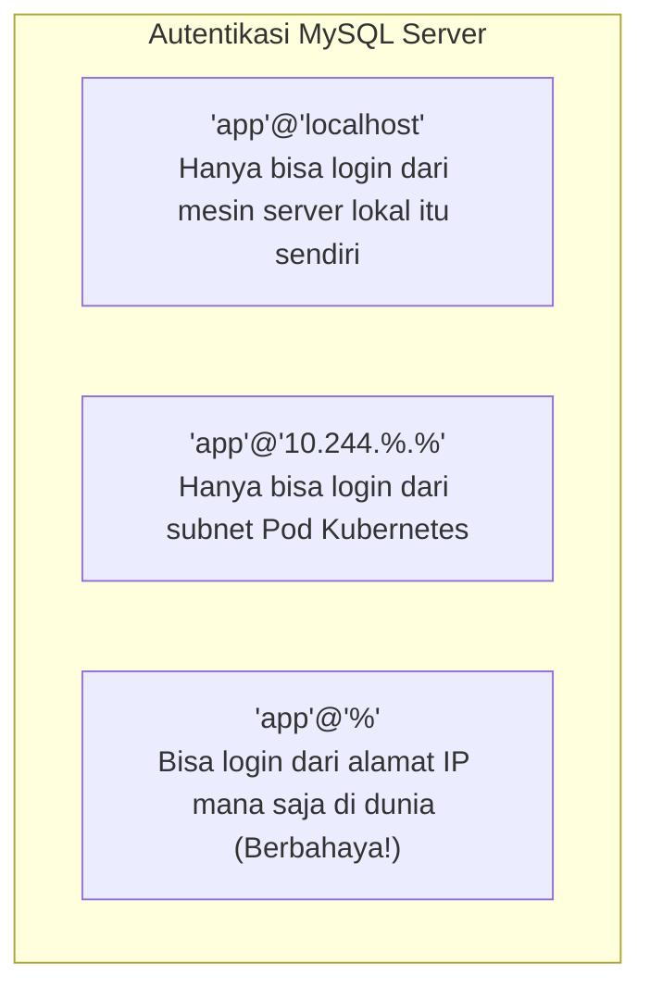

# 🐬 MySQL - Modul 07: Manajemen User, Privileges & Keamanan

Keamanan database adalah garis pertahanan terakhir aplikasi Anda. Memberikan akses `root` ke aplikasi web atau menggunakan wildcard host `'%'` tanpa pembatasan jaringan adalah celah fatal yang sering dieksploitasi penyerang.

---

## 1. Konsep Akun: Username & Host Scoping

Di MySQL, identitas user ditentukan oleh pasangan **`'username'@'host'`**. Dua user dengan nama sama namun host berbeda adalah dua entitas yang sepenuhnya terpisah!



### Membuat User Produksi yang Aman
```sql
-- Menggunakan plugin autentikasi modern caching_sha2_password:
CREATE USER 'app_backend'@'10.244.%.%' 
  IDENTIFIED WITH caching_sha2_password BY 'RahasiaKuat#2026_xYza'
  WITH MAX_QUERIES_PER_HOUR 0
  MAX_CONNECTIONS_PER_HOUR 0
  MAX_USER_CONNECTIONS 150; -- Batasi maksimal 150 koneksi per user
```

---

## 2. Prinsip Least Privilege: GRANT & REVOKE

Jangan pernah memberikan `ALL PRIVILEGES` ke akun aplikasi backend!

### A. Hak Akses Ideal untuk Aplikasi Web Backend
Aplikasi web biasa hanya membutuhkan akses CRUD data, **tanpa izin DDL** (seperti `DROP TABLE` atau `ALTER TABLE`):
```sql
GRANT SELECT, INSERT, UPDATE, DELETE ON toko_online.* TO 'app_backend'@'10.244.%.%';
```

### B. Hak Akses untuk Tool BI / Analis Data
Analis hanya membutuhkan akses baca (*Read-Only*):
```sql
GRANT SELECT ON toko_online.* TO 'bi_analyst'@'192.168.1.50';
```

### C. Memeriksa & Mencabut Hak Akses
```sql
-- Lihat izin yang dimiliki user:
SHOW GRANTS FOR 'app_backend'@'10.244.%.%';

-- Cabut izin DELETE (misal untuk akun audit):
REVOKE DELETE ON toko_online.* FROM 'app_backend'@'10.244.%.%';
```

> [!NOTE]
> **Mitos `FLUSH PRIVILEGES`**:
> Perintah `FLUSH PRIVILEGES;` **HANYA dibutuhkan** jika Anda mengubah tabel sistem `mysql.user` secara manual menggunakan `INSERT` atau `UPDATE`. Jika Anda menggunakan perintah standar `GRANT`, `REVOKE`, atau `CREATE USER`, MySQL langsung memperbarui memori hak akses detik itu juga tanpa perlu `FLUSH PRIVILEGES`!

---

## 3. Fitur Roles di MySQL 8.0+

Mengelola ratusan user secara individu sangat merepotkan. Gunakan **Roles** untuk mengelompokkan sekumpulan hak akses:

```sql
-- 1. Buat Roles
CREATE ROLE 'role_read_only', 'role_read_write';

-- 2. Berikan izin ke masing-masing Role
GRANT SELECT ON toko_online.* TO 'role_read_only';
GRANT SELECT, INSERT, UPDATE, DELETE ON toko_online.* TO 'role_read_write';

-- 3. Pasangkan Role ke User
GRANT 'role_read_only' TO 'analis_budi'@'%', 'analis_siti'@'%';

-- 4. Aktifkan Role secara otomatis saat login:
SET DEFAULT ROLE ALL TO 'analis_budi'@'%', 'analis_siti'@'%';
```

---

## 4. Fitur Keamanan Lanjutan

### A. Mewajibkan Koneksi Terenkripsi (Enforce SSL/TLS)
Cegah sniffing data transaksi di jaringan dengan mewajibkan enkripsi TLS:
```sql
ALTER USER 'app_backend'@'10.244.%.%' REQUIRE SSL;
```

### B. Zero-Downtime Password Rotation (Dual Passwords)
Saat Anda ingin mengganti password database di server produksi dengan 20 instance pod yang sedang berjalan, mengganti password seketika akan membuat pod lama yang belum di-restart mengalami error koneksi. 

MySQL 8.0.14+ menyediakan fitur **Dual Passwords**:

```sql
-- 1. Tambahkan password baru tanpa menghapus password lama (pod lama tetap aman jalan):
ALTER USER 'app_backend'@'10.244.%.%' 
  IDENTIFIED BY 'PasswordBaruSuper#2026' 
  RETAIN CURRENT PASSWORD;

-- 2. Rollout update konfigurasi aplikasi di Kubernetes hingga semua pod baru naik...

-- 3. Setelah semua pod memakai password baru, buang password lama:
ALTER USER 'app_backend'@'10.244.%.%' DISCARD OLD PASSWORD;
```

### C. Menonaktifkan Fitur Berbahaya di `my.cnf`
```ini
[mysqld]
# Matikan eksekusi pembacaan file lokal dari client (Cegah LFI exploit):
local_infile = 0

# Matikan lookup DNS terbalik agar koneksi lebih cepat dan aman dari spoofing DNS:
skip_name_resolve = 1

# Kunci IP listening hanya ke interface internal privat:
bind-address = 10.0.0.5
```
