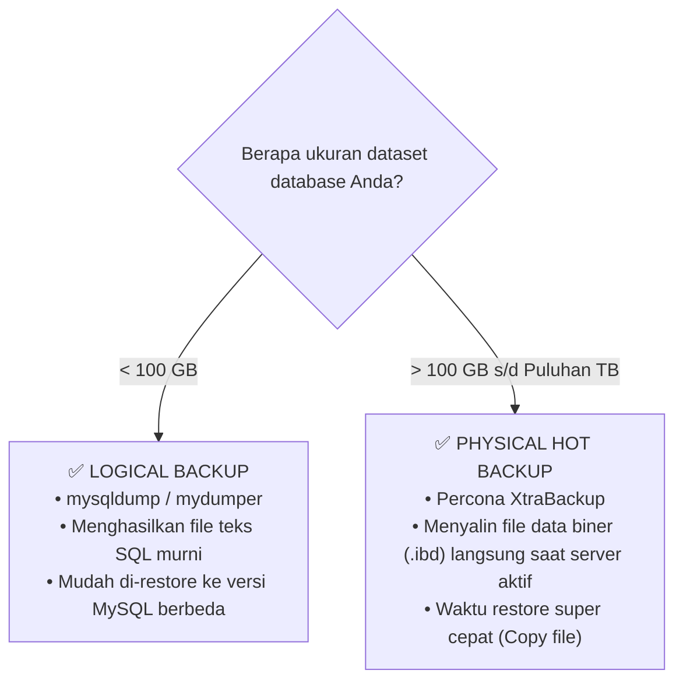

# 🐬 MySQL - Modul 09: Backup, Restore & Point-in-Time Recovery (PITR)

Memiliki backup yang valid adalah asuransi jiwa seorang engineer. Seringkali tim baru menyadari file backup mereka rusak atau tidak konsisten saat bencana (*disaster*) sudah terjadi. Di modul ini, kita membedah metode backup logis, fisik, dan penyelamatan data menit-terakhir.

---

## 1. Matriks Metode Backup MySQL



---

## 2. Logical Backup: `mysqldump` Standar Produksi

Jangan pernah menjalankan `mysqldump` tanpa parameter! Tanpa parameter yang benar, `mysqldump` bisa mengunci seluruh tabel Anda atau membuat server *Out of Memory*.

### Perintah mysqldump yang Benar:
```bash
mysqldump -u root -p \
  --single-transaction \
  --quick \
  --routines \
  --triggers \
  --events \
  --source-data=2 \
  --default-character-set=utf8mb4 \
  toko_online | gzip > /backup/backup_toko_$(date +%F).sql.gz
```

### Penjelasan Parameter Wajib:
1. **`--single-transaction`**: **PALING KRUSIAL!** Memulai transaksi dengan isolasi `REPEATABLE READ` agar backup mendapatkan snapshot konsisten **TANPA MENGUNCI TABEL InnoDB SAMA SEKALI**. Aplikasi tetap bisa melakukan read/write dengan lancar.
2. **`--quick`**: Memaksa mysqldump membaca baris per baris langsung dari server, bukan menarik seluruh isi tabel ke dalam RAM client.
3. **`--routines` & `--triggers` & `--events`**: Menyertakan Stored Procedures, Functions, Triggers, dan Scheduled Events.
4. **`--source-data=2`** (dulu `--master-data=2`): Mencatat posisi persis file Binary Log dan posisi nomor baris (*Binlog Coordinates*) sebagai komentar di awal file backup, modal utama untuk PITR!

### Restore Database dari File Dump:
```bash
# Ekstrak dan masukkan kembali ke database:
gunzip < /backup/backup_toko_2026-11-20.sql.gz | mysql -u root -p toko_online
```

---

## 3. Multi-Threaded Backup: `mydumper` & `myloader`

Jika database Anda berukuran 50GB, `mysqldump` bisa memakan waktu berjam-jam karena bekerja secara *single-threaded* (hanya 1 CPU core).

Gunakan **`mydumper`** dan **`myloader`** (standar industri untuk backup paralel):
```bash
# Dump dengan 8 thread paralel sekaligus:
mydumper \
  --user=root \
  --password='PasswordKuat' \
  --database=toko_online \
  --threads=8 \
  --compress \
  --outputdir=/backup/mydumper_$(date +%F)

# Restore paralel dengan 8 thread:
myloader \
  --user=root \
  --password='PasswordKuat' \
  --database=toko_online \
  --threads=8 \
  --directory=/backup/mydumper_2026-11-20
```
Kecepatan dump dan restore melonjak **5x hingga 10x lebih cepat** dibanding `mysqldump`!

---

## 4. Penyelamatan Bencana: Point-In-Time Recovery (PITR)

Bayangkan skenario horor ini:
1. Jam **00:00**: Backup harian otomatis berhasil dijalankan.
2. Jam **10:15**: Seorang developer menjalankan perintah fatal di server produksi:
   ```sql
   DROP TABLE orders; -- 💥 DATA TRANSAKSI 10 JAM TERAKHIR HILANG!
   ```

Jika Anda hanya me-restore backup jam 00:00, seluruh transaksi dari jam 00:00 sampai 10:15 akan hilang selamanya. 

Solusinya adalah **Point-In-Time Recovery (PITR)** menggunakan **Binary Log (Binlog)**!


### Langkah demi Langkah Melakukan PITR:

#### Langkah 1: Restore Full Backup Jam 00:00
```bash
mysql -u root -p toko_online < backup_00_00.sql
```

#### Langkah 2: Temukan Waktu Bencana di Binary Log
Cari posisi baris `DROP TABLE` di dalam log biner menggunakan `mysqlbinlog`:
```bash
mysqlbinlog --verbose /var/log/mysql/binlog.000045 | grep -i -B 5 "DROP TABLE"
# Ditemukan: Bencana terjadi persis pada waktu: "2026-11-20 10:15:00"
```

#### Langkah 3: Putar Ulang Transaksi Tepat 1 Detik Sebelum Bencana!
Gunakan parameter `--stop-datetime` untuk memutar semua transaksi dari jam 00:00 hingga **10:14:59**:
```bash
mysqlbinlog \
  --start-datetime="2026-11-20 00:00:00" \
  --stop-datetime="2026-11-20 10:14:59" \
  /var/log/mysql/binlog.000045 | mysql -u root -p toko_online
```

**Hasilnya**: Database kembali utuh $100\%$, semua transaksi hingga jam 10:14:59 terselamatkan, dan perintah `DROP TABLE` jam 10:15:00 tidak pernah dieksekusi!
