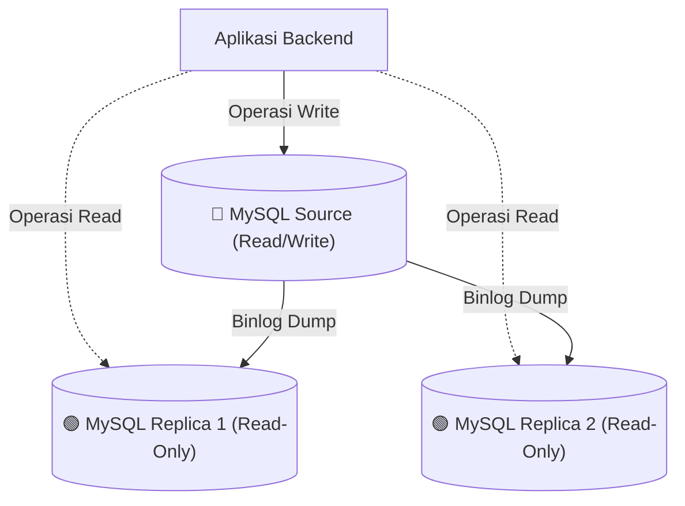
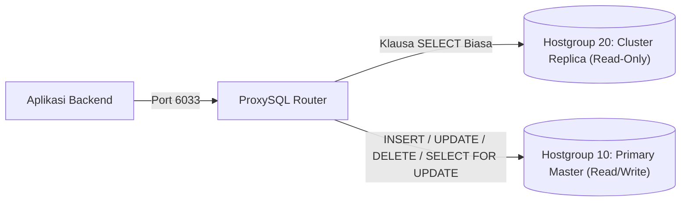

# 🐬 MySQL - Modul 10: Replikasi, High Availability & ProxySQL

Ketika traffic aplikasi Anda melampaui kemampuan satu server fisik, solusinya bukan sekadar membeli server yang lebih besar (*Vertical Scaling*), melainkan membagi beban kerja ke banyak server database (*Horizontal Scaling*).

---

## 1. Arsitektur Replikasi Source-Replica (Master-Slave)

Dalam pola klasik ini, seluruh operasi penulisan (**Write**) dialirkan ke server **Source (Master)**, sedangkan operasi pembacaan (**Read**) disebarkan ke beberapa server **Replica (Slave)**.



### A. Format Binary Log: Mengapa Wajib `ROW`?
Ada 3 format Binary Log di MySQL:
1. `STATEMENT`: Hanya mencatat teks query SQL mentah. **Bahaya!** Jika query memanggil fungsi non-deterministik seperti `NOW()` atau `UUID()`, data di Replica akan berbeda dengan Source.
2. `ROW` (Default & Standar): Mencatat perubahan byte fisik setiap baris data. Menjamin data di Replica $100\%$ identik dengan Source.
3. `MIXED`: Campuran otomatis antara Statement dan Row.

### B. GTID (Global Transaction Identifier)
Sebelum era GTID, konfigurasi replikasi sangat rapuh karena administrator harus mencatat nama file dan posisi byte binlog (`MASTER_LOG_FILE='binlog.000003', MASTER_LOG_POS=45123`).

Dengan **GTID**, setiap transaksi diberi UUID unik global: `3E11FA47-71CA-11E1-9E33-C80AA9429562:1-5`. Replikasi dan failover terjadi secara otomatis tanpa tebak-tebakan koordinat!

Konfigurasi di `my.cnf`:
```ini
[mysqld]
server_id = 1
binlog_format = ROW
gtid_mode = ON
enforce_gtid_consistency = ON
log_bin = mysql-bin
```

---

## 2. Asynchronous vs Semi-Synchronous Replication

- **Asynchronous Replication (Default)**:
  - Source menulis ke disk lokal, lalu langsung mengembalikan respon `OK` ke client tanpa menunggu Replica menerima data tersebut.
  - Sangat cepat, namun jika Source mati mendadak sebelum log terkirim ke Replica, terjadi kehilangan data (*Replication Lag & Data Loss*).
- **Semi-Synchronous Replication**:
  - Source **menunggu konfirmasi dari minimal 1 Replica** bahwa data telah diterima dan ditulis ke Relay Log Replica sebelum mengembalikan respon `OK` ke aplikasi.
  - Menjamin durabilitas tanpa resiko data hilang saat failover.

---

## 3. Pemisahan Read/Write Otomatis dengan ProxySQL

Daripada memodifikasi kode backend Anda untuk mengelola dua koneksi database terpisah (`db_writer` dan `db_reader`), gunakan **ProxySQL**.

ProxySQL adalah layer proxy database berkinerja tinggi yang diletakkan di antara aplikasi dan cluster MySQL.



### Konfigurasi Query Rules di ProxySQL:
```sql
-- Aturan 1: Arahkan semua SELECT ... FOR UPDATE ke Master (Hostgroup 10)
INSERT INTO mysql_query_rules (rule_id, active, match_pattern, destination_hostgroup, apply)
VALUES (1, 1, '^SELECT.*FOR UPDATE', 10, 1);

-- Aturan 2: Arahkan semua query SELECT biasa ke Replicas (Hostgroup 20)
INSERT INTO mysql_query_rules (rule_id, active, match_pattern, destination_hostgroup, apply)
VALUES (2, 1, '^SELECT', 20, 1);

-- Aturan 3: Default sisanya (INSERT, UPDATE, DELETE) otomatis ke Master (Hostgroup 10)
```
Aplikasi backend cukup mengarahkan koneksi ke host ProxySQL pada port 6033 seolah-olah berbicara dengan satu database tunggal!

---

## 4. Skalabilitas Ekstrem: Vitess & Sharding

Jika dataset Anda mencapai puluhan Terabyte dan jutaan QPS:
- **MySQL Partitioning**: Membagi tabel besar menjadi beberapa partisi disk lokal berdasarkan tanggal (`PARTITION BY RANGE (YEAR(order_date))`).
- **Vitess**: Mesin orkestrasi clustering open-source yang awalnya dikembangkan oleh **YouTube** untuk men-scale database MySQL secara horizontal ke ribuan server di Kubernetes. Vitess menangani query routing, 2PC (*Two-Phase Commit*), dan re-sharding dinamis tanpa downtime.
