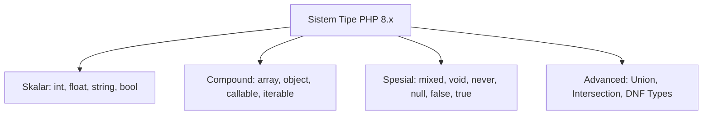

# 🐘 PHP - Modul 01: Sintaks Dasar, Type System Modern & Operator PHP 8.x

Lupakan anggapan bahwa PHP adalah bahasa skrip jadul tanpa tipe data. Sejak rilis PHP 8.0 hingga 8.4, PHP telah bertransformasi menjadi bahasa pemrograman berorientasi objek modern dengan sistem tipe statis yang sangat ketat (*Strict Type System*), JIT compiler, dan performa tinggi.

---

## 1. Anatomi File PHP & `declare(strict_types=1)`

Secara default, PHP beroperasi dalam mode koersif (*Coercive Typing*), di mana PHP akan mencoba mengonversi string `"42"` menjadi integer `42` secara diam-diam. Untuk mematikan perilaku berbahaya ini, **selalu letakkan `strict_types=1` di baris pertama**:

```php
<?php

declare(strict_types=1); // WAJIB: Menegakkan validasi tipe data ketat pada file ini

namespace App\Services;

// PENTING: Jangan pernah menutup file pure PHP dengan tag "?>"!
// Menutup tag "?>" rawan menyelipkan karakter whitespace / newline tersembunyi
// yang memicu error "Headers already sent" saat mengirim HTTP header / cookie!
```

> [!IMPORTANT]
> **Skop `declare(strict_types=1)`**: Direktif ini bersifat *per-file basis* dan mengontrol pemanggilan fungsi dari file tersebut. Jika File A mengaktifkan strict types memanggil fungsi di File B, tipe data argumen yang dikirim dari File A akan divalidasi secara ketat saat runtime!

---

## 2. Type System Modern (PHP 8.0 s/d 8.4)

PHP modern mendukung kombinasi tipe data ekspresif yang setara dengan TypeScript dan Rust:



### A. Nullable & Union Types (PHP 8.0+)
```php
// 1. Nullable (?Type): Shorthand untuk Type|null
function cariPengguna(?int $id): ?string 
{
    if ($id === null || $id <= 0) {
        return null;
    }
    return "Pengguna #$id";
}

// 2. Union Types (A | B): Menerima salah satu dari beberapa tipe
function prosesPembayaran(int|float $nominal, string|int $referensi): bool 
{
    return $nominal > 0;
}
```

### B. Intersection Types (PHP 8.1+)
Mewajibkan suatu objek mengimplementasikan **kedua interface sekaligus**:
```php
// Wajib berupa objek yang bisa di-loop DAN bisa dihitung jumlahnya:
function renderKoleksi(Iterator&Countable $koleksi): void 
{
    echo "Total item: " . count($koleksi);
    foreach ($koleksi as $item) {
        // render...
    }
}
```

### C. DNF (Disjunctive Normal Form) Types (PHP 8.2+)
Menggabungkan Union dan Intersection types dengan tanda kurung `(A & B) | C`:
```php
// Boleh berupa (Iterator yang Countable) ATAU bernilai null:
function prosesLaporan((Iterator&Countable)|null $data): void 
{
    if ($data !== null) {
        echo "Memproses " . count($data) . " baris data.";
    }
}
```

### D. Tipe Return Khusus: `void` vs `never`
- **`void`**: Fungsi selesai dieksekusi tanpa mengembalikan nilai (atau hanya `return;`).
- **`never`** (PHP 8.1+): Fungsi yang **dijamin tidak akan pernah mengembalikan kontrol** ke pemanggilnya (selalu melempar exception atau memanggil `exit()` / `die()`):

```php
function redirectDanHentikan(string $url): never 
{
    header("Location: $url");
    exit(0); // Eksekusi berhenti permanen di sini
}
```

---

## 3. String Literals: Heredoc vs Nowdoc

Untuk teks panjang multi-baris (SQL query, HTML template, JSON):

```php
$nama = "Eka";
$gaji = 15000000;

// 1. Heredoc (<<<TAG): Mendukung parsing variabel ($nama di-render)
$htmlHeredoc = <<<HTML
<div class="karyawan">
    <h2>Halo, {$nama}!</h2>
    <p>Gaji: Rp {$gaji}</p>
</div>
HTML;

// 2. Nowdoc (<<<'TAG'): String mentah literal (TIDAK mem-parse variabel, aman untuk skrip bash/regex)
$bashScript = <<<'BASH'
#!/usr/bin/env bash
echo "Variabel $nama tidak akan di-parse oleh PHP!"
BASH;
```

---

## 4. Perangkap Type Juggling & Perbandingan `==` vs `===`

> [!WARNING]
> **Perubahan Besar PHP 8.0**:
> Pada PHP 7.x ke bawah, perbandingan non-ketat `0 == "halo"` menghasilkan `true` (karena string `"halo"` dikonversi paksa ke integer 0).
> **Di PHP 8.0+**, perbandingan string vs angka hanya dikonversi jika string tersebut benar-benar angka numerik. Maka `0 == "halo"` sekarang bernilai **`false`**!

```php
// SELALU gunakan operator perbandingan identik '===':
var_dump(0 == "");        // false (di PHP 8+)
var_dump(0 === "");       // false
var_dump(42 == "42");     // true (Type Coercion)
var_dump(42 === "42");    // false (Beda tipe: int vs string)
var_dump(null == false);  // true
var_dump(null === false); // false
```

---

## 5. Operator-Operator Modern PHP 8.x

### A. Spaceship Operator (`<=>`)
Membandingkan dua nilai dan mengembalikan `-1`, `0`, atau `1`. Sangat sakti untuk kustom callback `usort()`:
```php
$angka = [5, 2, 8, 1, 9];

// Urutkan ASC:
usort($angka, fn(int $a, int $b): int => $a <=> $b);
// Hasil: [1, 2, 5, 8, 9]

// Urutkan DESC:
usort($angka, fn(int $a, int $b): int => $b <=> $a);
```

### B. Null Coalescing (`??`) vs Elvis Operator (`?:`)
```php
// 1. Elvis Operator (?:): Memeriksa 'truthy' (angka 0 atau string kosong dianggap false!)
$input = 0;
$hasilElvis = $input ?: 10; // Mengembalikan 10 (karena 0 adalah falsy)

// 2. Null Coalescing (??): HANYA memeriksa apakah variabel ISSET dan NOT NULL:
$hasilNull = $input ?? 10;  // Mengembalikan 0 (karena 0 bukan null!)
```

### C. Null Coalescing Assignment (`??=`)
Menetapkan nilai ke variabel hanya jika variabel tersebut belum didefinisikan atau bernilai `null`:
```php
$konfigurasi = [];

// Jika belum ada key 'timeout', set default 30:
$konfigurasi['timeout'] ??= 30;
$konfigurasi['timeout'] ??= 60; // Diabaikan, karena sudah bernilai 30!

echo $konfigurasi['timeout']; // Output: 30
```

### D. Nullsafe Operator (`?->`) (PHP 8.0+)
Menghindari rantai pengecekan `if ($obj !== null && $obj->getX() !== null)` yang melelahkan:

```php
// ❌ Gaya Kuno PHP 7:
$kota = null;
if ($user !== null) {
    $profil = $user->getProfile();
    if ($profil !== null) {
        $alamat = $profil->getAddress();
        if ($alamat !== null) {
            $kota = $alamat->city;
        }
    }
}

// ✅ Gaya Modern PHP 8 (Short-Circuit Otomatis):
// Jika salah satu rantai bernilai null, seluruh ekspresi langsung mengembalikan null tanpa error!
$kota = $user?->getProfile()?->getAddress()?->city ?? "Kota Tidak Diketahui";
```
