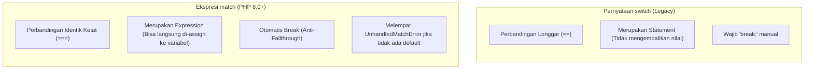
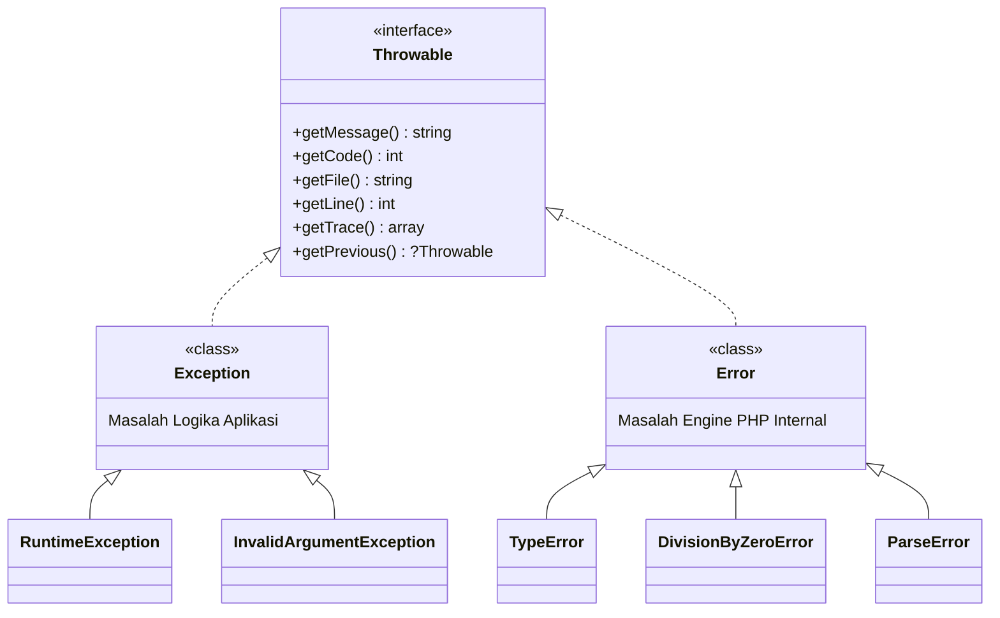

# 🐘 PHP - Modul 02: Control Flow, Match Expression & Error Handling Modern

Struktur kontrol dan penanganan error di PHP mengalami revolusi besar di era PHP 8.x. Pernyataan `switch` yang rawan bug kini digantikan oleh ekspresi `match` yang ekspresif dan type-safe, serta seluruh kesalahan fatal kini dapat ditangkap melalui hierarki `Throwable`.

---

## 1. Ekspresi Sakti: `match` vs Pernyataan `switch` (PHP 8.0+)

Pernyataan `switch` klasik memiliki dua kelemahan fatal: menggunakan perbandingan longgar (`==`) dan membutuhkan kata kunci `break` secara manual (rawan *fallthrough* tak sengaja).

PHP 8.0 memperkenalkan ekspresi **`match`**:



### Komparasi Kode Produksi:

```php
$httpStatusCode = 200;

// ❌ Gaya Kuno switch:
$pesan = "";
switch ($httpStatusCode) {
    case 200:
    case 201:
        $pesan = "Permintaan Berhasil";
        break;
    case 400:
        $pesan = "Bad Request";
        break;
    case 404:
        $pesan = "Halaman Tidak Ditemukan";
        break;
    default:
        $pesan = "Status Tidak Dikenal";
        break;
}

// ✅ Gaya Modern match (Jauh Lebih Ringkas & Type-Safe):
$pesan = match ($httpStatusCode) {
    200, 201 => "Permintaan Berhasil",
    400      => "Bad Request",
    404      => "Halaman Tidak Ditemukan",
    500      => throw new ServerErrorException("Internal Server Error"), // Bisa melempar exception!
    default  => "Status Tidak Dikenal: $httpStatusCode",
};
```

> [!WARNING]
> **UnhandledMatchError**: Jika nilai yang diuji tidak cocok dengan salah satu kondisi dan kamu lupa menyediakan cabang `default`, PHP akan melempar fatal exception `UnhandledMatchError`. Ini menjamin kepatuhan *exhaustive matching*!

---

## 2. Looping & Jebakan Mematikan `foreach` By-Reference

Perulangan `foreach` adalah cara paling umum untuk mengiterasi array di PHP. Namun, iterasi dengan referensi (`&$value`) menyimpan perangkap memori yang sangat terkenal:

```php
$daftarHarga = [10000, 20000, 30000];

// Loop 1: Berikan diskon 10% dengan mengubah nilai aslinya via referensi (&):
foreach ($daftarHarga as &$harga) {
    $harga *= 0.9;
}
// ⚠️ BAHAYA: Variabel $harga sekarang MASIH MEREFERENSIKAN elemen terakhir $daftarHarga[2]!

// Loop 2: Menggunakan nama variabel $harga yang sama tanpa referensi:
foreach ($daftarHarga as $harga) {
    // Karena $harga masih mereferensikan $daftarHarga[2],
    // setiap iterasi di sini akan MERUSAK nilai elemen terakhir array!
}

// HASIL KORUP: Elemen terakhir $daftarHarga bukan 27000 lagi, tapi 18000!
```

### Solusi Wajib: Selalu `unset()` Variabel Referensi!
```php
foreach ($daftarHarga as &$harga) {
    $harga *= 0.9;
}
unset($harga); // PENTING: Putuskan referensi ke elemen array terakhir seketika!
```

---

## 3. Hierarki Error Handling: `Throwable`, `Error`, dan `Exception`

Sejak PHP 7 dan disempurnakan di PHP 8, seluruh kesalahan sistem (seperti pembagian nol, kesalahan tipe data, atau memanggil method pada objek null) tidak lagi menghentikan skrip seketika (*white screen of death*), melainkan dapat ditangkap sebagai objek **`Error`**:



> [!IMPORTANT]
> **Aturan Catch**: Jika kamu ingin menangkap **SEMUA** jenis kegagalan (baik bug internal PHP maupun kesalahan logika aplikasi), tangkap interface **`Throwable`**, bukan sekadar `Exception`!

---

## 4. Pola Try-Catch-Finally Tingkat Lanjut

### A. Multi-Catch Exceptions (PHP 7.1+)
Menangani beberapa jenis exception berbeda dengan penanganan logika yang sama:
```php
try {
    $hasil = $paymentGateway->charge($customer, $amount);
} catch (InsufficientFundsException | CardExpiredException $e) {
    // Tangkap kedua masalah pembayaran ini di satu blok:
    logger()->warning("Gagal bayar: " . $e->getMessage());
    return response()->json(['error' => 'Kartu ditolak'], 422);
} catch (PaymentGatewayTimeoutException $e) {
    // Masalah jaringan terpisah:
    logger()->critical("Gateway down: " . $e->getMessage());
    return response()->json(['error' => 'Silakan coba beberapa saat lagi'], 504);
} catch (Throwable $e) {
    // Fallback tak terduga:
    logger()->emergency("Fatal error tak terduga: " . $e->getMessage(), ['trace' => $e->getTraceAsString()]);
    return response()->json(['error' => 'Terjadi kesalahan sistem'], 500);
} finally {
    // Selalu dieksekusi baik sukses maupun gagal (pembersihan resource):
    $auditLogger->flush();
}
```

### B. Membuat Custom Exception Terstruktur
```php
namespace App\Exceptions;

use Exception;
use Throwable;

class DomainValidationException extends Exception 
{
    /**
     * @param array<string, string[]> $fieldErrors
     */
    public function __construct(
        string $message,
        private readonly array $fieldErrors = [],
        int $code = 422,
        ?Throwable $previous = null
    ) {
        parent::__construct($message, $code, $previous);
    }

    public function getFieldErrors(): array 
    {
        return $this->fieldErrors;
    }
}
```

---

## 5. Mengubah PHP Warning / Notice Menjadi Exception

Di aplikasi lama, operasi seperti membuka file yang tidak ada (`fopen()`) hanya memunculkan `PHP Warning` dan tidak memicu blok `catch`.

Di aplikasi modern (seperti Laravel / Symfony), kita mengonversi semua Notice dan Warning menjadi `ErrorException`:

```php
set_error_handler(function (int $severity, string $message, string $file, int $line): bool {
    // Hormati error_reporting setting:
    if (!(error_reporting() & $severity)) {
        return false;
    }
    
    // Ubah warning/notice menjadi Exception resmi:
    throw new ErrorException($message, 0, $severity, $file, $line);
});

// Sekarang, fopen() yang gagal akan langsung memicu blok catch!
try {
    $handle = fopen("file_tidak_ada.txt", "r");
} catch (ErrorException $e) {
    echo "Tertangkap sebagai Exception: " . $e->getMessage();
}
```
