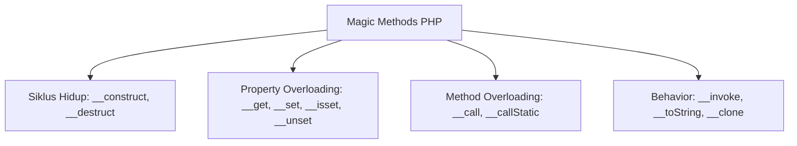

# 🐘 PHP - Modul 04: OOP Modern: Constructor Promotion, Readonly & Magic Methods

Pemrograman Berorientasi Objek (OOP) di PHP telah berkembang pesat. Pola lama penulisan class yang bertele-tele kini dipangkas habis melalui **Constructor Property Promotion** dan **Readonly Classes**, menghasilkan arsitektur kode yang bersih, ringkas, dan *immutable*.

---

## 1. Pemangkas Boilerplate: Constructor Property Promotion (PHP 8.0+)

Di PHP 7, mendefinisikan class DTO (Data Transfer Object) membutuhkan penulisan nama properti sebanyak **3 kali**: pada deklarasi properti, argumen konstruktor, dan baris assignment `$this->prop = $prop`.

PHP 8.0 menyederhanakannya menjadi **satu baris saja**:

```php
// ❌ Gaya Kuno PHP 7 (Bertele-tele):
class UserOld 
{
    public string $name;
    private int $age;
    protected string $email;

    public function __construct(string $name, int $age, string $email) {
        $this->name = $name;
        $this->age = $age;
        $this->email = $email;
    }
}

// ✅ Gaya Modern PHP 8+ (Constructor Property Promotion):
class UserModern 
{
    public function __construct(
        public string $name,
        private int $age,
        protected string $email,
        public string $role = "MEMBER" // Mendukung nilai default!
    ) {}
}
```

---

## 2. Immutability: `readonly` Properties & `readonly class`

Dalam arsitektur *Domain-Driven Design (DDD)*, Value Objects tidak boleh diubah nilainya setelah diinstansiasi (*Immutable*).

### A. Readonly Properties (PHP 8.1+)
Hanya boleh diisi satu kali saat konstruksi, dan tidak bisa dimodifikasi selamanya:
```php
class InvoiceId 
{
    public function __construct(
        public readonly string $value // Nilai terkunci permanen!
    ) {}
}

$id = new InvoiceId("INV-2026-001");
echo $id->value; // Boleh dibaca: INV-2026-001

// ❌ Error: Cannot modify readonly property InvoiceId::$value
// $id->value = "INV-2026-002";
```

### B. Readonly Class (PHP 8.2+)
Menandai seluruh properti di dalam class sebagai `readonly` secara otomatis:
```php
// Seluruh properti otomatis bersifat readonly dan WAJIB memiliki type hint:
readonly class OrderItemDto 
{
    public function __construct(
        public string $productId,
        public int $quantity,
        public float $unitPrice
    ) {}
}
```

---

## 3. Typed Class Constants (PHP 8.3+)

Konstanta di dalam class kini bisa diproteksi dengan tipe data statis agar tidak sengaja di-override dengan tipe salah oleh class turunan:

```php
class StatusTransaksi 
{
    // PHP 8.3+ Typed Constants:
    public const string PENDING = "pending";
    public const string SUCCESS = "success";
    public const int TIMEOUT_SECONDS = 3600;
}
```

---

## 4. Pewarisan: Abstract vs Final Classes

```php
// 1. Abstract Class: Template kontrak dasar yang tidak bisa di-instansiasi langsung:
abstract class PaymentGateway 
{
    public function __construct(protected readonly string $apiKey) {}

    // Method abstrak wajib diimplementasikan oleh anak:
    abstract public function charge(float $amount): bool;

    // Method konkret bisa langsung digunakan:
    public function log(string $message): void {
        echo "[LOG]: $message\n";
    }
}

// 2. Final Class: Melarang class ini di-extends oleh siapapun (Best Practice DDD):
final class MidtransGateway extends PaymentGateway 
{
    public function charge(float $amount): bool {
        $this->log("Memproses pembayaran Midtrans sebesar Rp $amount");
        return true;
    }
}

// ❌ Fatal Error: Class ChildGateway cannot extend final class MidtransGateway
// class ChildGateway extends MidtransGateway {}
```

---

## 5. Bedah Lengkap Magic Methods (Dunder Methods)

PHP menyediakan metode khusus berawalan `__` (*Double Underscore*) yang dipanggil secara otomatis oleh engine PHP saat terjadi event tertentu pada objek:



### A. Property Overloading: `__get` & `__set`
Menangkap akses ke properti yang tidak ada atau bersifat private:
```php
class DynamicRecord 
{
    private array $data = [];

    // Dipanggil saat membaca properti yang tidak ada:
    public function __get(string $name): mixed {
        return $this->data[$name] ?? null;
    }

    // Dipanggil saat menulis ke properti yang tidak ada:
    public function __set(string $name, mixed $value): void {
        $this->data[$name] = $value;
    }
}

$rec = new DynamicRecord();
$rec->judul = "Belajar PHP 8"; // Masuk ke __set()
echo $rec->judul;               // Masuk ke __get()
```

### B. Invokable Class: `__invoke`
Memungkinkan objek dieksekusi layaknya sebuah fungsi biasa. Pola standar untuk Single-Action Controller di framework modern:
```php
class KirimEmailSelamatDatang 
{
    public function __invoke(string $email): bool 
    {
        echo "Mengirim email sambutan ke: $email\n";
        return true;
    }
}

$action = new KirimEmailSelamatDatang();

// Eksekusi objek langsung sebagai fungsi callable:
$action("eka@dev.cloud");
```

### C. Deep Copy dengan `__clone`
Secara default, kata kunci `clone` pada PHP hanya melakukan *Shallow Copy*. Gunakan `__clone()` untuk menduplikasi objek bersarang (*Deep Copy*):
```php
class Alamat { public string $kota = "Jakarta"; }

class Pengguna 
{
    public Alamat $alamat;

    public function __construct() {
        $this->alamat = new Alamat();
    }

    // Dipanggil saat objek di-clone:
    public function __clone() {
        // Duplikasi juga objek alamat agar referensinya terpisah!
        $this->alamat = clone $this->alamat;
    }
}

$user1 = new Pengguna();
$user2 = clone $user1;
$user2->alamat->kota = "Surabaya";

echo $user1->alamat->kota; // Tetap "Jakarta" (Aman dari mutasi objek referensi!)
```
