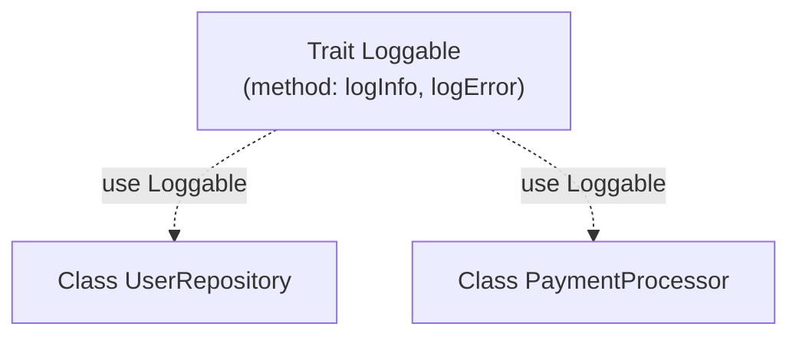
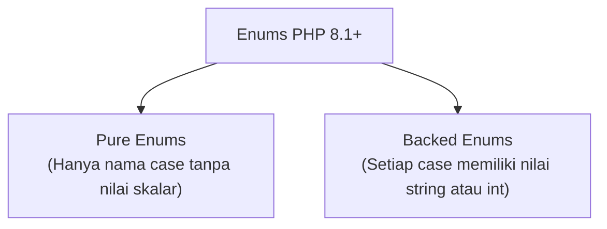

# 🐘 PHP - Modul 05: Traits, Interfaces & First-Class Enums (PHP 8.1+)

Modul ini mengupas teknik komposisi kode tingkat lanjut di PHP: mendefinisikan kontrak yang kokoh menggunakan **Interfaces**, berbagi fungsionalitas horizontal dengan **Traits**, serta memodelkan status domain secara *type-safe* menggunakan **First-Class Enums**.

---

## 1. Interfaces: Kontrak Polimorfisme yang Ketat

Interface mendefinisikan metode apa saja yang **wajib** dimiliki oleh suatu class tanpa menentukan bagaimana metode tersebut diimplementasikan:

```php
interface Notifiable 
{
    public function send(string $recipient, string $message): bool;
}

interface HasPriority 
{
    public function getPriorityLevel(): int;
}

// Satu class bisa mengimplementasikan BANYAK interface sekaligus:
final class SmsNotifier implements Notifiable, HasPriority 
{
    public function send(string $recipient, string $message): bool {
        echo "Mengirim SMS ke $recipient: $message\n";
        return true;
    }

    public function getPriorityLevel(): int {
        return 1; // Prioritas tinggi
    }
}
```

---

## 2. Traits: Horizontal Code Reuse & Resolusi Konflik

Berbeda dengan pewarisan vertikal (*Class Inheritance*), **Trait** memungkinkan kamu menyuntikkan metode yang sama ke dalam banyak class yang tidak saling berhubungan:



```php
trait Loggable 
{
    public function log(string $message): void {
        echo "[" . date("Y-m-d H:i:s") . "] LOG: $message\n";
    }
}

class UserRepository 
{
    use Loggable; // Menyuntikkan method log() ke dalam UserRepository
}

$repo = new UserRepository();
$repo->log("User baru berhasil disimpan.");
```

### Menyelesaikan Konflik Nama Method Trait (`insteadof` & `as`):
Jika dua Trait memiliki nama method yang sama persis:

```php
trait LoggerA { public function info(): void { echo "A"; } }
trait LoggerB { public function info(): void { echo "B"; } }

class AuditService 
{
    use LoggerA, LoggerB {
        // 1. Pilih method milik LoggerA daripada LoggerB:
        LoggerA::info insteadof LoggerB;

        // 2. Berikan nama alias alternatif untuk method milik LoggerB:
        LoggerB::info as infoDariB;
    }
}
```

---

## 3. First-Class Enums (PHP 8.1+)

Sebelum PHP 8.1, developer terpaksa menggunakan konstanta class biasa (`const STATUS_ACTIVE = 1;`) yang rawan typo dan tidak bisa di-type-hint secara aman.

PHP 8.1 memperkenalkan **First-Class Enums**:



### A. Pure Enums (Hanya Simbolis)
```php
enum ArahMataAngin 
{
    case UTARA;
    case TIMUR;
    case SELATAN;
    case BARAT;
}

function jalan(ArahMataAngin $arah): void {
    echo "Bergerak menuju: " . $arah->name;
}

jalan(ArahMataAngin::UTARA);
```

### B. Backed Enums (String / Integer Value)
Setiap case dipetakan ke nilai skalar (sangat ideal untuk penyimpanan kolom database atau API JSON):

```php
enum OrderStatus: string 
{
    case PENDING = "pending";
    case PROCESSING = "processing";
    case COMPLETED = "completed";
    case CANCELLED = "cancelled";

    // Enum di PHP bisa memiliki METHOD sendiri!
    public function labelWarna(): string 
    {
        return match($this) {
            self::PENDING    => "kuning",
            self::PROCESSING => "biru",
            self::COMPLETED  => "hijau",
            self::CANCELLED  => "merah",
        };
    }

    public function isFinal(): bool 
    {
        return in_array($this, [self::COMPLETED, self::CANCELLED], true);
    }
}
```

---

## 4. Serialisasi & Deserialisasi Enum

### A. Membaca Nilai Enum
```php
$status = OrderStatus::PROCESSING;

echo $status->name;  // Output: "PROCESSING" (Nama identifier)
echo $status->value; // Output: "processing" (Nilai scalar backed)
```

### B. Deserialisasi dari Input User / Database (`from` vs `tryFrom`)
```php
// 1. from(): Melempar ValueError jika nilai tidak valid:
try {
    $status = OrderStatus::from("completed"); // Berhasil
    $invalid = OrderStatus::from("status_ngawur"); // Fatal ValueError!
} catch (ValueError $e) {
    echo "Nilai status tidak dikenali: " . $e->getMessage();
}

// 2. tryFrom(): Pilihan aman, mengembalikan NULL jika tidak valid:
$statusInput = $_POST['status'] ?? '';
$statusEnum = OrderStatus::tryFrom($statusInput);

if ($statusEnum === null) {
    die("Error: Status tidak sah!");
}
```

---

## 5. Enum Mengimplementasikan Interface

Enum di PHP mendukung kontrak interface, menjadikannya model state machine yang sangat kuat:

```php
interface Berwarna {
    public function hexColor(): string;
}

enum StatusTiket: string implements Berwarna 
{
    case OPEN = "open";
    case CLOSED = "closed";

    public function hexColor(): string {
        return match($this) {
            self::OPEN => "#22c55e",
            self::CLOSED => "#64748b",
        };
    }
}
```
