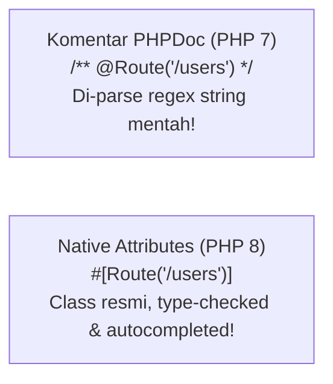

# 🐘 PHP - Modul 06: Attributes, Reflection API & Dependency Injection Container

Fitur **Attributes** (di bahasa lain disebut *Annotations* atau *Decorators*) diperkenalkan di PHP 8.0 untuk menggantikan komentar docblock (`/** @Route(...) */`) yang rapuh. Dikombinasikan dengan **Reflection API**, kamu bisa membangun arsitektur framework modern seperti Dependency Injection Container berbasis auto-wiring.

---

## 1. Native Attributes (PHP 8.0+) vs PHPDoc Docblocks

Sebelum PHP 8, framework seperti Symfony dan Laravel Doctrine terpaksa membaca string komentar menggunakan regular expression untuk mengambil metadata routing atau validasi.

Dengan **PHP 8 Attributes**, metadata didefinisikan sebagai class PHP resmi yang divalidasi oleh compiler:



### Mendeklarasikan Custom Attribute:

```php
namespace App\Attributes;

use Attribute;

// Batasi target di mana attribute ini boleh dipasang (Method dan Class):
#[Attribute(Attribute::TARGET_METHOD | Attribute::TARGET_CLASS)]
class Route 
{
    public function __construct(
        public string $path,
        public string $method = "GET"
    ) {}
}
```

### Menggunakan Attribute pada Controller:

```php
namespace App\Controllers;

use App\Attributes\Route;

class UserController 
{
    #[Route(path: "/api/users", method: "GET")]
    public function index(): array 
    {
        return ["users" => ["Eka", "Budi"]];
    }

    #[Route(path: "/api/users", method: "POST")]
    public function store(): array 
    {
        return ["status" => "created"];
    }
}
```

---

## 2. Membaca Attributes via Reflection API

Reflection API memungkinkan kamu menginspeksi struktur class, method, properti, dan attribute saat runtime:

```php
use App\Attributes\Route;
use App\Controllers\UserController;
use ReflectionClass;

$reflection = new ReflectionClass(UserController::class);

foreach ($reflection->getMethods() as $method) {
    // Ambil attribute berjenis Route:
    $attributes = $method->getAttributes(Route::class);

    foreach ($attributes as $attr) {
        /** @var Route $routeInstance */
        $routeInstance = $attr->newInstance(); // Instansiasi objek Route!

        echo "Ditemukan Rute: [{$routeInstance->method}] {$routeInstance->path} => " . 
             $reflection->getShortName() . "@" . $method->getName() . "\n";
    }
}
```

---

## 3. Membuat Mini Dependency Injection (IoC) Container dari Nol

Seluruh framework modern (Laravel, Symfony) bergantung pada **Dependency Injection Container** untuk menyelesaikan instansiasi class secara otomatis (*Auto-Wiring*) tanpa kamu perlu menulis `new ServiceA(new ServiceB(new Database()))` secara manual.

Mari kita bangun Container sederhana menggunakan Reflection:

```php
class Container 
{
    /** @var array<string, callable|string> */
    private array $bindings = [];

    // Mendaftarkan pemetaan Interface ke Class Konkret:
    public function bind(string $abstract, string|callable $concrete): void 
    {
        $this->bindings[$abstract] = $concrete;
    }

    // Menyelesaikan dan menginstansiasi class secara rekursif:
    public function make(string $class): object 
    {
        // 1. Cek apakah ada binding khusus:
        if (isset($this->bindings[$class])) {
            $concrete = $this->bindings[$class];
            if (is_callable($concrete)) {
                return $concrete($this);
            }
            $class = $concrete;
        }

        // 2. Inspeksi class menggunakan Reflection:
        $reflector = new ReflectionClass($class);

        if (!$reflector->isInstantiable()) {
            throw new Exception("Class {$class} tidak dapat diinstansiasi (mungkin abstract/interface).");
        }

        $constructor = $reflector->getConstructor();

        // Jika class tidak memiliki konstruktor, langsung buat objek:
        if ($constructor === null) {
            return new $class();
        }

        // 3. Auto-Wiring: Selesaikan setiap parameter di konstruktor secara rekursif!
        $dependencies = [];
        foreach ($constructor->getParameters() as $param) {
            $type = $param->getType();

            if ($type instanceof ReflectionNamedType && !$type->isBuiltin()) {
                // Parameter berupa objek class lain -> selesaikan rekursif!
                $dependencies[] = $this->make($type->getName());
            } elseif ($param->isDefaultValueAvailable()) {
                $dependencies[] = $param->getDefaultValue();
            } else {
                throw new Exception("Tidak bisa menyelesaikan parameter skalar {$param->getName()} di {$class}");
            }
        }

        // 4. Instansiasi class dengan menyuntikkan seluruh dependencies:
        return $reflector->newInstanceArgs($dependencies);
    }
}
```

### Menguji Auto-Wiring Container:

```php
interface LoggerInterface { public function log(string $msg): void; }
class FileLogger implements LoggerInterface {
    public function log(string $msg): void { echo "Log: $msg\n"; }
}

class DatabaseConnection {}

class OrderService 
{
    // Konstruktor membutuhkan 2 dependency:
    public function __construct(
        public DatabaseConnection $db,
        public LoggerInterface $logger
    ) {}

    public function checkout(): void {
        $this->logger->log("Checkout berhasil via database!");
    }
}

// EKSEKUSI AJAIB TANPA MANUAL 'NEW':
$container = new Container();
$container->bind(LoggerInterface::class, FileLogger::class);

/** @var OrderService $orderService */
$orderService = $container->make(OrderService::class);
$orderService->checkout();
```
Container otomatis mengenali bahwa `OrderService` butuh `DatabaseConnection` dan `LoggerInterface`, membuat instance `DatabaseConnection`, memetakan `LoggerInterface` ke `FileLogger`, dan menyuntikkan keduanya ke dalam `OrderService`!
