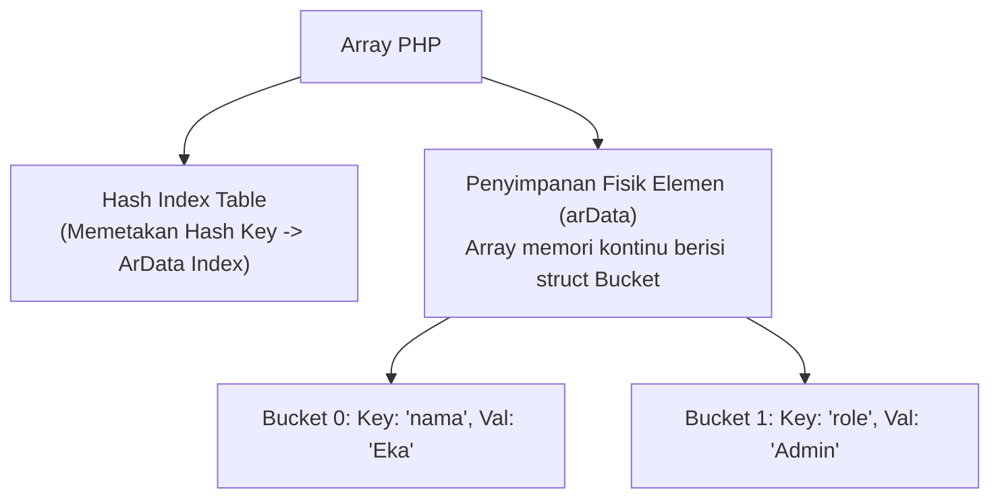

# 🐘 PHP - Modul 07: Array Internals (Zend HashTable) & Modern Collections

Array di PHP adalah struktur data serbaguna (*Swiss Army Knife*). Di balik layar, array PHP bukanlah array sekuensial C biasa, melainkan **Zend HashTable (Ordered Hash Map)** yang sangat fleksibel namun memiliki karakteristik memori yang unik.

---

## 1. Arsitektur Internal: Zend HashTable di Engine C

Di dalam C source code engine PHP (Zend Engine), sebuah array direpresentasikan oleh struct `_zend_array`:



### Karakteristik Teknis:
1. **Mempertahankan Urutan Penyisipan (*Insertion Order*)**: Tidak seperti HashMap di Java atau Go yang urutan kuncinya acak, array PHP selalu mengingat urutan elemen saat dimasukkan (*doubly-linked bucket order*).
2. **Overhead Memori**: Karena setiap elemen dibungkus oleh struct `Bucket` (berisi hash value, key pointer, dan zval data), menyimpan 1 juta integer di array PHP membutuhkan memori sekitar **$32\text{ MB} - 40\text{ MB}$ RAM**, jauh lebih besar dibanding array C murni ($\sim 4\text{ MB}$).

---

## 2. Array Destructuring & Spread Operator

### A. Destructuring Berurutan & Asosiatif (PHP 7.1+)
```php
// 1. Destructuring Array Terindeks:
$koordinat = [106.8456, -6.2088];
[$longitude, $latitude] = $koordinat;

// Melompati elemen:
[, $lat] = $koordinat; // Hanya ambil indeks ke-1

// 2. Destructuring Array Asosiatif (Berdasarkan Nama Kunci):
$user = [
    'id' => 101,
    'username' => 'ekadev',
    'email' => 'eka@dev.cloud',
    'role' => 'SUPERADMIN'
];

['username' => $namaUser, 'email' => $emailUser] = $user;
echo "$namaUser - $emailUser"; // Output: ekadev - eka@dev.cloud
```

### B. Spread Operator pada Array Asosiatif (PHP 8.1+)
Sejak PHP 8.1, operator `...` bisa digunakan pada array dengan string keys (menggantikan fungsi `array_merge`):

```php
$defaultConfig = [
    'driver' => 'mysql',
    'port' => 3306,
    'charset' => 'utf8mb4'
];

$customConfig = [
    'port' => 3307,        // Override port default
    'database' => 'app_db' // Tambah key baru
];

// Gabungkan keduanya:
$finalConfig = [
    'host' => '127.0.0.1',
    ...$defaultConfig,
    ...$customConfig // Nilai customConfig akan menimpa nilai yang cocok sebelumnya!
];
```

---

## 3. Cheatsheet Fungsi Array Vital & Perangkapnya

### A. `array_merge` vs Operator Union (`+`)
Gotcha klasik yang sering menjebak developer:

| Operasi | Kunci Numerik | Kunci String |
|---|---|---|
| **`array_merge($a, $b)`** | **Di-index ulang dari 0!** (Kunci numerik tidak pernah menimpa). | Kunci yang sama di `$a` **akan ditimpa** oleh `$b`. |
| **`$a + $b` (Union)** | Nilai di `$a` dipertahankan; nilai `$b` yang memiliki indeks sama **dibuang**! | Nilai di `$a` dipertahankan; nilai `$b` **dibuang**! |

```php
$a = [0 => "Merah", 1 => "Kuning"];
$b = [0 => "Hijau", 1 => "Biru"];

// array_merge me-reindex:
print_r(array_merge($a, $b)); 
// Hasil: [0 => "Merah", 1 => "Kuning", 2 => "Hijau", 3 => "Biru"]

// Operator '+' mempertahankan yang kiri:
print_r($a + $b); 
// Hasil: [0 => "Merah", 1 => "Kuning"] (Elemen $b dibuang karena key 0 dan 1 sudah ada di $a!)
```

### B. `in_array()` Wajib Strict Flag!
```php
$daftarStatus = ["1", "2", "3"];

// ❌ BAHAYA: Loose comparison! Di PHP 7, 0 == "string" bernilai true!
in_array(0, $daftarStatus); // Rawan false positive!

// ✅ SELALU gunakan parameter ke-3: strict = true (===)
in_array("1", $daftarStatus, strict: true); // Aman & Type-Safe
```

### C. `array_column` Transformasi Seketika
Mengubah array of arrays / objects menjadi format Key-Value instan:
```php
$karyawan = [
    ['id' => 10, 'nama' => 'Eka', 'divisi' => 'Tech'],
    ['id' => 20, 'nama' => 'Budi', 'divisi' => 'Marketing'],
];

// Parameter 2: Nilai yang diambil (nama)
// Parameter 3: Kunci yang dijadikan indeks (id)
$petaNama = array_column($karyawan, 'nama', 'id');
// Hasil: [10 => "Eka", 20 => "Budi"]
```

---

## 4. Membangun Fluent Collection Pipeline

Menggabungkan fungsi array procedural (`array_map`, `array_filter`) sering menghasilkan *nested code* dari dalam ke luar yang sulit dibaca.

Pola **Fluent Collection** membungkus array ke dalam class berantai (*Method Chaining*):

```php
/**
 * @template TKey of array-key
 * @template TValue
 */
class Collection implements IteratorAggregate, Countable 
{
    /** @param array<TKey, TValue> $items */
    public function __construct(protected array $items = []) {}

    public static function make(array $items = []): static {
        return new static($items);
    }

    public function filter(callable $callback): static {
        return new static(array_filter($this->items, $callback, ARRAY_FILTER_USE_BOTH));
    }

    public function map(callable $callback): static {
        return new static(array_map($callback, $this->items));
    }

    public function reduce(callable $callback, mixed $initial = null): mixed {
        return array_reduce($this->items, $callback, $initial);
    }

    public function toArray(): array {
        return $this->items;
    }

    public function getIterator(): Traversable {
        return new ArrayIterator($this->items);
    }

    public function count(): int {
        return count($this->items);
    }
}

// Penggunaan Elegan & Bersih:
$totalGajiTech = Collection::make([
    ['nama' => 'Eka', 'divisi' => 'IT', 'gaji' => 15000000],
    ['nama' => 'Siti', 'divisi' => 'HR', 'gaji' => 9000000],
    ['nama' => 'Budi', 'divisi' => 'IT', 'gaji' => 12000000],
])
->filter(fn(array $k): bool => $k['divisi'] === 'IT')
->map(fn(array $k): int => $k['gaji'])
->reduce(fn(int $carry, int $gaji): int => $carry + $gaji, 0);

echo "Total Gaji Tim IT: Rp $totalGajiTech\n"; // Rp 27.000.000
```
