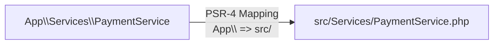

# 🐘 PHP - Modul 08: Composer, Autoloading PSR-4 & Standar PSR Modern

Di era modern, ekosistem PHP disatukan oleh pengelola paket **Composer** dan standar antarmuka bersama yang dirumuskan oleh **PHP-FIG (Framework Interop Group)** melalui dokumen **PSR (PHP Standards Recommendations)**.

---

## 1. Composer: Manajemen Dependensi Modern

Composer mengelola pustaka pihak ketiga (*packages*) per proyek lokal (di folder `vendor/`), bukan secara global di sistem operasi:

```json
{
    "name": "eka/api-gateway",
    "description": "High Performance Modern PHP Microservice",
    "type": "project",
    "require": {
        "php": ">=8.2",
        "guzzlehttp/guzzle": "^7.8",
        "monolog/monolog": "^3.5"
    },
    "require-dev": {
        "phpunit/phpunit": "^10.5",
        "pestphp/pest": "^2.34"
    },
    "autoload": {
        "psr-4": {
            "App\\": "src/"
        }
    }
}
```

### Memahami Constraint Versi SemVer:
- **`^1.2.3` (Caret Operator)**: Mengizinkan update patch dan minor yang tidak merusak kompatibilitas (`>= 1.2.3 < 2.0.0`).
- **`~1.2.3` (Tilde Operator)**: Hanya mengizinkan update bugfix patch (`>= 1.2.3 < 1.3.0`).
- **`composer.json` vs `composer.lock`**:
  - `composer.json`: Mendefinisikan aturan rentang versi dependensi yang diinginkan.
  - `composer.lock`: Mengunci **hash commit dan versi eksak** setiap paket yang terinstall. **Wajib di-commit ke Git** agar lingkungan Local, Staging, dan Production memiliki kode yang 100% identik!

---

## 2. Standar Autoloading: PSR-4

Standar **PSR-4** memetakan prefix namespace PHP secara langsung ke struktur folder di disk:



### Cara Kerja Autoloader di Balik Layar:
Sebelum PSR-4, developer terpaksa memanggil puluhan baris `require_once 'file.php'` secara manual. 

Composer memanfaatkan fungsi bawaan PHP **`spl_autoload_register()`**:
1. Ketika kode memanggil class `App\Services\PaymentService` yang belum ada di memori.
2. Engine PHP memicu callback autoloader Composer.
3. Composer menerjemahkan namespace `App\` menjadi `src/`, menambahkan subpath `Services/PaymentService.php`.
4. Composer memverifikasi keberadaan file di disk dan me-`require` file tersebut tepat pada saat dibutuhkan (*Lazy Loading*).

---

## 3. Peta Standar PSR Kunci di Ekosistem PHP

PHP-FIG mendefinisikan standar umum agar pustaka dari vendor berbeda (Symfony, Laravel, Slim) dapat saling bertukar komponen:

| Standar PSR | Judul Standar | Fungsi & Implementasi Nyata |
|---|---|---|
| **PSR-12 / PER-CS** | Extended Coding Style | Aturan indentasi 4 spasi, penamaan camelCase method, kurung kurawal, dan deklarasi strict types. |
| **PSR-4** | Autoloader | Standar pemetaan namespace ke struktur direktori filesystem. |
| **PSR-7** | HTTP Message Interface | Definisi objek `ServerRequestInterface` dan `ResponseInterface` yang bersifat *immutable*. |
| **PSR-11** | Container Interface | Standar metode `get($id)` dan `has($id)` untuk Dependency Injection Container. |
| **PSR-15** | HTTP Handlers & Middleware | Standar rantai middleware pemrosesan HTTP request: `process(ServerRequestInterface $request, RequestHandlerInterface $handler)`. |

### Pola PSR-15 Middleware Pipeline:
```php
use Psr\Http\Message\ResponseInterface;
use Psr\Http\Message\ServerRequestInterface;
use Psr\Http\Server\MiddlewareInterface;
use Psr\Http\Server\RequestHandlerInterface;

class AutentikasiTokenMiddleware implements MiddlewareInterface 
{
    public function process(
        ServerRequestInterface $request,
        RequestHandlerInterface $handler
    ): ResponseInterface {
        $authHeader = $request->getHeaderLine('Authorization');

        if (!str_starts_with($authHeader, 'Bearer secret-token-123')) {
            // Tolak sebelum masuk ke controller aplikasi:
            return new JsonResponse(['error' => 'Unauthorized'], 401);
        }

        // Lanjutkan ke middleware berikutnya atau controller tujuan:
        return $handler->handle($request);
    }
}
```

---

## 4. Optimasi Autoloader untuk Server Produksi

Secara default di tahap development, Composer memeriksa keberadaan file di disk (`file_exists()`) untuk setiap class yang belum terdaftar. Di lingkungan produksi dengan ribuan class, pemeriksaan filesystem berulang ini menimbulkan **I/O disk overhead**.

### Perintah Wajib saat Deploy Produksi (CI/CD Pipeline):
```bash
composer dump-autoload --optimize --no-dev --classmap-authoritative
```

### Penjelasan Flag Sakti:
1. **`--optimize` (`-o`)**: Mengubah seluruh pemetaan PSR-4 menjadi satu array raksasa (*Classmap Flat Array*). Composer bisa langsung menemukan path file dengan operasi $O(1)$ Hash Map.
2. **`--no-dev`**: Membuang library testing (PHPUnit, Mockery) dari autoloader agar tidak menghabiskan RAM produksi.
3. **`--classmap-authoritative` (`-a`)**: Memberi tahu Composer bahwa **seluruh class yang valid HANYA yang ada di dalam Classmap**. Composer **tidak akan pernah lagi memanggil `file_exists()` ke filesystem disk**. Jika class tidak ada di classmap, langsung throw error instan!

> [!TIP]
> Mengaktifkan `--classmap-authoritative` di produksi memangkas waktu *cold-boot* framework (seperti Symfony atau Laravel) sebesar **$15\% - 30\%$**!

---

## 5. Audit Keamanan & Higienitas Dependensi (`composer audit`)

Jangan menunggu sampai server kamu diretas karena ada celah keamanan (CVE) di pustaka pihak ketiga!

```bash
# 1. Audit keamanan database celah CVE secara lokal:
composer audit

# 2. Jika ada paket yang rentan (misal guzzlehttp versi lama):
# Output:
# Found 1 security vulnerability advisory affecting 1 package:
# Package: guzzlehttp/guzzle
# CVE: CVE-2023-29197 (Header Injection)

# 3. Perbarui dependensi yang aman:
composer update guzzlehttp/guzzle --with-all-dependencies
```

---

## 6. Otomasi Skrip & Repositori Git Internal (Composer Scripts)

Composer bisa digunakan sebagai *Task Runner* internal proyek tanpa perlu tool tambahan:

```json
{
    "scripts": {
        "test": "phpunit --testdox",
        "format": "php-cs-fixer fix --dry-run",
        "lint": "phpstan analyse -l 8 src",
        "ci": [
            "@lint",
            "@test"
        ],
        "post-autoload-dump": [
            "App\\Hooks\\CacheWarmup::run"
        ]
    },
    "repositories": [
        {
            "type": "vcs",
            "url": "git@github.com:perusahaan/paket-rahasia-internal.git"
        }
    ]
}
```
Cukup jalankan `composer test` atau `composer ci` di terminal development!
