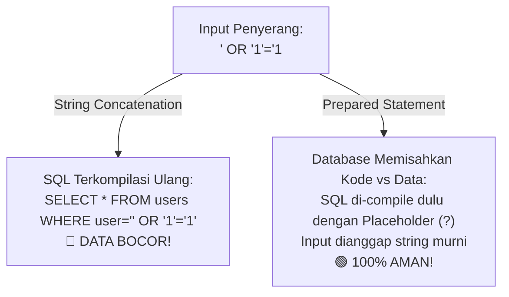

# 🐘 PHP - Modul 09: Database PDO, Transaksi ACID & Web Security Wajib

Aplikasi web adalah target empuk serangan peretas jika developer tidak memahami mitigasi kerentanan dasar. Modul ini mengulas interaksi basis data yang aman menggunakan **PDO (PHP Data Objects)** dan pedoman pertahanan siber wajib di PHP (*Defense-in-Depth*).

---

## 1. Arsitektur Koneksi Database: PDO (PHP Data Objects)

Jangan pernah menggunakan extension legacy seperti `mysql_*` (sudah dihapus di PHP 7)! Gunakan **PDO** sebagai layer abstraksi database yang seragam untuk PostgreSQL, MySQL, maupun SQLite.

```php
namespace App\Database;

use PDO;
use PDOException;

class Database 
{
    private static ?PDO $instance = null;

    public static function getConnection(): PDO 
    {
        if (self::$instance === null) {
            $dsn = "mysql:host=127.0.0.1;port=3306;dbname=production_db;charset=utf8mb4";
            $username = "db_user";
            $password = "UltraSecureDbPassword123!";

            $options = [
                // 1. Lempar PDOException setiap kali query SQL gagal (Wajib!):
                PDO::ATTR_ERRMODE => PDO::ERRMODE_EXCEPTION,

                // 2. Format fetch default sebagai array asosiatif:
                PDO::ATTR_DEFAULT_FETCH_MODE => PDO::FETCH_ASSOC,

                // 3. PENTING: Matikan emulasi query! Wajibkan server database melakukan
                // Native Prepared Statements sesungguhnya (Perlindungan 100% Anti SQLi):
                PDO::ATTR_EMULATE_PREPARES => false,
            ];

            try {
                self::$instance = new PDO($dsn, $username, $password, $options);
            } catch (PDOException $e) {
                // Jangan pernah mencetak $e->getMessage() mentah ke layar karena mengandung kredensial password!
                error_log("Database Connection Error: " . $e->getMessage());
                throw new RuntimeException("Koneksi database gagal.");
            }
        }

        return self::$instance;
    }
}
```

---

## 2. Anti-SQL Injection: Prepared Statements

SQL Injection terjadi ketika input user disambung langsung ke dalam string SQL (*String Concatenation*).



```php
$pdo = Database::getConnection();

// ✅ BENAR: Gunakan Named Parameter (:email)
$stmt = $pdo->prepare("SELECT id, password_hash, role FROM users WHERE email = :email AND status = :status");

// Bind parameter secara aman:
$stmt->bindValue(':email', $_POST['email'], PDO::PARAM_STR);
$stmt->bindValue(':status', 'ACTIVE', PDO::PARAM_STR);
$stmt->execute();

$user = $stmt->fetch();
```

---

## 3. Transaksi ACID di PDO

Untuk operasi multi-query yang saling bergantung (seperti pemindahan saldo):

```php
try {
    $pdo->beginTransaction(); // Kunci transaksi

    // 1. Kurangi saldo pengirim:
    $stmtDebit = $pdo->prepare("UPDATE rekening SET saldo = saldo - :nominal WHERE id = :id AND saldo >= :nominal");
    $stmtDebit->execute([':nominal' => 500000, ':id' => 1]);

    if ($stmtDebit->rowCount() === 0) {
        throw new RuntimeException("Saldo tidak mencukupi!");
    }

    // 2. Tambah saldo penerima:
    $stmtKredit = $pdo->prepare("UPDATE rekening SET saldo = saldo + :nominal WHERE id = :id");
    $stmtKredit->execute([':nominal' => 500000, ':id' => 2]);

    $pdo->commit(); // Permanenkan perubahan!
    echo "Transfer berhasil!";
} catch (Throwable $e) {
    if ($pdo->inTransaction()) {
        $pdo->rollBack(); // Batalkan seluruh operasi jika ada kegagalan!
    }
    echo "Transaksi dibatalkan: " . $e->getMessage();
}
```

---

## 4. Perlindungan Web Security Wajib di PHP

### A. Pencegahan XSS (Cross-Site Scripting)
Selalu escape data sebelum di-render ke dokumen HTML:
```php
function e(string $str): string 
{
    // ENT_QUOTES meng-escape tanda petik tunggal dan ganda
    return htmlspecialchars($str, ENT_QUOTES | ENT_HTML5, 'UTF-8');
}

// Di template view:
echo "<h2>Selamat datang, " . e($_GET['nama'] ?? '') . "</h2>";
```

### B. Pencegahan CSRF dengan `hash_equals()`
```php
// 1. Generate token acak yang aman (Cryptographically Secure):
if (empty($_SESSION['csrf_token'])) {
    $_SESSION['csrf_token'] = bin2hex(random_bytes(32));
}

// 2. Verifikasi Token POST menggunakan perbandingan Timing-Safe:
$tokenUser = $_POST['csrf_token'] ?? '';

// PENTING: Jangan gunakan '===' untuk membandingkan hash rahasia (rawan Timing Attacks)!
// Gunakan fungsi hash_equals():
if (!hash_equals($_SESSION['csrf_token'], $tokenUser)) {
    http_response_code(403);
    die("Akses Ditolak: Invalid CSRF Token!");
}
```

### C. Hashing Password Modern: Argon2id vs Bcrypt
PHP memiliki fungsi hashing kelas dunia bawaan tanpa perlu library pihak ketiga:

```php
$passwordUser = "PasswordRahasiaPengguna#2026";

// 1. Hashing dengan Algoritma Paling Aman di Dunia (Argon2id):
// Jika server Anda tidak mengompilasi Argon2id, gunakan PASSWORD_BCRYPT.
$algo = defined('PASSWORD_ARGON2ID') ? PASSWORD_ARGON2ID : PASSWORD_BCRYPT;
$hash = password_hash($passwordUser, $algo, [
    'memory_cost' => 65536, // 64 MB RAM
    'time_cost'   => 4,     // 4 Iterasi
    'threads'     => 1,
]);

// 2. Verifikasi Password saat Login:
if (password_verify($passwordUser, $hash)) {
    // 3. Cek apakah konfigurasi keamanan perlu ditingkatkan:
    if (password_needs_rehash($hash, $algo)) {
        $newHash = password_hash($passwordUser, $algo);
        // Simpan $newHash ke database...
    }
    echo "Login Berhasil!";
}
```

### D. Keamanan Cookie Sesi
Konfigurasikan parameter cookie sebelum memanggil `session_start()`:
```php
session_set_cookie_params([
    'lifetime' => 86400,
    'path'     => '/',
    'domain'   => 'eka-dev.cloud',
    'secure'   => true,     // Cookie HANYA dikirim via HTTPS
    'httponly' => true,     // JavaScript dilarang mengakses cookie (Anti-XSS Cookie Theft!)
    'samesite' => 'Lax'     // Mencegah serangan CSRF antar-domain
]);

session_start();
session_regenerate_id(true); // Ganti Session ID lama setelah login (Anti-Session Fixation)
```
