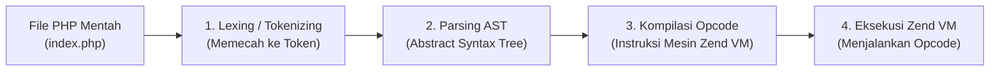
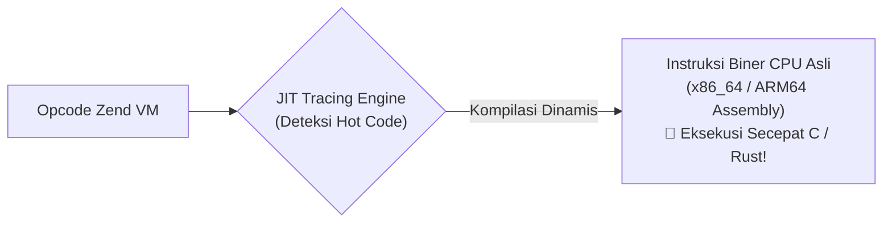

# 🐘 PHP - Modul 10: OPcache, JIT Compiler, PHP-FPM & Modern Runtimes

Di modul penutup ini, kita akan membongkar jeroan arsitektur internal **Zend VM**, bagaimana **OPcache** dan **JIT Compiler** melipatgandakan kecepatan eksekusi, cara mengoptimalkan **PHP-FPM** di lingkungan produksi bertrafik tinggi, serta evolusi runtime modern berbasis *Worker Mode* seperti **FrankenPHP** dan **RoadRunner**.

---

## 1. Siklus Hidup Eksekusi PHP (Zend Engine Lifecycle)

Setiap file skrip PHP melewati 4 tahapan eksekusi di dalam Zend Engine:



Tanpa OPcache, server harus mengulangi **tahap 1, 2, dan 3 pada setiap HTTP request yang masuk**—membuang jutaan siklus CPU hanya untuk membaca dan mengompilasi file yang sama berulang kali.

---

## 2. OPcache & OPcache Preloading

**OPcache** menyimpan hasil kompilasi (Opcode) langsung di dalam memori RAM (*Shared Memory*). Request berikutnya bisa langsung loncat ke **Tahap 4 (Eksekusi Zend VM)** dengan latensi nol koma sekian milidetik!

```mermaid
flowchart TD
    Req1["Request Datang"] --> Check{"Apakah Opcode Ada di RAM?"}
    Check -->|Sudah Ada (Cache Hit)| Execute["Langsung Jalankan di Zend VM!\n(Kecepatan Maksimal 🚀)"]
    Check -->|Belum Ada (Cold Boot)| Compile["Compile File -> Simpan ke RAM OPcache"]
    Compile --> Execute
```

### Konfigurasi Produksi Wajib di `php.ini`:
```ini
; Aktifkan OPcache untuk web dan CLI
opcache.enable=1
opcache.enable_cli=1

; Alokasikan 256 MB RAM untuk menyimpan Opcode:
opcache.memory_consumption=256

; Ukuran buffer string interned (nama class, nama method, string berulang):
opcache.interned_strings_buffer=16

; Jumlah maksimum file PHP yang bisa di-cache (sesuaikan dengan ukuran vendor project):
opcache.max_accelerated_files=20000

; PENTING PRODUKSI: Matikan validasi timestamp file!
; PHP TIDAK AKAN PERNAH memeriksa apakah file di disk berubah (Memangkas stat() disk I/O):
opcache.validate_timestamps=0

; Catatan: Saat deploy versi baru, Anda WAJIB me-restart service php-fpm (systemctl reload php-fpm)
; untuk membersihkan cache memori lama!
```

### OPcache Preloading (PHP 7.4+):
Memuat seluruh framework (ribuan class Laravel/Symfony) ke dalam memori saat server pertama kali dinyalakan (*server boot*), sebelum request pertama tiba:
```ini
; php.ini:
opcache.preload=/var/www/app/preload.php
opcache.preload_user=www-data
```

---

## 3. Just-In-Time (JIT) Compiler (PHP 8.0+)

Sebelum PHP 8, Zend VM membaca Opcode menggunakan loop penerjemah (*Interpreter Loop*). 

**JIT Compiler** memantau Opcode yang sering dieksekusi (*Hot Code*), lalu mengompilasinya langsung menjadi **Instruksi Mesin Biner Asli (x86_64 atau ARM64 Machine Code)** yang dieksekusi langsung oleh prosesor CPU:



### Kapan JIT Bersinar?
- **Sangat Berpengaruh ($2\times - 10\times$ Lebih Cepat)**: Tugas intensif CPU seperti kalkulasi matematis murni, manipulasi gambar (GD/Imagick), machine learning, atau kompilasi AST linter.
- **Kurang Berpengaruh pada Web I/O**: Aplikasi web tipikal yang menghabiskan 95% waktunya menunggu respons database PostgreSQL/MySQL atau panggilan jaringan API tidak akan merasakan lompatan drastis dari JIT.

### Konfigurasi JIT di `php.ini`:
```ini
; Mode Tracing JIT (Paling optimal dan pintar mendeteksi hotspot):
opcache.jit=tracing

; Alokasi RAM buffer untuk kode biner mesin terkompilasi:
opcache.jit_buffer_size=128M
```

---

## 4. Tuning PHP-FPM di Server Produksi

**PHP-FPM (FastCGI Process Manager)** mengelola sekumpulan worker process terpisah untuk melayani request web.

File konfigurasi pool: `/etc/php/8.3/fpm/pool.d/www.conf`

```ini
[www]
user = www-data
group = www-data

; Gunakan UNIX Domain Socket (Jauh lebih cepat dibanding TCP socket localhost:9000):
listen = /run/php/php8.3-fpm.sock
listen.owner = www-data
listen.group = www-data

; Mode Process Manager: 'static' SANGAT DISARANKAN untuk server produksi!
pm = static

; Jumlah worker proses statis (hitung dengan rumus di bawah):
pm.max_children = 50

; Daur ulang worker setelah melayani 1000 request untuk mencegah kebocoran memori (Memory Leaks):
pm.max_requests = 1000
```

### Rumus Menghitung `pm.max_children`:
$$\text{pm.max\_children} = \frac{\text{Total Dedicated RAM Server} - \text{OS \& DB Overhead RAM}}{\text{Rata-rata Konsumsi RAM per 1 Worker Process}}$$

*Contoh Kasus*: Server dengan 4 GB RAM. OS dan sistem lain menghabiskan 1 GB RAM (tersisa 3 GB = 3072 MB). Jika rata-rata satu worker Laravel menghabiskan 60 MB RAM:
$$\text{pm.max\_children} = \frac{3072\text{ MB}}{60\text{ MB}} \approx 50\text{ Workers}$$

---

## 5. Revolusi Runtime Modern: FrankenPHP & RoadRunner

Secara historis, PHP menggunakan arsitektur **Shared-Nothing** (seluruh aplikasi di-boot dari nol saat request datang, lalu seluruh memori dihancurkan saat request selesai). Pola ini sangat aman, namun boros untuk komputasi framework modern.

Runtime generasi baru menjalankan PHP dalam **Persistent Worker Mode** (aplikasi di-boot sekali di memori, dan terus hidup untuk melayani jutaan request layaknya server Node.js atau Go):

| Runtime | Karakteristik Utama | Kecepatan Throughput |
|---|---|---|
| **PHP-FPM (Tradisional)** | Menghancurkan memori per request. Aman, tidak ada kebocoran state. | $\sim 500 - 1.500\text{ req/sec}$ |
| **FrankenPHP (Modern)** | Server aplikasi berbasis Caddy Web Server (Go). Mendukung **Worker Mode**, **HTTP/3**, dan **103 Early Hints**. | $\sim 10.000 - 30.000\text{ req/sec}$ 🚀 |
| **RoadRunner** | Application server berbasis Go dengan load-balancer worker pool internal via IPC stream. | $\sim 8.000 - 25.000\text{ req/sec}$ |

---

## 6. Implementasi Worker Mode di FrankenPHP

Di FrankenPHP, script aplikasi kamu tidak di-load ulang setiap request. Aplikasi kamu hidup di RAM dalam event loop tak terbatas:

```php
// public/index.php (FrankenPHP Worker Loop):
ignore_user_abort(true);

// 1. Booting Framework SEKALI SAJA di memori (Dependency Injection, Config, Routes):
$app = require __DIR__ . '/../bootstrap/app.php';
$kernel = $app->make(Illuminate\Contracts\Http\Kernel::class);

// 2. Loop penanganan request berkecepatan tinggi:
$handler = static function () use ($kernel) {
    $request = Illuminate\Http\Request::capture();
    $response = $kernel->handle($request);
    $response->send();
    $kernel->terminate($request, $response);
};

// FrankenPHP worker runner:
for ($nbRequests = 0; !$maxRequests || $nbRequests < $maxRequests; ++$nbRequests) {
    $nbRequests = frankenphp_handle_request($handler);
    // Garbage collection memory cleanup antar request:
    gc_collect_cycles();
}
```

```nginx
# Caddyfile:
{
    frankenphp {
        num_threads 8 # 8 Thread Caddy Go
    }
}

api.eka-dev.cloud {
    root * /app/public
    encode zstd gzip
    
    # Aktifkan Worker Mode pada public/index.php:
    php_server {
        worker /app/public/index.php 16 # 16 persistent PHP workers
    }
}
```

---

## 7. Monitoring Kesehatan PHP-FPM via Status Page

Aktifkan halaman status internal FPM untuk memantau apakah ada request yang antre di buffer sistem:

```ini
; /etc/php/8.3/fpm/pool.d/www.conf:
pm.status_path = /fpm-status
ping.path = /fpm-ping
```

Akses status melalui curl lokal:
```bash
curl http://127.0.0.1/fpm-status?json
```

```json
{
  "pool": "www",
  "process manager": "static",
  "start time": 1763612000,
  "start since": 1500,
  "accepted conn": 128490,
  "listen queue": 0,
  "max listen queue": 3,
  "listen queue len": 511,
  "idle processes": 42,
  "active processes": 8,
  "total processes": 50
}
```

> [!CAUTION]
> **Tanda Bahaya PHP-FPM**:
> Jika nilai **`listen queue`** lebih besar dari `0`, artinya seluruh 50 worker process kamu sedang sibuk melayani request, dan pengunjung web baru sedang **mengantre di socket buffer OS**. Segera naikkan `pm.max_children` atau lakukan horizontal scaling!

