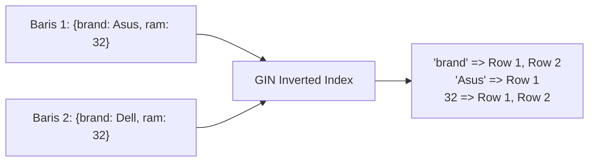

# 🐘 PostgreSQL - Modul 02: JSONB Internals, GIN Indexing & SQL/JSON Queries

PostgreSQL sering dijuluki *"The Best NoSQL Database"* berkat implementasi tipe data **`JSONB` (Binary JSON)** yang menggabungkan fleksibilitas skema dokumen ala MongoDB dengan kehandalan transaksi ACID relasional.

---

## 1. Perbedaan Mendasar: `JSON` vs `JSONB`

| Parameter | `JSON` Biasa | `JSONB` (Binary Storage) |
|---|---|---|
| **Format Penyimpanan** | Disimpan sebagai string teks mentah apa adanya. | Diurai (*parsed*) menjadi format biner terdekomposisi. |
| **Kecepatan Tulis (Insert)** | Sedikit lebih cepat (karena tanpa proses parsing). | Sedikit lebih lambat saat insert (karena konversi biner). |
| **Kecepatan Baca (Query)** | **Sangat Lambat**: Harus di-parse ulang setiap query. | **Ultra Cepat**: Pembacaan langsung tanpa re-parsing. |
| **Dukungan Indexing** | ❌ Tidak bisa di-index secara menyeluruh. | ✅ **Bisa di-index dengan GIN Index**! |
| **Preservasi Format** | Menjaga spasi, indentasi, & urutan key asli. | Menghapus spasi dan otomatis mengurutkan key. |

> [!IMPORTANT]
> **Aturan Wajib**: 99.9% kasus di produksi, **selalu gunakan `JSONB`**, jangan pernah gunakan `JSON` biasa!

---

## 2. Kamus Operator Sakti JSONB

```sql
CREATE TABLE produk (
    id SERIAL PRIMARY KEY,
    nama VARCHAR(100),
    spesifikasi JSONB
);

INSERT INTO produk (nama, spesifikasi) VALUES
('Laptop Gaming', '{"brand": "Asus", "ram_gb": 32, "tags": ["gaming", "rgb"], "layar": {"resolusi": "4K", "hz": 144}}');
```

| Operator | Fungsi | Contoh Query | Hasil Kembalian |
|---|---|---|---|
| **`->`** | Ambil field sebagai **JSON Object/Array** | `spesifikasi -> 'brand'` | `"Asus"` (Tipe JSONB) |
| **`->>`**| Ambil field sebagai **TEXT Murni** | `spesifikasi ->> 'brand'` | `Asus` (Tipe TEXT) |
| **`#>`** | Ekstrak path bersarang sebagai **JSONB** | `spesifikasi #> '{layar, resolusi}'` | `"4K"` (Tipe JSONB) |
| **`#>>`**| Ekstrak path bersarang sebagai **TEXT** | `spesifikasi #>> '{layar, resolusi}'` | `4K` (Tipe TEXT) |
| **`@>`** | Pengecekan penahanan (**Containment**) | `spesifikasi @> '{"ram_gb": 32}'` | `true` / `false` |
| **`?`**  | Pengecekan keberadaan key | `spesifikasi ? 'brand'` | `true` / `false` |

```sql
-- Query mencari laptop dengan RAM 32GB dan resolusi layar 4K:
SELECT nama, spesifikasi ->> 'brand' AS brand
FROM produk
WHERE spesifikasi @> '{"ram_gb": 32}'
  AND spesifikasi #>> '{layar, resolusi}' = '4K';
```

---

## 3. GIN Indexing: Rahasia Performa Skala Milyaran Dokumen

Tanpa index, query `@>` pada 10 juta baris tabel akan melakukan *Sequential Scan* yang lambat. **GIN (Generalized Inverted Index)** membuat indeks pembalik yang mencatat lokasi setiap key dan value di dalam dokumen biner:



### Membuat GIN Index:
```sql
-- 1. Default GIN Index (jsonb_ops): Mendukung operator ?, ?&, ?|, dan @>
CREATE INDEX idx_produk_spesifikasi ON produk USING GIN (spesifikasi);

-- 2. GIN Index Teroptimasi (jsonb_path_ops): 
-- Hanya mendukung operator @>, namun ukuran index 30% LEBIH KECIL dan JAUH LEBIH CEPAT!
CREATE INDEX idx_produk_spesifikasi_fast ON produk USING GIN (spesifikasi jsonb_path_ops);
```

---

## 4. Query JSONPATH Modern (Standar SQL/JSON)

Sejak Postgres 12, standar `JSONPATH` memungkinkan filter ekspresi kompleks di dalam JSON array:

```sql
-- Mencari produk yang memiliki tag 'gaming' dan RAM >= 16:
SELECT nama
FROM produk
WHERE jsonb_path_exists(
    spesifikasi,
    '$.tags[*] ? (@ == "gaming") && $.ram_gb >= 16'
);
```
