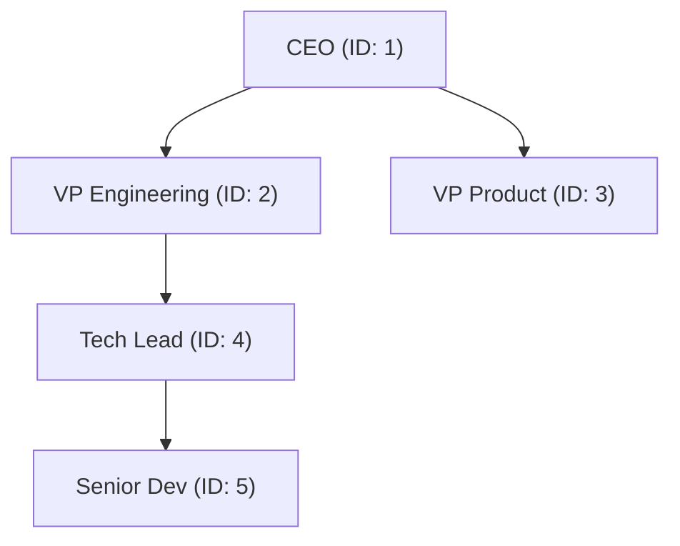

# 🐘 PostgreSQL - Modul 03: Advanced Joins, LATERAL, Recursive CTE & Window Functions

Kekuatan query analitik PostgreSQL melampaui SQL konvensional. Melalui **`CROSS JOIN LATERAL`**, **Recursive CTE**, dan **Window Functions**, kamu bisa menyelesaikan kalkulasi bisnis tersulit murni di dalam database tanpa membebani backend service.

---

## 1. Senjata Rahasia Postgres: `CROSS JOIN LATERAL`

Secara standar, subquery di klausa `FROM` tidak bisa mereferensikan kolom dari tabel sebelah kirinya. **`LATERAL`** bertindak seperti loop `for-each`: subquery di kanan dieksekusi untuk setiap baris tabel di kiri.

### Kasus Klasik: Mengambil 3 Transaksi Terbesar per Customer (Top-N Per Group)
Tanpa `LATERAL`, query ini memerlukan window function lambat dengan filter luar. Dengan `LATERAL`, query menjadi instan:

```sql
SELECT c.id, c.nama, t.id AS order_id, t.nominal, t.created_at
FROM customers c
CROSS JOIN LATERAL (
    SELECT o.id, o.nominal, o.created_at
    FROM orders o
    WHERE o.customer_id = c.id
    ORDER BY o.nominal DESC
    LIMIT 3 -- Ambil tepat 3 transaksi tertinggi per customer!
) t;
```

---

## 2. Recursive CTE (`WITH RECURSIVE`): Melintasi Pohon Hierarki

Digunakan untuk membaca data berstruktur pohon tak terbatas: struktur organisasi karyawan, kategori produk bersarang (*breadcrumbs*), atau rute graph:



```sql
WITH RECURSIVE HierarkiOrganisasi AS (
    -- 1. ANCHOR MEMBER: Titik awal (Pucuk pimpinan / Root node)
    SELECT id, nama, manager_id, 1 AS level, CAST(nama AS TEXT) AS path_pohon
    FROM employees
    WHERE manager_id IS NULL

    UNION ALL

    -- 2. RECURSIVE MEMBER: Sambungkan child ke parent
    SELECT e.id, e.nama, e.manager_id, h.level + 1, h.path_pohon || ' -> ' || e.nama
    FROM employees e
    INNER JOIN HierarkiOrganisasi h ON e.manager_id = h.id
)
SELECT level, LPAD('', (level - 1) * 4) || nama AS hierarki_visual, path_pohon
FROM HierarkiOrganisasi
ORDER BY path_pohon;
```

> [!TIP]
> **Deteksi Siklus (Cycle Prevention)**: Pada Postgres 14+, tambahkan klausa `CYCLE id SET is_cycle USING path` di akhir CTE recursive untuk mencegah *infinite loop* jika ada data karyawan yang saling mereferensikan manager melingkar.

---

## 3. Window Functions & Frame Specifications

Window function melakukan agregasi tanpa melenyapkan baris individual (berbeda dengan `GROUP BY` yang memadatkan baris):

```sql
SELECT 
    tanggal,
    kategori,
    omset,
    -- 1. Penomoran berurutan dalam kategori yang sama:
    ROW_NUMBER() OVER (PARTITION BY kategori ORDER BY omset DESC) AS peringkat_kategori,

    -- 2. Mengambil omset hari sebelumnya (Analisis Tren):
    LAG(omset, 1) OVER (PARTITION BY kategori ORDER BY tanggal) AS omset_kemarin,

    -- 3. Akumulasi Berjalan (Running Total):
    SUM(omset) OVER (
        PARTITION BY kategori 
        ORDER BY tanggal
        ROWS BETWEEN UNBOUNDED PRECEDING AND CURRENT ROW
    ) AS running_total_omset

FROM penjualan_harian;
```

### Memahami Window Frame (`ROWS BETWEEN`):
- `UNBOUNDED PRECEDING`: Dari baris pertama dalam partisi.
- `CURRENT ROW`: Hingga baris yang sedang dievaluasi saat ini.
- `ROWS BETWEEN 6 PRECEDING AND CURRENT ROW`: Rata-rata bergerak 7 hari (*7-Day Moving Average*)!
