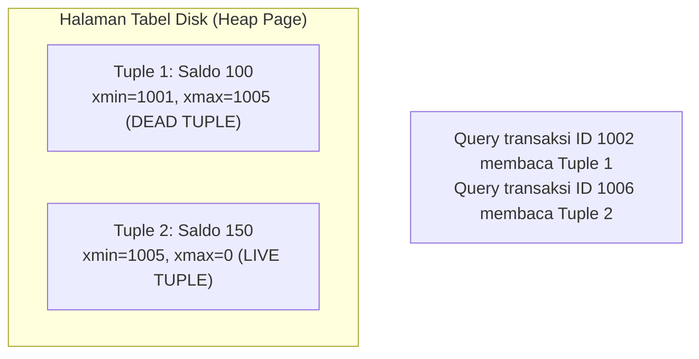

# 🐘 PostgreSQL - Modul 04: MVCC Internals, Isolation Levels, FOR UPDATE & Advisory Locks

Berbeda dengan database lain (seperti MySQL atau Oracle) yang menyimpan versi data lama di dalam *Undo Log*, PostgreSQL mengimplementasikan **MVCC (Multi-Version Concurrency Control) langsung di dalam tabel heap**.

---

## 1. Anatomi MVCC Postgres: `xmin`, `xmax` & Dead Tuples

Di Postgres:
- **`INSERT`**: Menulis baris (*tuple*) baru ke halaman tabel dengan metadata `xmin = ID_TRANSAKSI_INI`.
- **`DELETE`**: **Tidak langsung menghapus data secara fisik**, melainkan hanya menandai `xmax = ID_TRANSAKSI_INI` pada baris tersebut.
- **`UPDATE`**: Menjalankan kombinasi **DELETE + INSERT**! Baris lama ditandai `xmax`, dan baris versi baru ditulis dengan `xmin` baru.

```sql
-- Menginspeksi kolom sistem tersembunyi milik Postgres:
SELECT xmin, xmax, ctid, id, saldo FROM accounts WHERE id = '...';
```



> [!NOTE]
> **Konsekuensi Arsitektural**: Karena baris lama tetap ada di disk sebagai *Dead Tuple*, Postgres membutuhkan proses berkala bernama **`VACUUM`** untuk membersihkan sampah baris lama agar tabel tidak membengkak (*bloat*).

---

## 2. Empat Tingkat Isolasi ANSI di Postgres

1. **Read Committed (Default)**: Setiap statement SQL di dalam transaksi mengambil snapshot data terbaru yang sudah di-commit.
2. **Repeatable Read**: Snapshot data diambil **hanya sekali di awal transaksi**. Statement berikutnya akan melihat dunia yang identik. Jika ada transaksi konkuren lain yang memodifikasi baris yang sama, Postgres akan melempar error:
   `ERROR: could not serialize access due to concurrent update`.
3. **Serializable (SSI - Serializable Snapshot Isolation)**: Tingkat isolasi tertinggi. Postgres melacak dependensi baca/tulis (*si-locks*) dan otomatis membatalkan transaksi yang berpotensi menghasilkan anomali matematis (*write skew*) tanpa perlu mengunci tabel.

---

## 3. Pola Antrean Job Produksi: `FOR UPDATE SKIP LOCKED`

Jika kamu ingin membuat sistem antrean pesan / task worker (seperti Celery atau BullMQ) langsung di atas PostgreSQL:

```sql
-- Dijalankan oleh banyak worker paralel bersamaan:
BEGIN;

SELECT id, payload
FROM job_queue
WHERE status = 'PENDING'
ORDER BY priority DESC, id ASC
LIMIT 1
FOR UPDATE SKIP LOCKED; -- SAKTI: Jika baris sedang dikunci worker lain, LEWATI INSTAN tanpa blocking!

-- Update status job yang berhasil dikunci:
UPDATE job_queue
SET status = 'PROCESSING', started_at = CURRENT_TIMESTAMP
WHERE id = :job_id;

COMMIT;
```
> [!TIP]
> **Keunggulan `SKIP LOCKED`**: Puluhan worker bisa mengambil tugas dari tabel antrean yang sama secara paralel dengan **nol waktu tunggu (Zero Lock Contention)**!

---

## 4. Distributed Lock Bebas Tabel: Postgres Advisory Locks

Jika aplikasimu butuh *Distributed Lock* (misal: memastikan cron job harian hanya berjalan di 1 instance pod Kubernetes), kamu **tidak perlu menginstal Redis atau ZooKeeper**. Postgres menyediakan **Advisory Locks** di memori:

```sql
-- 1. Mengambil lock berbasis integer 64-bit (Menunggu jika sedang dipegang pod lain):
SELECT pg_advisory_lock(99281);

-- 2. Mengambil lock non-blocking (Return true jika berhasil, false jika sedang dipakai):
SELECT pg_try_advisory_lock(99281);

-- Jalankan pekerjaan berat di aplikasi...

-- 3. Melepaskan lock setelah selesai:
SELECT pg_advisory_unlock(99281);

-- 4. Transaction-level Advisory Lock (Otomatis dilepas saat COMMIT / ROLLBACK):
SELECT pg_advisory_xact_lock(99281);
```
Advisory locks murni beroperasi di memori RAM Postgres tanpa menulis data ke tabel atau memicu dead tuple!
