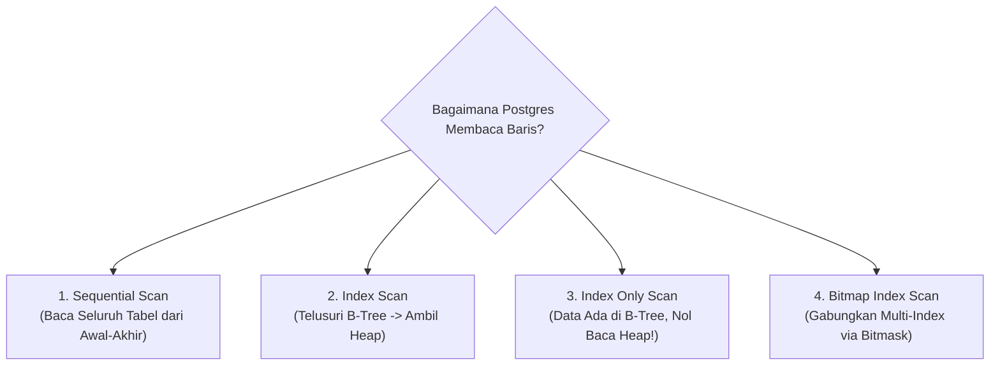

# 🐘 PostgreSQL - Modul 05: EXPLAIN ANALYZE, Buffers & Query Optimization

Kemampuan membaca dan mendiagnosis rencana eksekusi query (*Execution Plan*) adalah keterampilan wajib Database Administrator dan Backend Architect untuk mengubah query berdurasi 30 detik menjadi 3 milidetik.

---

## 1. Perintah Sakti: `EXPLAIN (ANALYZE, BUFFERS)`

Jangan hanya menjalankan `EXPLAIN` biasa. Selalu sertakan `ANALYZE` (mengeksekusi query sungguhan untuk membandingkan estimasi vs kenyataan) dan `BUFFERS` (melaporkan interaksi RAM vs Disk):

```sql
EXPLAIN (ANALYZE, BUFFERS, COSTS, TIMING)
SELECT u.id, u.email, o.total
FROM users u
JOIN orders o ON u.id = o.user_id
WHERE u.status = 'ACTIVE' AND o.total > 1000000;
```

### Membedah Metrik Buffer:
```text
Buffers: shared hit=421 read=15 dirtied=2 written=0
```
- **`shared hit`**: Halaman data yang berhasil dibaca **langsung dari RAM (`shared_buffers`)** (Ultra cepat, $\sim$ nanodetik).
- **`shared read`**: Halaman data yang terpaksa dibaca **dari penyimpanan fisik Disk/SSD** (Lambat, $\sim$ milidetik). Query lambat biasanya memiliki rasio `shared read` yang sangat tinggi!

---

## 2. Empat Jenis Scan Utama di PostgreSQL



| Tipe Scan | Kapan Terjadi? | Solusi Optimasi |
|---|---|---|
| **Seq Scan** | Tabel kecil, atau **kolom di WHERE belum di-index**, atau kriteria filter mencakup >20% isi tabel. | Buat B-Tree Index jika tabel besar dan selektivitas tinggi. |
| **Index Scan** | Mengambil sedikit baris menggunakan B-Tree index, lalu mengunjungi heap untuk mengambil kolom lain. | Bagus, normal. |
| **Index Only Scan** | **Paling Cepat!** Semua kolom yang diminta oleh `SELECT` dan `WHERE` sudah ada di dalam index. | Gunakan klausa `INCLUDE` saat membuat index: `CREATE INDEX idx_user ON users(email) INCLUDE (nama);` |
| **Bitmap Scan** | Mencari rentang data menengah atau menggabungkan dua index berbeda (`col_a = 1 AND col_b = 2`). | Normal, efisien untuk membaca halaman yang tersebar. |

---

## 3. Tiga Algoritma Join di Mesin Postgres

1. **Nested Loop Join**:
   - Bagus untuk dataset kecil atau saat tabel sebelah dalam (*inner table*) memiliki index pada join key.
2. **Hash Join**:
   - Postgres membangun Hash Table dari tabel yang lebih kecil di dalam memori `work_mem`, lalu memindai tabel kedua. Sangat efisien untuk tabel besar.
3. **Merge Join**:
   - Digunakan jika kedua tabel **sudah terurut** pada kolom join key (misal: keduanya memiliki B-Tree index). Postgres menggabungkan keduanya seperti ritsleting baju.

---

## 4. Deteksi Bottleneck: Sort Tumpah ke Disk (`External Merge Disk`)

Perhatikan baris output EXPLAIN berikut saat ada klausa `ORDER BY`:

```text
Sort Method: external merge  Disk: 42100kB
```

> [!CAUTION]
> **Tanda Bahaya**: Tulisan `external merge Disk` berarti kuota memori `work_mem` di server terlalu kecil untuk menampung data sort di RAM. Postgres terpaksa menulis file sementara (*temp files*) ke disk, yang memangkas performa hingga $100\times$ lebih lambat!
> 
> **Solusi**: Tingkatkan nilai `work_mem` untuk sesi terkait atau di konfigurasi global:
> ```sql
> SET work_mem = '64MB'; -- Tingkatkan dari default 4MB
> ```
