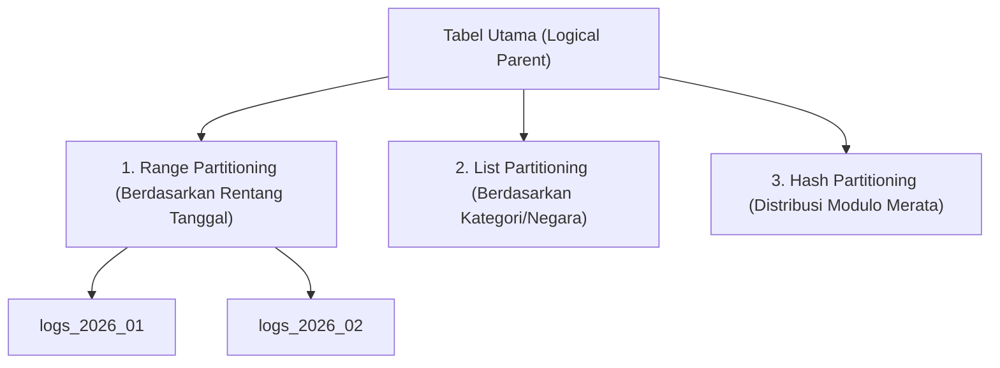

# 🐘 PostgreSQL - Modul 06: Declarative Table Partitioning & Partition Pruning

Ketika sebuah tabel tumbuh melewati **puluhan juta baris atau ratusan gigabyte**, query lambat, index memakan banyak RAM, dan operasi `DELETE` massal memicu tabel bloat parah. **Declarative Partitioning** memecah tabel raksasa menjadi sub-tabel fisik kecil yang transparan bagi aplikasi.

---

## 1. Tiga Strategi Partisi Deklaratif



---

## 2. Praktik Produksi: Range Partitioning Berdasarkan Tanggal

```sql
-- 1. Buat Tabel Parent dengan klausul PARTITION BY RANGE:
CREATE TABLE sensor_logs (
    id BIGSERIAL,
    sensor_id INT NOT NULL,
    suhu NUMERIC(5, 2) NOT NULL,
    created_at TIMESTAMPTZ NOT NULL,
    -- Kolom partisi WAJIB masuk ke dalam PRIMARY KEY:
    PRIMARY KEY (id, created_at)
) PARTITION BY RANGE (created_at);

-- 2. Buat Sub-Tabel Partisi Fisik Bulanan:
CREATE TABLE sensor_logs_2026_01 PARTITION OF sensor_logs
    FOR VALUES FROM ('2026-01-01 00:00:00+00') TO ('2026-02-01 00:00:00+00');

CREATE TABLE sensor_logs_2026_02 PARTITION OF sensor_logs
    FOR VALUES FROM ('2026-02-01 00:00:00+00') TO ('2026-03-01 00:00:00+00');

-- 3. Buat Partisi DEFAULT (Penampung jika ada data di luar rentang):
CREATE TABLE sensor_logs_default PARTITION OF sensor_logs DEFAULT;
```

### Mengakses Data:
Aplikasi **cukup melakukan INSERT dan SELECT ke tabel parent `sensor_logs`**. Postgres otomatis merutekan baris ke sub-tabel fisik yang sesuai!

---

## 3. Partition Pruning: Pangkas 95% Pembacaan Disk

**Partition Pruning** adalah kemampuan perencana query (*query planner*) untuk mendeteksi partisi mana saja yang relevan dan **mengabaikan partisi lainnya secara total**:

```sql
EXPLAIN SELECT * FROM sensor_logs 
WHERE created_at BETWEEN '2026-01-10' AND '2026-01-15';
```
Output Plan:
```text
Append  (cost=0.00..25.50 rows=10 width=24)
  ->  Seq Scan on sensor_logs_2026_01  (cost=0.00..25.40 rows=10 width=24)
```
> [!NOTE]
> Perhatikan bahwa partisi `sensor_logs_2026_02` dan `sensor_logs_default` **sama sekali tidak disentuh atau dibaca**. Ini membuat query jutaan baris selesai dalam beberapa milidetik!

---

## 4. Pemeliharaan Zero-Downtime: Menghapus Data Lama Instan

Pada tabel biasa, menghapus 50 juta baris data kadaluarsa via `DELETE FROM sensor_logs WHERE created_at < ...` akan:
- Mengunci baris dalam waktu lama.
- Menghasilkan jutaan *dead tuples* dan memicu bloat parah.
- Menulis gigabyte log WAL ke disk.

Dengan Partisi Tabel, menghapus data lama dilakukan dengan **melepas partisi (*DETACH*) lalu menghapusnya (*DROP*) dalam hitungan 0.01 detik**:

```sql
-- 1. Lepas partisi tanpa mengunci tabel utama (Zero Downtime):
ALTER TABLE sensor_logs DETACH PARTITION sensor_logs_2026_01 CONCURRENTLY;

-- 2. Hapus sub-tabel fisik seketika:
DROP TABLE sensor_logs_2026_01;
-- 100GB data langsung dibebaskan dari disk tanpa beban CPU!
```
