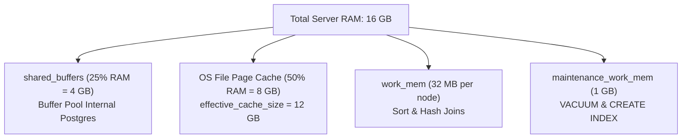

# 🐘 PostgreSQL - Modul 08: Performance Tuning postgresql.conf & Server Resource

Konfigurasi bawaan (*default*) `postgresql.conf` saat pertama kali diinstal sangat konservatif (didesain agar bisa berjalan di laptop tua dengan RAM 256MB). Menjalankan beban produksi dengan settingan default akan menyia-nyiakan 90% potensi hardware servermu!

---

## 1. Rumus Emas Alokasi Memori Server Produksi

Asumsi server database produksi memiliki **RAM 16 GB** dan **8 CPU Cores**:



### Parameter Memori Paling Kritis:
| Parameter | Nilai Rekomendasi | Penjelasan & Aturan Teknis |
|---|---|---|
| **`shared_buffers`** | **$25\%$ Total RAM** (Maks 32GB) | Alokasi RAM khusus untuk men-cache tabel dan index di Postgres. Jangan disetel $>40\%$ karena Postgres mengandalkan OS Page Cache (*Double Buffering*). |
| **`effective_cache_size`** | **$50\% - 75\%$ Total RAM** | Pedoman bagi *query planner* untuk memperkirakan berapa banyak memori yang tersedia di OS Cache. Tidak mengalokasikan RAM fisik! Nilai ini membantu compiler memilih Index Scan daripada Seq Scan. |
| **`work_mem`** | **$16\text{ MB} - 64\text{ MB}$** | Kuota RAM untuk operasi `ORDER BY`, `DISTINCT`, dan `Hash Join`. **HATI-HATI**: Nilai ini dialokasikan **per operasi per query**, bukan per koneksi! Jika disetel terlalu besar dan ada 200 koneksi bersamaan, server bisa tewas terkena OOM (*Out Of Memory*). |
| **`maintenance_work_mem`** | **$512\text{ MB} - 2\text{ GB}$** | Digunakan khusus untuk operasi berat seperti `VACUUM`, `CREATE INDEX`, dan `ALTER TABLE`. |

---

## 2. Tuning Disk I/O & Checkpoint Smoothing

Penyebab utama aplikasi tiba-tiba mengalami lonjakan latensi (*latency spike*) setiap beberapa menit adalah **Checkpoint Spikes** (Postgres menulis ribuan halaman dirty buffer ke disk secara mendadak).

Atur parameter penyeimbang I/O berikut:
```ini
# postgresql.conf

# 1. Rentang waktu antar checkpoint (menghindari penulisan terlalu sering)
checkpoint_timeout = 15min

# 2. Sebar penulisan disk secara halus sepanjang 90% durasi interval (Smoothing)
checkpoint_completion_target = 0.9

# 3. Buffer penulisan WAL log sebelum flush ke SSD
wal_buffers = 16MB

# 4. Target acak pembacaan SSD modern (NVMe/SSD memiliki latency acak yang sangat rendah)
random_page_cost = 1.1 # Default 4.0 (untuk HDD lama). Wajib 1.1 untuk Cloud SSD!
```

---

## 3. Menemukan Query Paling Lambat dengan `pg_stat_statements`

Ekstensi bawaan **`pg_stat_statements`** adalah alat wajib untuk mencatat statistik performa seluruh query yang berjalan di server:

```sql
-- Tambahkan ke postgresql.conf: shared_preload_libraries = 'pg_stat_statements'
CREATE EXTENSION IF NOT EXISTS pg_stat_statements;

-- Query mencari 5 SQL paling boros memakan total waktu CPU:
SELECT 
    round((total_exec_time / 1000)::numeric, 2) AS total_detik,
    calls AS jumlah_dipanggil,
    round((mean_exec_time)::numeric, 2) AS rata_rata_ms,
    query
FROM pg_stat_statements
ORDER BY total_exec_time DESC
LIMIT 5;
```
Query hasil laporan ini adalah kandidat pertama yang wajib kamu optimasi dengan menambahkan index atau menata ulang struktur SQL!
