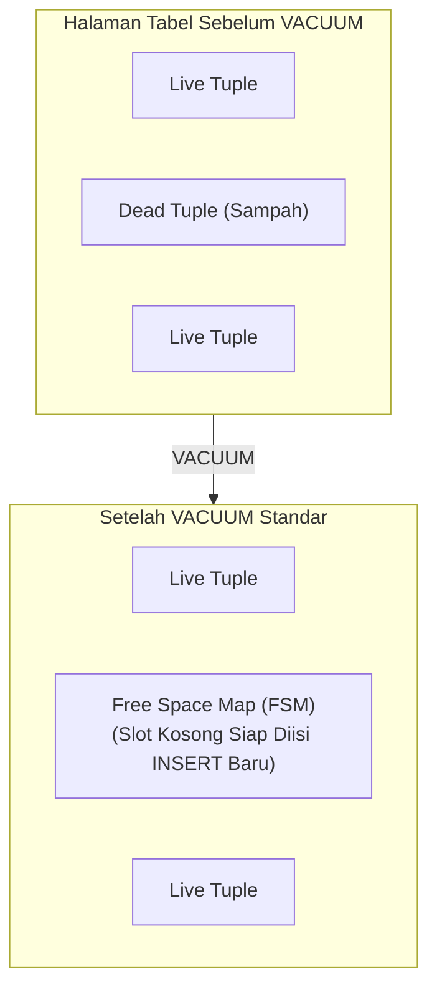

# 🐘 PostgreSQL - Modul 09: VACUUM, Autovacuum Tuning & Bloat Management

Karena model MVCC Postgres tidak menggunakan Undo Log, setiap perintah `DELETE` dan `UPDATE` meninggalkan baris sampah yang disebut **Dead Tuples**. Jika tidak dibersihkan dengan benar, tabel dan index akan mengalami **Bloat (Pembengkakan)**: ukuran disk membengkak 10x lipat dan query melambat drastis.

---

## 1. Anatomi Table Bloat & Perilaku VACUUM



### `VACUUM` Standar vs `VACUUM FULL`:
- **`VACUUM` (Biasa)**:
  - Menandai ruang yang ditempati dead tuples sebagai kosong di **Free Space Map (FSM)** agar bisa diisi ulang oleh baris `INSERT` berikutnya.
  - **TIDAK MENGEMBALIKAN ukuran disk ke OS** (ukuran file tabel di SSD tetap sama).
  - **Aman dijalankan di produksi** karena tidak memblokir query `SELECT`, `INSERT`, atau `UPDATE`.
- **`VACUUM FULL`**:
  - Menulis ulang seluruh isi tabel ke file baru di disk dan mengembalikan sisa ruang kosong ke OS.
  - ⚠️ **SANGAT BERBAHAYA DI PRODUKSI**: Meminta kunci eksklusif mutlak (*ACCESS EXCLUSIVE LOCK*). **Semua aktivitas baca dan tulis aplikasi akan terblokir total** hingga proses selesai!

---

## 2. Rumus Pemicu Autovacuum & Cara Menjinakkannya

Postgres menjalankan background worker bernama **Autovacuum Daemon**. Rumus pemicu kapan sebuah tabel dibersihkan otomatis adalah:

$$\text{Ambang Batas Dead Tuples} = \text{threshold} + (\text{scale\_factor} \times \text{total\_baris})$$

Nilai default konfigurasi:
- `autovacuum_vacuum_threshold = 50`
- `autovacuum_vacuum_scale_factor = 0.2` (Artinya: $20\%$ baris harus mati dulu baru Autovacuum berjalan!)

### 💥 Masalah pada Tabel Skala Besar:
Jika tabel memiliki **100.000.000 baris**, $20\%$ berarti tabel harus menumpuk **20.000.000 dead tuples** sebelum Autovacuum mulai bekerja! Pada saat itu, ukuran tabel sudah membengkak puluhan gigabyte.

### Solusi: Atur Scale Factor Khusus per Tabel
Untuk tabel transaksi yang sangat sibuk, perkecil scale factor menjadi $1\% - 5\%$:

```sql
ALTER TABLE orders SET (
    autovacuum_vacuum_scale_factor = 0.02, -- Picu jika ada 2% dead tuples
    autovacuum_vacuum_cost_limit = 1000     -- Beri kuota I/O lebih besar agar vacuum selesai lebih cepat
);
```

---

## 3. Bahaya Bencana Kritis: Transaction ID Wraparound (TXID)

Postgres menggunakan integer 32-bit untuk nomor transaksi ($2\text{ Miliar}$ batas angka transaksi). Jika angka ini mencapai titik $2$ miliar, angka akan berputar kembali ke $0$ (*wraparound*), yang secara teori membuat data lama tampak seolah-olah terjadi di masa depan (tidak terlihat).

Untuk mencegah bencana kehilangan data ini:
- Postgres menjalankan **`VACUUM FREEZE`** untuk mengubah transaksi lama menjadi status beku (*Frozen XID*).
- Jika database kamu mengabaikan peringatan wraparound, Postgres akan **mematikan dirinya sendiri secara otomatis ke status READ-ONLY darurat** untuk melindungi integritas data!

---

## 4. Solusi Produksi Zero-Downtime: `pg_repack`

Jika tabelmu sudah terlanjur membengkak 80% dan kamu ingin mengembalikan ruang disk ke sistem operasi **tanpa downtime dan tanpa mengunci tabel**, gunakan ekstensi resmi **`pg_repack`**:

```bash
# Menata ulang tabel 'orders' dan semua index-nya secara online di background:
pg_repack -d nama_database -t orders
```
`pg_repack` membuat tabel salinan baru, menyalin data secara bertahap, menangkap perubahan data baru via trigger, lalu menukar tabel dalam waktu 0.001 detik tanpa memutus koneksi aplikasi!
