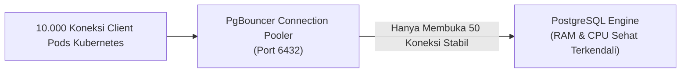

# 🐘 PostgreSQL - Modul 10: Streaming & Logical Replication, CDC & PgBouncer

Di modul penutup PostgreSQL ini, kita akan membahas arsitektur skala produksi enterprise: **Replikasi Data**, integrasi event-driven **Change Data Capture (CDC)**, dan penanganan ribuan koneksi konkuren menggunakan **PgBouncer**.

---

## 1. Physical Streaming Replication vs Logical Replication

| Fitur | Physical Streaming Replication | Logical Replication (Pub/Sub) |
|---|---|---|
| **Mekanisme** | Aliran biner mentah Write-Ahead Log (WAL) byte-per-byte. | Aliran baris data logis berbasis perintah SQL / decoding plugin. |
| **Granularitas** | Seluruh cluster database secara mutlak (*All-or-Nothing*). | **Per Tabel Individual** atau subset kolom tertentu. |
| **Versi Postgres** | Wajib versi major Postgres yang sama persis (misal: v16 ke v16). | **Bisa beda versi** (misal: migrasi tanpa downtime v14 ke v16)! |
| **Status Replicas** | Standby node berstatus **Read-Only murni**. | Standby node **bisa ditulis (*read-write*)** dan memiliki index berbeda. |

### Menyiapkan Logical Replication (Pub/Sub):
```sql
-- 1. Di Database Sumber (Publisher / Primary):
CREATE PUBLICATION pub_transaksi FOR TABLE orders, payments;

-- 2. Di Database Tujuan (Subscriber / Data Warehouse):
CREATE SUBSCRIPTION sub_transaksi 
    CONNECTION 'host=primary-db.internal dbname=prod user=replicator password=secret' 
    PUBLICATION pub_transaksi;
```

---

## 2. Change Data Capture (CDC) ke Kafka dengan Debezium

Dalam arsitektur mikroservis event-driven, setiap mutasi data di database Postgres (`INSERT`, `UPDATE`, `DELETE`) harus dipancarkan sebagai event ke Apache Kafka.

Postgres menyediakan **Logical Decoding Slots (`pgoutput`)**:
- Engine membaca WAL stream secara non-blocking.
- Debezium / Kafka Connect menangkap perubahan baris dan memancarkannya ke topik Kafka dalam format JSON/Avro secara *real-time* ($< 10\text{ milidetik}$).
- Sistem pencarian (Elasticsearch) dan Cache (Redis) otomatis ter-update tanpa perlu kode sinkronisasi manual di backend!

---

## 3. Bahaya Fatal `max_connections` & Solusi PgBouncer

### ⚠️ Mengapa Menyetel `max_connections = 2000` Menghancurkan Server?
Berbeda dengan Node.js atau Go yang menggunakan green thread ringan, **setiap koneksi baru ke PostgreSQL membuat PROSES SISTEM OPERASI LENGKAP (*OS Process Fork*)**:
- 1 koneksi mengonsumsi $5 - 10\text{ MB}$ RAM.
- Jika ada 1.000 koneksi aktif, CPU server akan habis hanya untuk melakukan *OS Context Switching* tanpa sempat menjalankan query SQL!



---

## 4. Tiga Mode Kolam PgBouncer (Pool Modes)

| Mode PgBouncer | Perilaku Alokasi Koneksi | Keamanan Transaksi Multi-Statement |
|---|---|---|
| **Session Pooling** | Koneksi server dipinjamkan ke client selama client tidak memutus koneksi socket. | ✅ Aman 100% |
| **Transaction Pooling (Standar Emas!)** | **Koneksi server HANYA dipinjamkan selama transaksi berjalan (`BEGIN` s.d. `COMMIT`)**. Begitu commit selesai, koneksi langsung dikembalikan ke kolam untuk melayani request client lain! | ✅ Aman (Mampu melayani 20.000 request dengan hanya 50 backend koneksi Postgres!). |
| **Statement Pooling** | Koneksi dipinjamkan per satu statement SQL tunggal. | ❌ Tidak mendukung transaksi multi-baris (`BEGIN...COMMIT` dilarang). |

### Konfigurasi Produksi `pgbouncer.ini`:
```ini
[databases]
prod_db = host=127.0.0.1 port=5432 dbname=prod_db

[pgbouncer]
listen_port = 6432
listen_addr = *
auth_type = scram-sha-256
pool_mode = transaction
max_client_conn = 10000
default_pool_size = 50
reserve_pool_size = 10
```
Dengan PgBouncer di port 6432, ribuan microservices pod Kubernetes bisa terhubung tanpa pernah menenggelamkan database Postgres!
