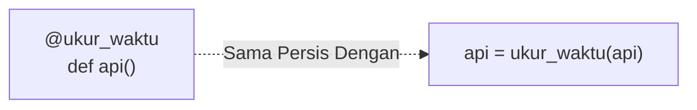

# 🐍 Python - Modul 03: Parameter /, *, Args, Kwargs, Closures & Decorators

Fungsi di Python adalah **First-Class Objects**: fungsi bisa ditugaskan ke variabel, disimpan di dalam struktur data, dikirim sebagai argumen, dan dikembalikan oleh fungsi lain.

---

## 1. Delimiter Khusus: Positional-Only (`/`) & Keyword-Only (`*`)

Sejak Python 3.8, kamu bisa mengontrol secara kaku bagaimana pemanggil fungsi mengirimkan argumennya:

```python
# Sintaks: (positional_only, /, standard, *, keyword_only)
def konfigurasi_server(host, port, /, timeout=30, *, debug=False, log_file=None):
    print(f"Host: {host}:{port}, Timeout: {timeout}, Debug: {debug}")

# CARA PEMANGGILAN YANG VALID:
konfigurasi_server("127.0.0.1", 8080, debug=True)
konfigurasi_server("127.0.0.1", 8080, 60, debug=True)

# CARA PEMANGGILAN YANG GAGAL (COMPILE / RUNTIME ERROR):
# konfigurasi_server(host="127.0.0.1", port=8080)
# TypeError: konfigurasi_server() got some positional-only arguments passed as keyword arguments

# konfigurasi_server("127.0.0.1", 8080, 30, True)
# TypeError: konfigurasi_server() takes from 2 to 3 positional arguments but 4 were given
```

> [!NOTE]
> - Parameter sebelum tanda garis miring (`/`) **WAJIB posisi** (tidak boleh dipanggil dengan nama `host=...`).
> - Parameter setelah tanda bintang (`*`) **WAJIB keyword** (wajib menyebut nama parameternya `debug=True`).

---

## 2. Variadic Parameters: `*args` & `**kwargs`

- **`*args`**: Menampung kelebihan argumen posisi tanpa nama ke dalam sebuah **Tuple**.
- **`**kwargs`**: Menampung kelebihan argumen berpasangan nama ke dalam sebuah **Dictionary**.

```python
def log_transaksi(user_id, *transaksi_ids, **metadata):
    print(f"User: {user_id}")
    print(f"Daftar Transaksi (Tuple): {transaksi_ids}")
    print(f"Metadata Tambahan (Dict): {metadata}")

log_transaksi("USR-01", 1001, 1002, 1003, ip="192.168.1.1", browser="Brave")
# Output:
# User: USR-01
# Daftar Transaksi (Tuple): (1001, 1002, 1003)
# Metadata Tambahan (Dict): {'ip': '192.168.1.1', 'browser': 'Brave'}

# Argument Unpacking (Menyebarkan isi data):
daftar_angka = [10, 20, 30]
print(*daftar_angka) # Setara: print(10, 20, 30)
```

---

## 3. Closures & Keyword `nonlocal`

Sebuah closure terjadi ketika fungsi bersarang (*inner function*) mengingat variabel di scope fungsi luar pembungkusnya (*enclosing scope*):

```python
def buat_counter(mulai=0):
    hitungan = mulai

    def tambah():
        nonlocal hitungan # Wajib: Tanpa 'nonlocal', Python mengira ini variabel lokal baru!
        hitungan += 1
        return hitungan

    return tambah

c = buat_counter(10)
print(c()) # 11
print(c()) # 12
```

---

## 4. Arsitektur Decorator: Sintaks `@` Dibongkar

Decorator adalah fungsi yang menerima fungsi lain sebagai argumen dan memperluas perilakunya tanpa memodifikasi kode aslinya.



### Membuat Decorator Standar Produksi (Wajib Gunakan `functools.wraps`):
```python
import functools
import time

def ukur_durasi(func):
    # functools.wraps MENJAGA nama fungsi asli, docstring, dan metadata __name__
    @functools.wraps(func)
    def wrapper(*args, **kwargs):
        start = time.perf_counter()
        
        # Eksekusi fungsi asli:
        hasil = func(*args, **kwargs)
        
        durasi = time.perf_counter() - start
        print(f"⏱️ Fungsi '{func.__name__}' selesai dalam {durasi:.6f} detik")
        return hasil

    return wrapper

@ukur_durasi
def komputasi_berat(n):
    return sum(i**2 for i in range(n))

komputasi_berat(1_000_000)
```

---

## 5. Decorator yang Menerima Parameter (3 Tingkat Nested Function)

Jika decorator butuh parameter konfigurasi (misal: jumlah percobaan retry), buat 3 lapis fungsi:

```python
def retry(max_attempts=3, delay_sec=1):
    def decorator(func):
        @functools.wraps(func)
        def wrapper(*args, **kwargs):
            attempts = 0
            while attempts < max_attempts:
                try:
                    return func(*args, **kwargs)
                except Exception as e:
                    attempts += 1
                    print(f"Percobaan ke-{attempts} gagal: {e}. Mengulang dalam {delay_sec}s...")
                    time.sleep(delay_sec)
            raise RuntimeError(f"Fungsi '{func.__name__}' gagal setelah {max_attempts} percobaan!")
        return wrapper
    return decorator

@retry(max_attempts=3, delay_sec=2)
def koneksi_ke_redis():
    # Simulasi kegagalan
    raise ConnectionError("Redis server unreachable")
```
