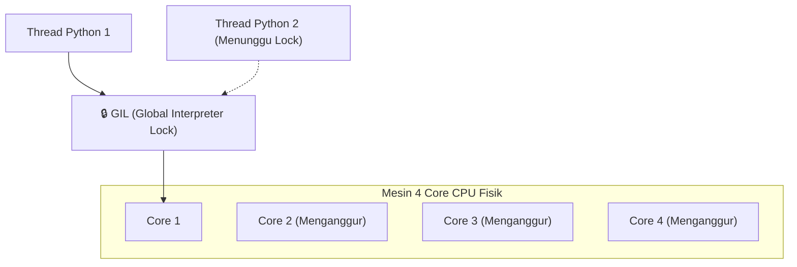

# 🐍 Python - Modul 07: Concurrency: GIL, Threading vs Multiprocessing

Salah satu topik paling sering dibahas dan disalahpahami dalam rekayasa perangkat lunak Python adalah **GIL (Global Interpreter Lock)** dan strategi memilih model konkurensi yang tepat.

---

## 1. Anatomi Global Interpreter Lock (GIL)

Di dalam implementasi standar Python (CPython), **GIL adalah mutex tingkat interpreter yang menjamin bahwa hanya ada TEPAT SATU thread yang boleh mengeksekusi Python bytecode dalam satu waktu**, terlepas dari apakah komputermu memiliki 32 core CPU fisik!



### Mengapa CPython Menggunakan GIL?
Untuk mengamankan manajemen memori internal CPython (*Reference Counting*). Tanpa GIL, setiap modifikasi objek akan membutuhkan lock mikro tersendiri yang justru memperlambat eksekusi single-threaded hingga 30%!

---

## 2. Matriks Keputusan: Threading vs Multiprocessing vs Asyncio

| Karakteristik | `threading` | `multiprocessing` | `asyncio` |
|---|---|---|---|
| **Model** | Preemptive Multi-Threading | Multi-Process (OS Process Terpisah) | Cooperative Single-Threaded Event Loop |
| **Bisa Menembus GIL?** | ❌ **TIDAK** (Terkunci di 1 Core) | ✅ **YA** (Setiap proses punya GIL sendiri) | ❌ **TIDAK** |
| **Kasus Terbaik** | **I/O-Bound**: Menunggu download HTTP, query database, baca file disk. | **CPU-Bound**: Komputasi matematika, pemrosesan gambar, machine learning, kompresi video. | **High-Concurrency I/O**: Web server dengan 10.000+ koneksi soket aktif. |
| **Konsumsi RAM** | Ringan (Berbagi memori) | Berat (Menduplikasi seluruh memori proses) | Paling Ringan |

> [!NOTE]
> **Mengapa Threading Efektif untuk I/O?** Saat sebuah thread melakukan operasi I/O (seperti `socket.recv()`, `time.sleep()`, atau query SQL), CPython **otomatis melepas GIL**. Thread lain bisa langsung menggunakan CPU sementara thread pertama menunggu jaringan!

---

## 3. High-Level Concurrency: `concurrent.futures`

Standar industri modern Python tidak lagi menggunakan modul `threading` atau `multiprocessing` tingkat rendah secara manual, melainkan abstraksi **`concurrent.futures`**:

### A. I/O-Bound Task: `ThreadPoolExecutor`
```python
from concurrent.futures import ThreadPoolExecutor, as_completed
import urllib.request

URLS = [
    "https://python.org",
    "https://github.com",
    "https://google.com",
]

def download_url(url):
    with urllib.request.urlopen(url, timeout=5) as conn:
        return url, len(conn.read())

# Menggunakan ThreadPool untuk tugas I/O (GIL otomatis dilepas saat request jaringan):
with ThreadPoolExecutor(max_workers=5) as executor:
    # Submit task ke pool:
    futures = [executor.submit(download_url, url) for url in URLS]

    # Ambil hasil segera setelah ada task yang selesai:
    for f in as_completed(futures):
        url, ukuran = f.result()
        print(f"URL: {url} | Ukuran: {ukuran:,} bytes")
```

### B. CPU-Bound Task: `ProcessPoolExecutor` (Memanfaatkan 100% Core CPU)
Untuk kalkulasi berat, `ProcessPoolExecutor` membuat proses OS independen, mendistribusikan beban ke seluruh core CPU:

```python
from concurrent.futures import ProcessPoolExecutor
import time

def hitung_prima_berat(n):
    # Simulasi perhitungan matematika berat
    total = sum(i for i in range(n) if i % 2 == 0)
    return total

if __name__ == "__main__": # WAJIB pada multiprocessing untuk mencegah infinite fork loop!
    daftar_beban = [20_000_000, 20_000_000, 20_000_000, 20_000_000]

    start = time.perf_counter()
    with ProcessPoolExecutor() as executor:
        hasil = list(executor.map(hitung_prima_berat, daftar_beban))

    durasi = time.perf_counter() - start
    print(f"Semua core bekerja paralel! Selesai dalam: {durasi:.2f} detik")
```

---

## 4. Masa Depan: Free-Threaded Python (PEP 703 di Python 3.13+)

Mulai **Python 3.13**, Python menyediakan build eksperimental **Free-Threaded Mode (`--disable-gil`)** di mana GIL sepenuhnya dimatikan. Reference counting diganti dengan *mimalloc* dan atomic instructions, memungkinkan multi-threading murni melintasi banyak core CPU untuk pertama kalinya dalam sejarah 30 tahun Python!
