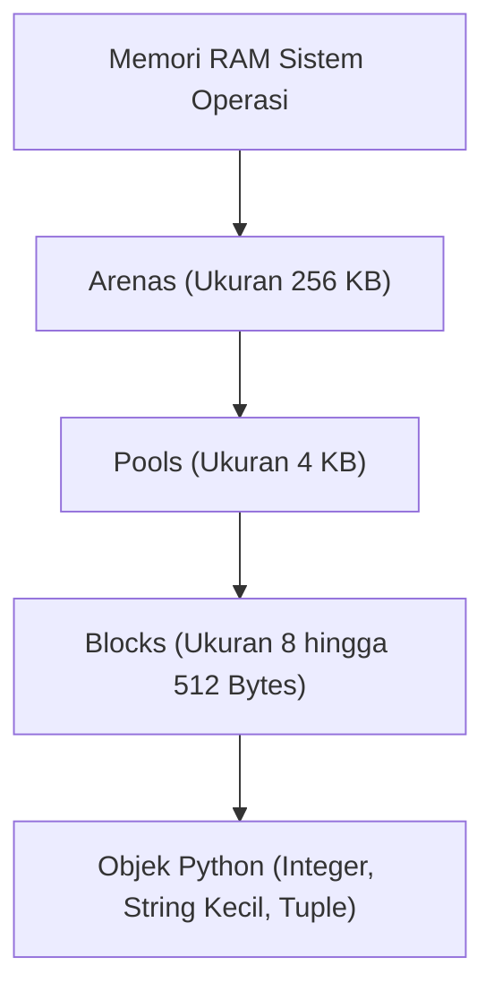

# 🐍 Python - Modul 09: Memory Architecture, Reference Counting & Cyclic GC

Memahami bagaimana CPython mengelola memori di balik layar adalah pembeda utama antara developer yang sering kebingungan menghadapi lonjakan RAM (*memory bloat*) dengan engineer yang mampu mendesain sistem stabil jangka panjang.

---

## 1. Hierarki Alokasi Memori CPython (PyMalloc)

Untuk menghindari *overhead* alokasi sistem operasi (`malloc`) yang lambat untuk jutaan objek kecil, CPython mengimplementasikan alokator memori khusus bernama **PyMalloc**:



- **Objek Kecil ($\le 512\text{ bytes}$)**: Dikelola langsung oleh PyMalloc di dalam *Pools* dan *Arenas* tanpa memanggil kernel OS.
- **Objek Besar ($> 512\text{ bytes}$)**: Diteruskan langsung ke alokator standar C sistem operasi.

---

## 2. Pilar 1: Reference Counting (Pembersihan Instan)

Setiap objek di CPython memiliki header internal `PyObject` yang mencatat field **`ob_refcnt`** (jumlah referensi aktif yang menunjuk ke objek tersebut):

1. Ketika objek dibuat atau ditugaskan ke variabel baru: `ob_refcnt += 1`.
2. Ketika variabel keluar scope, ditimpa, atau dihapus dengan `del`: `ob_refcnt -= 1`.
3. **Saat `ob_refcnt == 0`**: Memori objek tersebut **SEGERA DIHAPUS SEKETIKA ITU JUGA!**

```python
import sys

data = [1, 2, 3] # data dibuat (refcount = 1)
print("Ref count awal:", sys.getrefcount(data) - 1) # 1

alias = data     # alias menunjuk ke objek yang sama
print("Setelah alias:", sys.getrefcount(data) - 1)  # 2

del alias         # refcount berkurang
print("Setelah del:", sys.getrefcount(data) - 1)    # 1
```

> [!NOTE]
> `sys.getrefcount(obj)` selalu menghasilkan angka $1$ lebih tinggi dari aslinya, karena mempassing `data` ke dalam parameter fungsi `getrefcount` itu sendiri menambah referensi sementara selama pemanggilan!

---

## 3. Pilar 2: Cyclic Garbage Collector (Mengatasi Circular Reference)

Reference Counting memiliki satu kelemahan fatal: **Referensi Melingkar (*Circular Reference*)**:

```python
class Node:
    def __init__(self, nama):
        self.nama = nama
        self.tetangga = None

node_a = Node("A")
node_b = Node("B")

# Terjadi Siklus Melingkar:
node_a.tetangga = node_b
node_b.tetangga = node_a

# Kita hapus variabel lokalnya:
del node_a
del node_b
```

Meskipun variabel `node_a` dan `node_b` sudah dihapus dari scope kita, kedua objek tersebut **TIDAK BISA DIBERSIHKAN OLEH REFERENCE COUNTING** karena keduanya saling mereferensikan satu sama lain (`refcount` masing-masing masih bernilai 1)!

### Solusi CPython: Generational Cyclic GC
CPython menjalankan algoritma pendeteksi siklus yang membagi objek menjadi **3 Generasi**:
- **Generasi 0 (Gen 0)**: Objek-objek baru yang baru saja dialokasikan. Sering diperiksa.
- **Generasi 1 (Gen 1)**: Objek yang bertahan dari siklus GC generasi 0.
- **Generasi 2 (Gen 2)**: Objek yang hidup lama (seperti variabel global modul). Jarang diperiksa.

```python
import gc

# Memeriksa ambang batas alokasi (Threshold):
print("GC Thresholds:", gc.get_threshold()) # (700, 10, 10)

# Memaksa Garbage Collector membersihkan siklus melingkar sekarang:
unreachable_count = gc.collect()
print(f"Objek siklus melingkar yang dibersihkan: {unreachable_count}")
```

---

## 4. `weakref`: Menunjuk Objek Tanpa Mengunci Memori

Jika kamu ingin membuat sistem Caching tanpa memblokir Garbage Collector untuk membebaskan objek:

```python
import weakref

class GambarBerat:
    def __init__(self, nama):
        self.nama = nama

img = GambarBerat("banner.png")

# Buat weak reference (TIDAK MENAIKKAN ob_refcnt!):
ref_lemah = weakref.ref(img)

print("Akses objek:", ref_lemah().nama) # banner.png

del img # Objek img LANGSUNG DIBEBASKAN DARI RAM!

print("Akses setelah del:", ref_lemah()) # None! Otomatis bernilai None
```

---

## 5. Melacak Kebocoran Memori Produksi: `tracemalloc`

Gunakan modul standar `tracemalloc` untuk melacak baris kode mana yang paling boros mengalokasikan RAM:

```python
import tracemalloc

# 1. Mulai pelacakan
tracemalloc.start()

# 2. Jalankan logika kode aplikasi
cache_bocor = [f"Data raksasa nomor {i}" * 50 for i in range(100_000)]

# 3. Ambil snapshot memori
snapshot = tracemalloc.take_snapshot()
top_stats = snapshot.statistics("lineno")

print("🔥 TOP 3 Baris Paling Boros Alokasi Memori:")
for stat in top_stats[:3]:
    print(stat)
```
