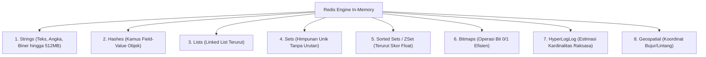

# 🔴 Redis - Modul 01: Struktur Data Lengkap & Perintah Inti

Redis (*Remote Dictionary Server*) adalah penyimpanan struktur data dalam memori (*In-Memory Data Structure Store*) yang digunakan sebagai **Database, Cache, Streaming Engine, dan Message Broker**. Semua data disimpan di RAM, menghasilkan latensi operasi sub-milidetik ($< 1\text{ ms}$).

---

## 1. Delapan Struktur Data Inti Redis

Banyak developer mengira Redis hanyalah tempat simpan teks key-value sederhana. Kenyataannya, Redis memiliki 8 struktur data canggih:



---

## 2. Strings & Hashes

### A. Strings (Tipe Paling Fleksibel)
Bisa berupa teks JSON, gambar biner, atau integer yang bisa di-increment atomik:

```bash
# Simpan data dengan masa kedaluwarsa 60 detik (EX):
SET user:101:session "token_abc123" EX 60

# Ambil data:
GET user:101:session

# Atomik Counter (Cocok untuk hit-counter / rate limiting):
SET counter:pageviews 100
INCR counter:pageviews        # 101 (O(1))
INCRBY counter:pageviews 5    # 106 (O(1))
DECR counter:pageviews        # 105 (O(1))
```

### B. Hashes (Representasi Objek)
Menyimpan objek pengguna tanpa perlu men-serialize/deserialize seluruh JSON:

```bash
# Simpan field objek:
HSET user:101 nama "Eka" email "eka@dev.cloud" login_count 1

# Ambil satu field (O(1)):
HGET user:101 nama

# Ambil semua field dan value (O(N)):
HGETALL user:101

# Naikkan counter field integer di dalam hash secara atomik:
HINCRBY user:101 login_count 1 # 2
```

---

## 3. Lists & Sets

### A. Lists (Two-Way Linked List)
Sangat efisien untuk antrean pesan FIFO (*First-In First-Out*) atau LIFO:

```bash
# Push ke antrean:
LPUSH antrean:email "job_1" "job_2" # [job_2, job_1]
RPUSH antrean:email "job_3"         # [job_2, job_1, job_3]

# Pop elemen (Blocking Pop menunggu hingga 5 detik jika antrean kosong):
BRPOP antrean:email 5

# Ambil 10 data teratas:
LRANGE antrean:email 0 9
```

### B. Sets (Himpunan Unik & Operasi Matematika)
Menjamin nilai unik otomatis (*deduplication*) dan mendukung operasi himpunan instan:

```bash
# Tambahkan anggota:
SADD tag:post:1 "golang" "redis" "k8s"
SADD tag:post:2 "golang" "docker" "k8s"

# Cek apakah anggota ada di dalam set (O(1)):
SISMEMBER tag:post:1 "redis" # 1 (True)

# Operasi Irisan Matematika (Intersection):
SINTER tag:post:1 tag:post:2 # Hasil: ["golang", "k8s"]

# Operasi Gabungan (Union):
SUNION tag:post:1 tag:post:2 # Hasil: ["golang", "redis", "k8s", "docker"]
```

---

## 4. Sorted Sets (ZSet): Leaderboard Real-Time

Setiap elemen memiliki nilai skor angka desimal (*floating-point score*) dan otomatis diurutkan di memori secara konstan:

```bash
# Tambah pemain dengan skor poin:
ZADD leaderboard 1500 "Eka"
ZADD leaderboard 2100 "Budi"
ZADD leaderboard 1850 "Siti"

# Ambil 3 pemain skor tertinggi (Rank 1 s.d. 3):
ZREVRANGE leaderboard 0 2 WITHSCORES
# 1) "Budi"  -> 2100
# 2) "Siti"  -> 1850
# 3) "Eka"   -> 1500

# Cari peringkat spesifik pemain (0-based rank):
ZREVRANK leaderboard "Eka" # 2 (Artinya juara ke-3)
```

---

## 5. HyperLogLog & Bitmaps (Hemat RAM Luar Biasa)

- **Bitmaps**: Menghitung absensi 100 juta pengguna harian hanya memakan **$12\text{ MB}$ RAM**!
  ```bash
  SETBIT user:active:2026-11-20 101 1 # User ID 101 aktif hari ini
  BITCOUNT user:active:2026-11-20    # Hitung total user aktif
  ```
- **HyperLogLog**: Menghitung estimasi jumlah pengunjung unik (*Unique Visitors*) hingga milyaran user dengan **RAM konstan hanya 12 KB** dan batas toleransi kesalahan (*error rate*) standar hanya $0.81\%$:
  ```bash
  PFADD visitors:homepage "ip_1" "ip_2" "ip_3"
  PFCOUNT visitors:homepage # Mengembalikan perkiraan jumlah unik
  ```
