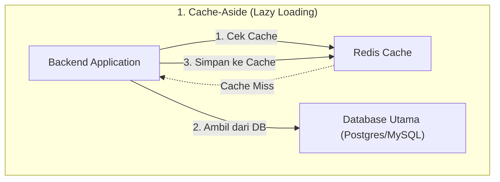
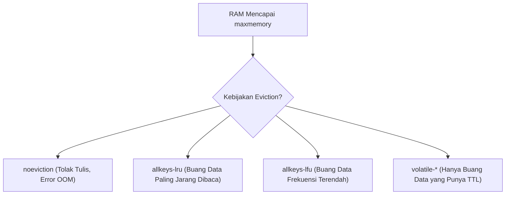

# 🔴 Redis - Modul 02: Pola Caching, 8 Kebijakan Eviction & Penjinak Stampede

Caching yang dirancang asal-asalan seringkali menjadi penyebab utama robohnya database utama saat traffic melonjak. Memahami pola caching yang tepat dan mekanisme **Eviction Policy** saat RAM penuh adalah syarat wajib insinyur backend.

---

## 1. Tiga Pola Caching Standar Industri



| Pola Caching | Alur Kerja | Kelebihan & Kekurangan |
|---|---|---|
| **Cache-Aside (Paling Populer)** | Aplikasi mencari data di Redis. Jika tidak ada (*Cache Miss*), ambil dari Postgres, lalu tulis ke Redis. | ✅ Hemat RAM (hanya data yang diminta yang disimpan).<br>❌ Data awal mengalami latency saat cold start. |
| **Write-Through** | Aplikasi menulis data ke Redis, dan Redis/Handler langsung menulis ke Postgres secara sinkron sebelum return. | ✅ Data cache dijamin selalu segar.<br>❌ Latency operasi penulisan lebih tinggi. |
| **Write-Back (Write-Behind)** | Aplikasi menulis ke Redis seketika (sub-1ms). Redis mengantrekan perubahan ke database utama secara asinkron di background. | ✅ Throughput penulisan sangat tinggi.<br>⚠️ Ada risiko kehilangan data jika Redis crash sebelum data sempat di-flush ke DB. |

---

## 2. Tiga Bencana Besar Cache & Solusi Solutifnya

### A. Cache Avalanche (Longsor Salju)
- **Gejala**: Ribuan key cache disetel dengan durasi TTL yang sama persis (misal: 1 jam). Tepat pada detik ke-3600, seluruh key kedaluwarsa serentak, menyebabkan jutaan request langsung menghujam database utama seketika.
- **Solusi**: **Tambahkan Random Jitter (Acakan Waktu)** pada TTL:
  ```python
  import random
  # TTL dasar 3600 detik + acakan antara 0 sampai 300 detik:
  ttl_aman = 3600 + random.randint(0, 300)
  redis.set("user:profile", data, ex=ttl_aman)
  ```

### B. Cache Penetration (Penetrasi Tembus)
- **Gejala**: Hacker sengaja me-request jutaan ID yang **tidak pernah ada di database** (misal: ID acak `user:-999`). Redis selalu mengalami *Cache Miss*, sehingga setiap request memaksa database melakukan query disk yang sia-sia.
- **Solusi**:
  1. Simpan nilai kosong/null sementara di Redis dengan TTL pendek (misal: 60 detik): `SET user:-999 "EMPTY" EX 60`.
  2. Gunakan **Bloom Filter** di depan Redis untuk menolak ID yang terbukti tidak pernah ada.

### C. Cache Stampede (Dog-Piling / Thundering Herd)
- **Gejala**: Satu key yang sangat populer (misal: berita viral atau beranda flash-sale) kedaluwarsa. Dalam waktu 0.1 detik, 50.000 request bersamaan menyadari key tersebut kosong dan serentak mengeksekusi query database berat yang sama persis!
- **Solusi**: Gunakan **Distributed Mutex Lock** atau algoritma probabilistik pembaruan dini (*XFetch algorithm*):
  Hanya ada 1 worker yang diizinkan mengambil lock untuk me-refresh database, sementara request lain disajikan cache versi sebelumnya atau menunggu 50ms.

---

## 3. Delapan Kebijakan Pembuangan Memori (`maxmemory-policy`)

Ketika memori RAM Redis mencapai batas kuota `maxmemory` di konfigurasi:



| Kebijakan | Perilaku Saat RAM Penuh | Kapan Digunakan? |
|---|---|---|
| **`noeviction`** | Menolak semua perintah penulisan baru (`OOM command not allowed`). | Redis digunakan sebagai Database persisten primer, bukan murni cache. |
| **`allkeys-lru` (Rekomendasi Utama Caching)** | **Least Recently Used**: Membuang data yang paling lama tidak pernah diakses dari seluruh semesta key. | **Paling ideal untuk Web Cache umum**. Data populer tetap aman di RAM. |
| **`allkeys-lfu`** | **Least Frequently Used**: Membuang data yang frekuensi pemanggilannya paling sedikit. | Bagus jika ada data historis lama namun sangat sering dibaca. |
| **`volatile-lru`** | Membuang data paling lama tidak diakses **HANYA dari key yang memiliki masa TTL**. | Bagus jika ada key permanen yang dilarang dihapus di instance yang sama. |
| **`volatile-ttl`** | Membuang data yang memiliki **sisa waktu TTL terpendek** terlebih dahulu. | Data yang hampir kedaluwarsa dibuang lebih awal. |

### Mengonfigurasi Eviction Policy:
```ini
# redis.conf
maxmemory 4gb
maxmemory-policy allkeys-lru
```
Atau secara langsung via perintah runtime tanpa restart:
```bash
CONFIG SET maxmemory-policy allkeys-lru
```
