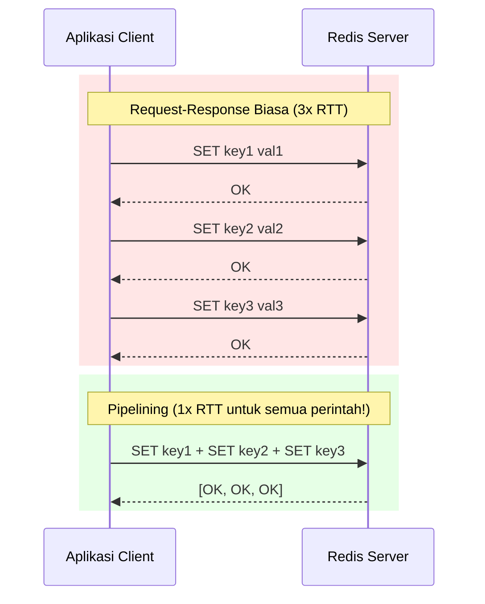
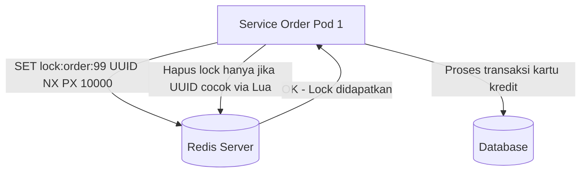

# 🔴 Redis - Modul 04: Transaksi, Pipelining & Scripting Lua

Meskipun Redis beroperasi secara *single-threaded* untuk eksekusi perintah (sehingga setiap perintah individu bersifat atomik), aplikasi nyata seringkali membutuhkan eksekusi sekumpulan perintah secara bersamaan tanpa interupsi atau pengiriman batch untuk memotong latensi jaringan.

---

## 1. Pipelining: Menghancurkan Latensi RTT Jaringan

Dalam pola request-response biasa, setiap perintah menunggu bolak-balik jaringan (*Round Trip Time* / RTT). Jika RTT jaringan adalah 1 ms, kita hanya bisa mengeksekusi maksimal 1000 perintah/detik per koneksi client.

**Pipelining** memungkinkan client mengirim puluhan ribu perintah sekaligus tanpa menunggu respons masing-masing perintah terlebih dahulu, lalu menerima semua balasannya sekaligus.



### Contoh Pipelining di Node.js (ioredis)
```javascript
import Redis from "ioredis";
const redis = new Redis();

// Pipelining 10.000 data dalam 1 Round Trip:
const pipeline = redis.pipeline();

for (let i = 0; i < 10000; i++) {
  pipeline.set(`sensor:${i}`, Math.random());
}

// Kirim batch sekaligus:
const results = await pipeline.exec();
console.log(`Selesai menulis 10.000 data, hasil:`, results.length);
```

> [!NOTE]
> Pipelining mengoptimalkan **throughput jaringan**, tetapi perintah di server tetap bisa diselingi oleh perintah dari client lain. Untuk atomisitas tanpa interupsi, gunakan Transaksi atau Lua.

---

## 2. Transaksi Dasar: MULTI, EXEC, DISCARD & WATCH

Transaksi di Redis mengantrekan (*queue*) serangkaian perintah agar dieksekusi secara berurutan dan terisolasi tanpa interupsi dari client lain.

### A. Alur Dasar MULTI & EXEC
```bash
# 1. Mulai transaksi
MULTI

# 2. Antrekan perintah (Redis membalas dengan QUEUED)
INCR transfer_counter
DECR saldo:akun_a:1000
INCRBY saldo:akun_b 1000

# 3. Batalkan jika ragu:
# DISCARD

# 4. Eksekusi semua perintah sekaligus:
EXEC
```

### B. Optimistic Locking dengan WATCH
Bagaimana jika nilai yang ingin kita modifikasi berubah di tengah jalan oleh client lain? Gunakan `WATCH` (mekanisme *check-and-set*):

```bash
# Pantau saldo sebelum mengecek nilainya
WATCH saldo:user:123

# Ambil nilainya di aplikasi:
# GET saldo:user:123 -> misal 500

# Mulai blok transaksi jika saldo cukup:
MULTI
DECRBY saldo:user:123 200
INCRBY saldo:merchant 200
EXEC
```
> [!IMPORTANT]
> Jika ada client lain yang memodifikasi `saldo:user:123` sebelum `EXEC` dijalankan, perintah `EXEC` akan gagal dan mengembalikan `(nil)`. Aplikasi Anda cukup mengulang kembali (*retry loop*).

---

## 3. Lua Scripting: Atomisitas Mutlak & Logika Server-Side

Kelemahan `MULTI/EXEC` adalah Anda tidak bisa membaca nilai di tengah transaksi untuk mengambil keputusan percabangan (`if-else`). Solusi paling sakti di Redis adalah **Lua Scripting**.

Redis mengeksekusi script Lua secara **100% atomik**. Selama script berjalan, tidak ada perintah lain yang bisa menyela!

### Sintaks EVAL
```bash
EVAL "script_lua" jumlah_key key1 key2 ... arg1 arg2 ...
```

### Contoh Kasus: Rate Limiter Token Bucket dengan Lua
Skrip atomik: jika key belum ada, buat dengan limit 5; jika sudah ada dan > 0, kurangi 1; jika 0, tolak!

```bash
EVAL "
  local current = redis.call('GET', KEYS[1])
  if current and tonumber(current) <= 0 then
    return 0 -- Limit habis (Tolak)
  else
    if not current then
      redis.call('SET', KEYS[1], ARGV[1], 'EX', ARGV[2])
    end
    redis.call('DECR', KEYS[1])
    return 1 -- Berhasil (Izinkan)
  end
" 1 rate:user:101 5 60
```
- `KEYS[1]`: `rate:user:101`
- `ARGV[1]`: Kuota (5)
- `ARGV[2]`: Expire detik (60)

### Optimasi dengan SCRIPT LOAD & EVALSHA
Mengirim teks script panjang berulang kali menghabiskan bandwidth jaringan. Simpan script sekali, lalu jalankan via SHA1 hash-nya:

```bash
# Simpan script ke memori Redis:
SCRIPT LOAD "return redis.call('GET', KEYS[1])"
# Output: "64724891147a75091d1e451b7c468ba458cf68f7"

# Jalankan kapan saja dengan SHA1:
EVALSHA "64724891147a75091d1e451b7c468ba458cf68f7" 1 user:101
```

---

## 4. Distributed Locking: Mengamankan Critical Section

Ketika Anda memiliki 10 instance microservices di Kubernetes yang bersaing memproses pesanan yang sama, Anda butuh **Distributed Lock**.



### A. Cara Mengunci yang Benar (Single Instance)
Gunakan kombinasi `SET` dengan parameter `NX` (Not Exists) dan `PX` (Milliseconds Expiration), serta nilai unik (UUID):

```bash
# Kunci order 99 dengan TTL 10.000ms (10 detik) dan UUID pemilik:
SET lock:order:99 "d9f8e43e-a12b-42f7" NX PX 10000
```
- `NX`: Mencegah pod lain merebut lock jika lock masih aktif.
- `PX 10000`: Mencegah *deadlock* jika aplikasi crash mendadak sebelum sempat merilis lock.
- UUID unik: Mencegah pod A menghapus lock milik pod B yang kebetulan baru diambil setelah lock pod A kedaluwarsa.

### B. Cara Melepas Lock yang Aman (Lua Release)
Lock **TIDAK BOLEH** dilepas langsung dengan `DEL lock:order:99`. Harus dicek apakah pemilik UUID-nya masih kita:

```lua
-- Lua script pelepasan lock yang aman:
if redis.call("GET", KEYS[1]) == ARGV[1] then
    return redis.call("DEL", KEYS[1])
else
    return 0
end
```

### C. Redlock Algorithm
Untuk cluster multi-node Redis independen yang terpisah secara geografis atau zone demi menghindari Single Point of Failure (SPOF), gunakan algoritma **Redlock** (akuisisi kuorum minimal $N/2 + 1$ node dalam batas waktu validitas lock).
