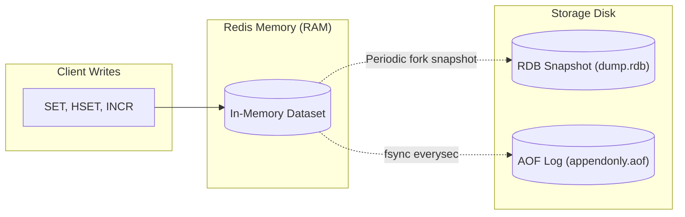
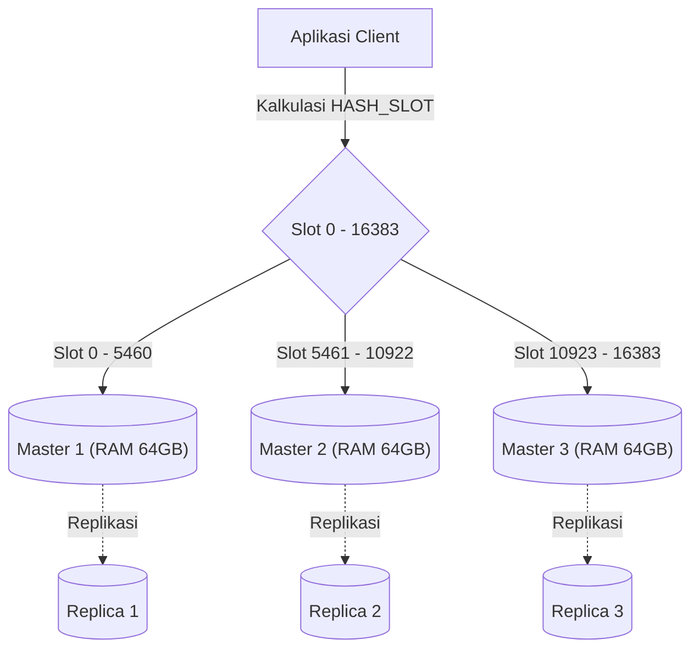

# 🔴 Redis - Modul 05: Persistensi, Sentinel & Clustering

Secara default, Redis menyimpan seluruh dataset di dalam memori RAM utama. Namun, bagaimana jika server mati mendadak, listrik padam, atau container di-restart? Di modul ini, kita membedah mekanisme persistensi ke disk dan cara membangun cluster skala enterprise dengan ketersediaan tinggi (*High Availability*).

---

## 1. Persistensi: RDB vs AOF vs Hybrid

Redis menyediakan dua mekanisme utama untuk menulis data ke hard disk (SSD/NVMe):

| Fitur | RDB (*Redis Database File*) | AOF (*Append Only File*) |
|---|---|---|
| **Mekanisme** | Snapshot biner terkompresi dari seluruh RAM pada interval waktu tertentu (`dump.rdb`). | Log penulisan teks yang merekam setiap perintah modifikasi (`appendonly.aof`). |
| **Kecepatan Restart** | Sangat cepat (langsung load binary dump ke RAM). | Lebih lambat (harus memutar ulang seluruh log perintah dari awal). |
| **Risiko Data Loss** | Lebih tinggi (data sejak snapshot terakhir akan hilang jika crash). | Sangat rendah (maksimal kehilangan 1 detik data jika memakai `fsync everysec`). |
| **Ukuran File** | Sangat ringkas dan terkompresi. | Lebih besar (namun bisa di-rewrite dengan `BGREWRITEAOF`). |
| **Beban CPU/Disk** | Fork child process sewaktu snapshot (bisa spike memori via CoW). | I/O disk stabil dan terus-menerus. |



### Rekomendasi Production: Hybrid Persistence (RDB + AOF)
Mulai Redis 4.0+, aktifkan **AOF with RDB-preamble**. Ketika AOF di-rewrite, data lama ditulis sebagai snapshot biner RDB di awal file, sedangkan instruksi baru ditulis sebagai teks AOF di bagian akhir. Ini memberikan kecepatan startup RDB dan keamanan durabilitas AOF!

Konfigurasi di `redis.conf`:
```properties
# Aktifkan AOF
appendonly yes
appendfsync everysec

# Aktifkan Hybrid Persistence
aof-use-rdb-preamble yes

# Snapshot RDB berkala sebagai cadangan
save 900 1      # jika ada 1 perubahan dalam 15 menit
save 300 10     # jika ada 10 perubahan dalam 5 menit
save 60 10000   # jika ada 10000 perubahan dalam 1 menit
```

---

## 2. Redis Sentinel: Otomasi High Availability (Failover)

Redis Sentinel adalah sistem pengawas terdistribusi yang memantau node **Master** dan beberapa **Replica**. Jika Master mati, Sentinel akan mempromosikan salah satu Replica menjadi Master baru secara otomatis tanpa downtime manual.

```mermaid
flowchart TD
    subgraph SentinelQuorum["Sentinel Quorum (3 Node)"]
        S1[Sentinel 1]
        S2[Sentinel 2]
        S3[Sentinel 3]
    end

    subgraph RedisNodes["Redis Data Nodes"]
        Master[("🔴 Redis Master (Read/Write)")]
        Replica1[("🟢 Redis Replica 1 (Read-Only)")]
        Replica2[("🟢 Redis Replica 2 (Read-Only)")]
    end

    S1 & S2 & S3 -. Heartbeat PING & Monitoring .-> Master
    Master -->|Asynchronous Replication| Replica1
    Master -->|Asynchronous Replication| Replica2

    Note over S1, S3: Jika Master down 30 detik,<br/>Sentinels voting & promote Replica1 jadi Master baru!
```

### Fitur Utama Sentinel:
1. **Monitoring**: Memeriksa kesehatan Master dan Replica terus-menerus via ping.
2. **Notification**: Memberitahu sysadmin atau webhook saat terjadi anomali node.
3. **Automatic Failover**: Jika Master mengalami status `ODOWN` (*Objectively Down* disetujui kuorum Sentinel), Replica dipromosikan dan Master lama yang hidup kembali dijadikan Replica.
4. **Configuration Provider**: Aplikasi client bertanya ke Sentinel: *"Siapa Master yang aktif sekarang?"*

---

## 3. Redis Cluster: Sharding Horizontal & 16.384 Hash Slots

Jika dataset Anda melebihi kapasitas RAM satu mesin (misal > 64GB) atau Anda butuh write throughput di atas 200.000 QPS, Redis Sentinel tidak cukup. Anda membutuhkan **Redis Cluster**.

Redis Cluster membagi data ke banyak node master secara otomatis menggunakan konsep **Hash Slots**.



### Rumus Hash Slot:
Redis membagi ruang kunci menjadi tepat **16.384 slot**. Setiap key dihitung lokasinya dengan algoritma CRC16:
$$\text{HASH\_SLOT} = \text{CRC16}(\text{key}) \pmod{16384}$$

### Hash Tags `{...}`: Memaksa Data Berada di Node yang Sama
Operasi multi-key (seperti transaksi `MULTI/EXEC` atau `MGET`) di Redis Cluster mensyaratkan semua key berada pada hash slot yang sama. Gunakan kurung kurawal `{}` untuk mengunci hashing:

```bash
# Key berikut akan menghasilkan hash slot BERBEDA (bisa beda node!):
SET user:100:profile "..."
SET user:100:orders "..."

# DENGAN Hash Tag: Slot hanya dihitung dari string di dalam {}:
SET {user:100}:profile "..."
SET {user:100}:orders "..."
# Sekarang kedua key PASTI berada di slot dan node fisik yang sama!
```

### Respon MOVED vs ASK
- **`MOVED <slot> <ip>:<port>`**: Shard sudah berpindah secara permanen ke node baru. Client cluster-aware akan memperbarui cache routing mereka.
- **`ASK <slot> <ip>:<port>`**: Slot sedang dalam proses migrasi (*resharding*). Client hanya mengarahkan satu query tersebut ke node tujuan sementara waktu.
