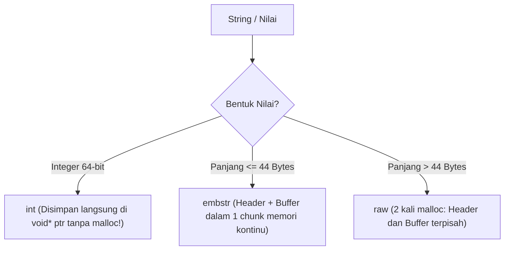
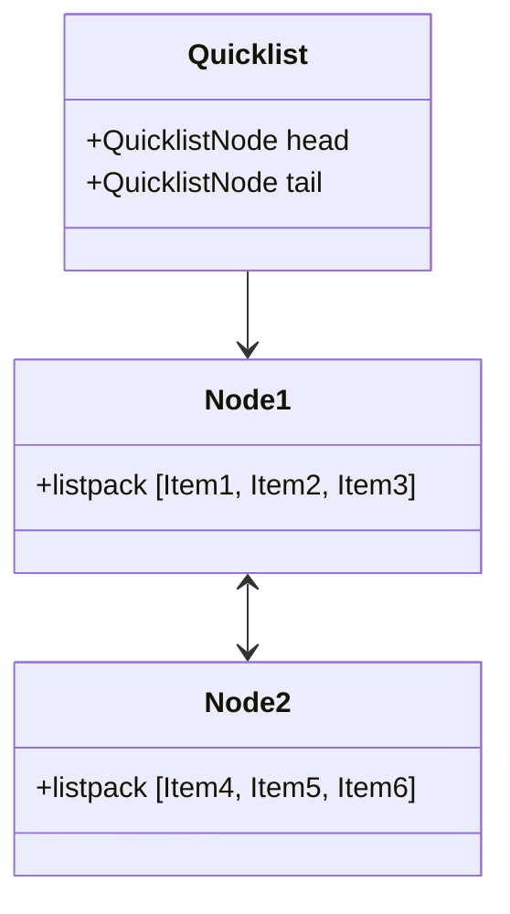

# 🔴 Redis - Modul 05: Memory Internals: embstr, Quicklist, Intset & Skiplist

Kecepatan luar biasa dan efisiensi memori Redis bukan kebetulan: Salvatore Sanfilippo (antirez) merancang representasi memori C di dalam Redis hingga ke tingkat bit individual untuk menghindari fragmentasi RAM.

---

## 1. Anatomi Header `redisObject`

Setiap entri data yang disimpan di Redis dibungkus oleh sebuah struct C bernama `redisObject` (berukuran 16 byte):

```c
struct redisObject {
    unsigned type:4;       // Tipe data: string, hash, list, set, zset (4 bits)
    unsigned encoding:4;   // Format pengkodean memori internal (4 bits)
    unsigned lru:24;       // Timestamp LRU untuk kebijakan eviction (24 bits)
    int refcount;          // Reference counter (4 bytes)
    void *ptr;             // Pointer ke nilai data aktual (8 bytes)
};
```

Untuk menginspeksi jenis encoding internal yang digunakan oleh suatu key:
```bash
OBJECT ENCODING user:101
```

---

## 2. String Encoding: `int` vs `embstr` vs `raw`



- **`embstr` ($\le 44\text{ bytes}$)**:
  - Alokator `jemalloc` mengalokasikan memori dalam kelipatan 64 byte. Karena `redisObject` berukuran 16 byte dan header string `sdshdr` memakan beberapa byte, tersisa tepat 44 byte.
  - Redis mengalokasikan header dan string dalam **satu blok memori fisik yang bersambung (*contiguous chunk*)**.
  - **Efek Performa**: Mengurangi alokasi memori dari 2x menjadi 1x, dan memaksimalkan *CPU L1/L2 Cache hit*!

---

## 3. List: `quicklist` (Linked List of Compressed Listpacks)

Jika Redis hanya menggunakan *Linked List* biasa (pointer dua arah `prev` dan `next`), setiap node akan membuang 16 byte pointer hanya untuk menyimpan 2 byte data (overhead 800% pemborosan memori!).

Sebaliknya, jika menggunakan *Array* murni, penambahan elemen di tengah akan lambat (*reallocation cost*).

### Solusi Jenius Redis: `quicklist`
`quicklist` adalah **Linked List dua arah yang setiap node-nya berisi blok array kompak (*listpack / ziplist*)**:


Hasilnya: Sangat hemat pointer, bebas fragmentasi memori, dan operasi `LPUSH`/`RPUSH` tetap berjalan dalam kompleksitas $O(1)$!

---

## 4. Sets: `intset` (Kompresi Array Integer Otomatis)

Jika sebuah Set hanya berisi angka integer dan jumlahnya sedikit (`< 512`), Redis **tidak menggunakan Hash Table**. Redis menggunakan **`intset`** (array integer terurut kompak):

- Mulai dengan encoding **16-bit integers** (`int16_t`).
- Jika ada angka yang lebih besar dari 32.767: Redis otomatis meng-upgrade seluruh array menjadi **32-bit integers** (`int32_t`).
- Jika melebihi 2 miliar: Di-upgrade menjadi **64-bit integers** (`int64_t`).

Jika kamu memasukkan 1 elemen string huruf alfabet, `intset` seketika bertransformasi menjadi **`hashtable`**.

---

## 5. Mengapa Sorted Sets (ZSet) Menggunakan `skiplist` Alih-Alih Red-Black Tree?

Banyak developer bertanya: *"Mengapa ZSet menggunakan Skip List, bukan Red-Black Tree atau AVL Tree seperti database relasional?"*

Salvatore Sanfilippo memberikan 3 alasan teknis mutlak:

```mermaid
flowchart LR
    subgraph Level3["Level 3 (Express Lane)"]
        L3_1["1"] ----------> L3_8["8"]
    end
    subgraph Level2["Level 2"]
        L2_1["1"] ----> L2_4["4"] ----> L2_8["8"]
    end
    subgraph Level1["Level 1 (Semua Elemen Terurut)"]
        L1_1["1"] -> L1_2["2"] -> L1_3["3"] -> L1_4["4"] -> L1_8["8"]
    end
```

1. **Query Rentang (*Range Queries*) Sangat Cepat**:
   Untuk perintah `ZRANGEBYSCORE min max`, Skip List cukup mencari titik awal via express lane, lalu **cukup menelusuri pointer linked list di level terbawah secara horizontal**. Pada Red-Black Tree, query rentang memerlukan penelusuran pohon *in-order traversal* yang rumit dan lambat.
2. **Tanpa Rebalancing Mutasi Berat**:
   Menambah atau menghapus elemen di Red-Black Tree memerlukan operasi rotasi cabang pohon (*tree rotations*) yang memicu penulisan memori beruntun. Di Skip List, penentuan tinggi level node menggunakan algoritma probabilistik koin lempar (*random probability*), tanpa perlu rotasi global!
3. **Lebih Hemat Memori & Ramah CPU Cache**:
   Rata-rata pointer per node pada Skip List hanya sekitar $1.33$ pointer, jauh lebih hemat dibanding 2 pointer anak + 1 pointer parent + bit warna pada Red-Black Tree.
