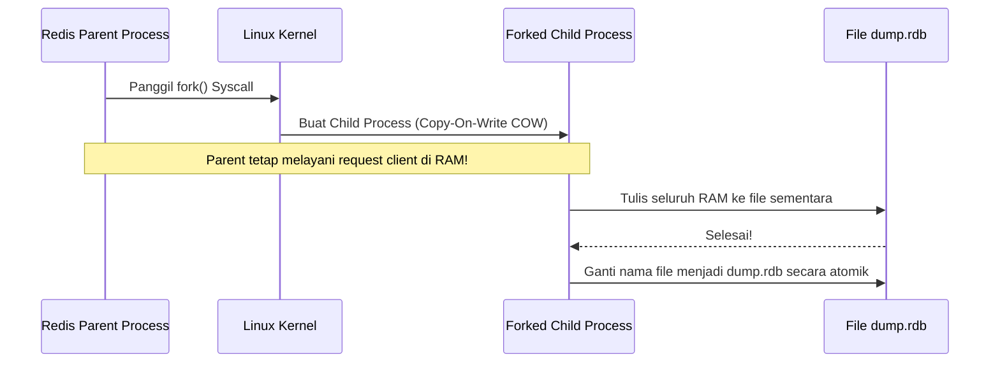

# 🔴 Redis - Modul 06: Persistensi Data: RDB, AOF & Hybrid Persistence

Meskipun Redis adalah penyimpanan *in-memory*, data tidak akan hilang saat server mati atau reboot berkat **dua mekanisme persistensi disk: RDB dan AOF**, serta mode modern **Hybrid Persistence**.

---

## 1. RDB (Redis Database Snapshot)

RDB mengambil foto (*snapshot*) seluruh kondisi memori RAM pada satu titik waktu tertentu dan menyimpannya sebagai file biner kompak (`dump.rdb`).



### Kehebatan Linux Copy-On-Write (COW):
Saat `BGSAVE` dipanggil, Redis membuat *child process* via `fork()`. Karena fitur Copy-On-Write OS, child process **tidak menggandakan penggunaan RAM**. Child membaca memori yang sama persis dengan parent. Hanya halaman memori yang dimodifikasi oleh client baru yang akan disalin secara terpisah.

- ✅ **Kelebihan RDB**: File sangat ramping, sangat ideal untuk backup harian di AWS S3, dan proses recovery saat startup database sangat cepat.
- ❌ **Kekurangan RDB**: Jika server mati mendadak, data transaksi yang terjadi sejak snapshot terakhir diambil (misal: 5 menit terakhir) **akan hilang permanen**.

---

## 2. AOF (Append-Only File)

AOF mencatat setiap perintah penulisan (`SET`, `HSET`, `DEL`) ke dalam file log teks terformat secara berurutan:

```bash
# Isi file appendonly.aof dalam format biner RESP:
*3
$3
SET
$4
nama
$3
Eka
```

### Tiga Opsi Frekuensi Sinkronisasi Disk (`appendfsync`):
| Mode | Kecepatan | Risiko Kehilangan Data | Penjelasan |
|---|:---:|:---:|---|
| **`appendfsync always`** | Sangat Lambat | **Nol** | Memanggil `fsync()` ke disk setiap selesai 1 perintah. Membatasi performa hingga $\sim$ 1.000 ops/sec pada SSD. |
| **`appendfsync everysec` (Standar Emas Produksi)** | **Sangat Cepat** | **Maksimal 1 Detik** | Menulis buffer di RAM, lalu thread background memanggil `fsync()` tepat **satu kali per detik**. Pilihan terbaik untuk 99% aplikasi! |
| **`appendfsync no`** | Maksimal | Tergantung OS (Bisa 30 detik) | Menyerahkan keputusan flush disk sepenuhnya ke kernel sistem operasi. |

---

## 3. AOF Rewrite: Mencegah File Log Membengkak

Jika sebuah counter di-increment 1 juta kali (`INCR counter`), file AOF akan berisi 1 juta baris teks. **AOF Rewrite (`BGREWRITEAOF`)** menganalisis state memori terkini dan mengganti 1 juta baris teks tersebut menjadi **1 baris perintah ringkas**: `SET counter 1000000`.

AOF rewrite berjalan di background tanpa memblokir pembacaan client.

---

## 4. Standar Emas Modern: Hybrid Persistence (Redis 4.0+)

Sebelum Redis 4.0, kamu harus memilih: ingin restart cepat (RDB) atau data aman tanpa hilang (AOF).

**Hybrid Persistence** menggabungkan keduanya ke dalam satu file `appendonly.aof`:
- **Bagian Awal File**: Berisi data snapshot biner **RDB** (Membuat proses boot / restart database super cepat).
- **Bagian Akhir File**: Berisi log delta mutasi **AOF** sejak snapshot terakhir dibuat (Memastikan nol data loss).

### Mengaktifkan Hybrid Persistence di `redis.conf`:
```ini
# Mengaktifkan AOF:
appendonly yes

# Sinkronisasi per detik:
appendfsync everysec

# Aktifkan Hybrid Persistence:
aof-use-rdb-preamble yes
```
Dengan konfigurasi ini, database kamu mendapatkan **kecepatan restart RDB** sekaligus **keamanan data AOF**!
