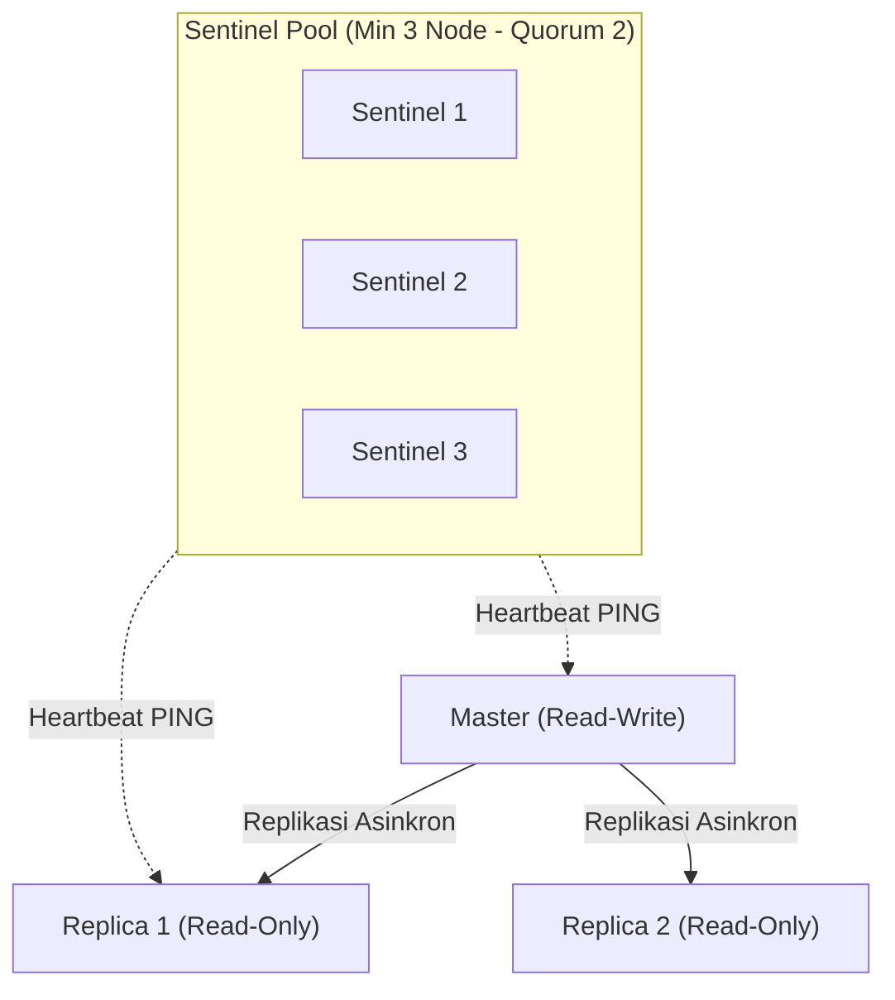
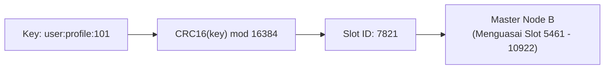

# 🔴 Redis - Modul 07: High Availability (Sentinel) & Sharding (Redis Cluster)

Satu node Redis tunggal (*standalone*) memiliki dua batasan fisik: **rentan single-point-of-failure jika server mati**, dan **dibatasi oleh kapasitas total RAM satu mesin fisik**. Untuk skala produksi, Redis menyediakan dua solusi arsitektur: **Redis Sentinel** untuk High Availability, dan **Redis Cluster** untuk Horizontal Sharding.

---

## 1. Redis Sentinel: Failover Otomatis Tanpa Downtime

Redis Sentinel adalah sistem pengawas terdistribusi yang memantau node Master dan Replica:



### Mekanisme Deteksi Kematian Master:
1. **SDOWN (Subjectively Down)**: Satu node Sentinel tidak menerima balasan `PONG` dari Master dalam batas waktu `down-after-milliseconds`.
2. **ODOWN (Objectively Down)**: Sentinel pertama meminta konfirmasi ke Sentinel lain. Jika jumlah persetujuan mencapai batas **Quorum** (misal: 2 dari 3 Sentinel setuju Master mati), status Master resmi dinyatakan **ODOWN**.
3. **Failover Otomatis**:
   - Para Sentinel memilih salah satu Sentinel sebagai *Leader*.
   - Leader mempromosikan Replica paling mutakhir menjadi **Master Baru**.
   - Node Replica lain dikonfigurasi ulang untuk mereplikasi dari Master baru.
   - Sentinel mempublikasikan alamat Master baru ke klien aplikasi via Pub/Sub.

---

## 2. Redis Cluster: Sharding Horizontal Milyaran Data

Jika data kamu melebihi 64GB RAM atau membutuhkan jutaan throughput per detik, satu mesin tidak lagi cukup. **Redis Cluster memecah data (*sharding*) melintasi banyak server master secara otomatis**.

### Konsep Inti: 16.384 Hash Slots
Redis Cluster **tidak menggunakan sharding berbasis rentang**. Redis Cluster membagi semesta data menjadi tepat **16.384 Hash Slots**:

$$\text{Slot} = \text{CRC16}(\text{key}) \pmod{16384}$$



- **Master Node A**: Menguasai Slot $0 - 5460$
- **Master Node B**: Menguasai Slot $5461 - 10922$
- **Master Node C**: Menguasai Slot $10923 - 16383$

Setiap Master memiliki minimal 1 Replica untuk backup failover otomatis.

---

## 3. Trik Sakti: Hash Tags `{...}` untuk Multi-Key Operations

Secara standar di Redis Cluster, perintah yang melibatkan banyak key sekaligus (seperti `MGET`, transaksi `MULTI/EXEC`, atau Lua Scripting) **DILARANG jika key-key tersebut berada di slot server yang berbeda** (`CROSSSLOT Keys in request don't hash to the same slot`).

### Solusi: Gunakan Hash Tags `{}`
Jika sebuah key mengandung kurung kurawal `{...}`, Redis **hanya akan menghitung hash CRC16 dari teks di dalam kurung kurawal tersebut**:

```bash
# Kedua key ini DIJAMIN mendarat di Slot Server dan Node fisik yang SAMA:
SET {user:101}:profil '{"nama": "Eka"}'
SET {user:101}:pesanan '[1001, 1002]'

# Sekarang operasi multi-key dan Lua Script aman dieksekusi 100%!:
MGET {user:101}:profil {user:101}:pesanan
```

---

## 4. Mekanisme Klien Redirection: `MOVED` vs `ASK`

Klien Redis cerdas (seperti Jedis, go-redis, ioredis) menyimpan *cache peta slot* di memorinya:

- **`MOVED <slot> <ip:port>`**:
  - Dikembalikan oleh Redis jika klien salah mengirim perintah ke node yang tidak memegang slot tersebut.
  - Klien otomatis memperbarui peta slot lokalnya dan meneruskan query ke alamat IP yang benar.
- **`ASK <slot> <ip:port>`**:
  - Terjadi saat proses **Resharding** (pemindahan slot data antar node yang sedang berlangsung).
  - Pengalihan bersifat sementara hanya untuk 1 request terkait.
