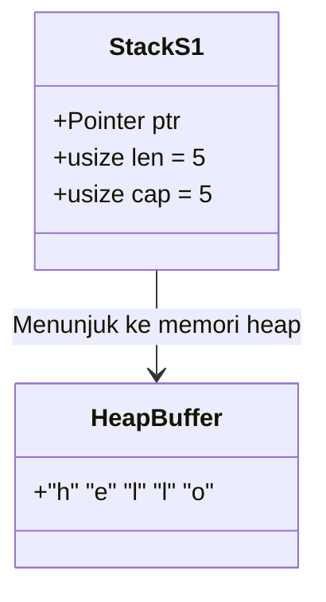

# 🦀 Rust - Modul 02: Ownership, Borrowing & Slices Deep Dive

Ownership adalah inovasi paling revolusioner di dunia rekayasa perangkat lunak modern. Fitur ini memungkinkan Rust menjamin keamanan memori (*memory safety*), mencegah kebocoran (*leak*), dan menghapus *data race* **sepenuhnya pada saat kompilasi tanpa perlu Garbage Collector**.

---

## 1. Tiga Aturan Emas Ownership

Di Rust, aturan ini ditegakkan tanpa kompromi oleh **Borrow Checker**:

1. **Setiap nilai di Rust memiliki satu pemilik (*Owner*)** berupa variabel.
2. **Hanya boleh ada SATU pemilik dalam satu waktu**.
3. **Ketika pemilik keluar dari scope (`}`), nilai tersebut otomatis dihapus dari memori** (method `drop` dipanggil seketika).

---

## 2. Move Semantics vs Copy Trait

### A. Tipe Data Stack Mengimplementasikan `Copy` Trait
Tipe data sederhana yang ukurannya diketahui saat kompilasi (`i32`, `f64`, `bool`, `char`, fixed array) disalin secara instan di Stack:

```rust
let a = 42;
let b = a; // Nilai disalin (Copy) secara otomatis
println!("a: {}, b: {}", a, b); // VALID: a dan b sama-sama hidup!
```

### B. Tipe Data Heap Mengalami `Move` Semantics
Tipe data dinamis di Heap seperti `String` terdiri dari 3 word di Stack: pointer buffer heap, `len`, dan `capacity`.



Ketika ditugaskan ke variabel baru, Rust **memindahkan kepemilikan (Move)** dan menganulir variabel lama:

```rust
let s1 = String::from("hello");
let s2 = s1; // KEPEMILIKAN BERPINDAH (MOVE) ke s2! s1 dianggap MATI.

// println!("{}", s1); // COMPILE ERROR: borrow of moved value: `s1`
println!("{}", s2);    // VALID!
```

> [!NOTE]
> **Mengapa Rust Memilih Move?** Jika Rust menyalin pointer tanpa memindahkan kepemilikan, maka saat `s1` dan `s2` keluar scope, keduanya akan mencoba membebaskan memori heap yang sama (*Double Free Vulnerability*). Dengan sistem Move, hanya `s2` yang akan membebaskan memori saat keluar scope.

Jika kamu sengaja ingin menyalin data heap secara menyeluruh (*deep copy*), panggil method `.clone()`:
```rust
let s2 = s1.clone(); // Mengalokasikan buffer heap baru yang terpisah
```

---

## 3. Borrowing: Meminjam Data via Referensi (`&`)

Daripada memindahkan kepemilikan bolak-balik, kita bisa **meminjam (*borrow*)** data menggunakan referensi:

### Dua Aturan Mutlak Peminjaman (Borrowing Rules):
1. Dalam satu waktu, kamu boleh memiliki:
   - **Banyak referensi Immutable (`&T`)** (Banyak pembaca aman), **ATAU**
   - **Tepat SATU referensi Mutable (`&mut T`)** (Hanya satu penulis eksklusif).
2. Referensi harus **selalu valid** (Dilarang ada *Dangling Reference*).

```rust
fn main() {
    let mut teks = String::from("Rust");

    // 1. Immutable Borrow: Boleh banyak sekaligus
    let r1 = &teks;
    let r2 = &teks;
    println!("Baca: {} dan {}", r1, r2);

    // 2. Mutable Borrow: Hanya boleh satu dan tidak boleh bersamaan dengan r1/r2
    let r3 = &mut teks;
    r3.push_str(" Lang");
    println!("Ubah: {}", r3);
}
```

---

## 4. Non-Lexical Lifetimes (NLL)

Di Rust versi modern, masa hidup sebuah referensi berakhir pada **baris kode terakhir di mana referensi tersebut digunakan**, bukan pada kurung kurawal penutup (`}`):

```rust
let mut data = vec![1, 2, 3];

let ref_baca = &data; // Mulai meminjam baca
println!("Data: {:?}", ref_baca); // PENGGUNAAN TERAKHIR ref_baca

// Berkat NLL, di baris ini ref_baca sudah dianggap selesai,
// sehingga kita aman meminjam mutasi eksklusif:
let ref_tulis = &mut data; 
ref_tulis.push(4); // VALID! Tidak ada konflik borrow
```

---

## 5. Mencegah Dangling Reference di Masa Kompilasi

Di C/C++, mengembalikan pointer ke variabel stack lokal adalah sumber bug crash mematikan (*use-after-free*). Di Rust, kompilator menolak kode ini seketika:

```rust
// COMPILE ERROR: `s` does not live long enough
fn buat_dangling() -> &String {
    let s = String::from("halo");
    &s // Error: s dihapus saat fungsi return, referensi akan menunjuk ke memori kosong!
}

// SOLUSI: Kembalikan kepemilikan datanya secara langsung (Move)
fn buat_aman() -> String {
    let s = String::from("halo");
    s // Ownership berpindah ke pemanggil fungsi
}
```

---

## 6. Slices: String Slice (`&str`) vs `String`

Slice adalah referensi ke urutan elemen yang bersebelahan di dalam suatu koleksi tanpa menyalin datanya:

```rust
let kalimat = String::from("Halo Dunia");

// Slice mereferensikan bagian dari buffer string:
let kata1: &str = &kalimat[0..4]; // "Halo"
let kata2: &str = &kalimat[5..10]; // "Dunia"

// Tipe data parameter fungsi terbaik untuk teks:
// Gunakan &str alih-alih &String agar fungsi bisa menerima String maupun &str literal!
fn cetak_pesan(pesan: &str) {
    println!("{}", pesan);
}
```
