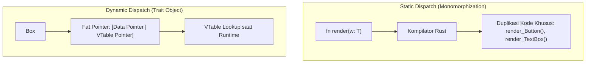

# 🦀 Rust - Modul 05: Traits, Generics, Trait Objects (dyn) & Lifetimes

Traits adalah jantung dari sistem abstraksi polimorfisme di Rust. Dipadukan dengan **Generics** dan **Lifetimes (`'a`)**, Rust memungkinkan abstraksi tingkat tinggi dengan performa *zero runtime penalty*.

---

## 1. Traits: Kontrak Perilaku & Default Implementation

Trait mendefinisikan fungsionalitas bersama yang bisa diimplementasikan oleh berbagai tipe data:

```rust
pub trait Summary {
    // Method abstrak tanpa body (Wajib diimplementasikan)
    fn summarize_author(&self) -> String;

    // Method default (Bisa di-override jika diinginkan)
    fn summarize(&self) -> String {
        format!("(Baca selengkapnya dari {}...)", self.summarize_author())
    }
}

pub struct Tweet {
    pub username: String,
    pub content: String,
}

impl Summary for Tweet {
    fn summarize_author(&self) -> String {
        format!("@{}", self.username)
    }
}
```

---

## 2. Trait Bounds & Sintaks `where`

Kita bisa membatasi parameter generic agar hanya menerima tipe yang memenuhi trait tertentu:

```rust
use std::fmt::Display;

// 1. Sintaks impl Trait ringkas (Syntactic sugar)
fn cetak_info(item: &impl Summary) {
    println!("{}", item.summarize());
}

// 2. Trait bounds ganda dengan operator '+'
fn laporkan<T: Summary + Display>(item: &T) {
    println!("{}: {}", item, item.summarize());
}

// 3. Klausa 'where' untuk merapikan fungsi kompleks
fn proses_komputasi<T, U>(t: &T, u: &U) -> i32
where
    T: Display + Clone,
    U: Summary + std::fmt::Debug,
{
    // ...
    42
}
```

---

## 3. Static Dispatch vs Dynamic Dispatch (`dyn Trait`)

Rust memberikan pilihan arsitektural antara performa mentah atau fleksibilitas polimorfisme:



| Parameter | Static Dispatch (`<T: Trait>`) | Dynamic Dispatch (`&dyn Trait` / `Box<dyn Trait>`) |
|---|---|---|
| **Mekanisme** | **Monomorphization**: Compiler membuat salinan fungsi terpisah untuk setiap tipe saat kompilasi. | **VTable (Virtual Method Table)**: Pointer fungsi dicari secara dinamis saat runtime. |
| **Performa** | **Maksimal**: Bisa di-inline langsung oleh CPU optimizer, nol overhead runtime. | Ada sedikit biaya dereferensi vtable pointer saat pemanggilan method. |
| **Koleksi Heterogen**| ❌ Tidak bisa menyimpan bermacam tipe dalam satu `Vec<T>`. | ✅ Bisa menyimpan berbagai struct berbeda dalam satu `Vec<Box<dyn Trait>>`! |

```rust
// Contoh Dynamic Dispatch: Koleksi Widget Heterogen di UI
pub trait Widget {
    fn draw(&self);
}

struct Button;
impl Widget for Button { fn draw(&self) { println!("Tombol"); } }

struct TextBox;
impl Widget for TextBox { fn draw(&self) { println!("Kotak Teks"); } }

fn main() {
    // Koleksi menampung Button DAN TextBox sekaligus via Trait Object!
    let layar: Vec<Box<dyn Widget>> = vec![
        Box::new(Button),
        Box::new(TextBox),
    ];

    for w in layar {
        w.draw();
    }
}
```

---

## 4. Generic Lifetimes (`'a`): Menjamin Keabsahan Referensi

Masa hidup (*Lifetime*) adalah anotasi generic yang membantu **Borrow Checker** memastikan bahwa **sebuah referensi tidak pernah hidup lebih lama daripada data yang ditunjuknya**.

### Sintaks Anotasi Lifetime:
```rust
// 'a adalah parameter lifetime generic
// Artinya: Referensi kembalian dijamin valid selama x DAN y sama-sama masih hidup
fn string_terpanjang<'a>(x: &'a str, y: &'a str) -> &'a str {
    if x.len() > y.len() {
        x
    } else {
        y
    }
}

fn main() {
    let string1 = String::from("panjang");
    let hasil;
    {
        let string2 = String::from("pendek");
        hasil = string_terpanjang(string1.as_str(), string2.as_str());
        println!("Terpanjang: {}", hasil); // VALID di dalam scope string2
    }
    // println!("{}", hasil); // COMPILE ERROR: string2 sudah mati, hasil tidak boleh diakses!
}
```

---

## 5. Struct dengan Referensi & Lifetime `'static`

### A. Struct yang Menyimpan Referensi
Jika sebuah struct menyimpan referensi (bukan data yang dimiliki langsung), struct tersebut wajib diberi anotasi lifetime:

```rust
struct KutipanBuku<'a> {
    bagian: &'a str, // Struct ini tidak boleh hidup melebihi string aslinya!
}
```

### B. Masa Hidup Abadi: `'static`
Referensi dengan masa hidup `'static` dijamin hidup selama program berjalan. Semua string literal bawaan binary bersifat `'static`:

```rust
let s: &'static str = "Saya disimpan langsung di segmen data binary executable!";
```
