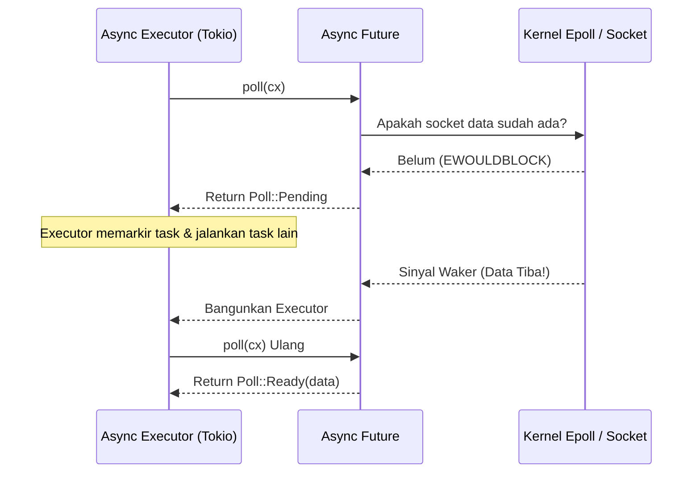

# 🦀 Rust - Modul 08: Asynchronous Rust, Tokio Runtime & Futures Internals

Asynchronous di Rust sangat unik dibandingkan JavaScript atau Python: **Future di Rust bersifat pasif (*lazy*)**. Sebuah future tidak melakukan pekerjaan apa pun dan tidak mengonsumsi resource CPU sama sekali sampai dieksekusi dengan `.await` atau dijalankan di dalam *Async Executor*.

---

## 1. Anatomi Trait `Future` & Siklus Polling

Di tingkat inti (`std::future::Future`), model async Rust didasarkan pada mekanisme polling kooperatif:

```rust
pub trait Future {
    type Output;

    // Memeriksa kemajuan eksekusi future
    fn poll(self: Pin<&mut Self>, cx: &mut Context<'_>) -> Poll<Self::Output>;
}

pub enum Poll<T> {
    Ready(T), // Tugas selesai dengan hasil T
    Pending,  // Tugas masih menunggu I/O
}
```



> [!NOTE]
> **Apa itu `Pin`?** Ketika sebuah fungsi async di-compile, Rust mengubahnya menjadi *State Machine* internal yang seringkali memiliki pointer yang menunjuk ke variabel miliknya sendiri (*self-referential struct*). Jika struct ini dipindahkan lokasinya di memori RAM, pointernya akan menjadi korup. `Pin<P>` menjamin bahwa memori objek tersebut **terpaku dan tidak boleh dipindahkan (*unmovable*)** selama proses eksekusi berlangsung.

---

## 2. Menjalankan Kode Async dengan Tokio Runtime

Standar de-facto ekosistem async Rust untuk aplikasi web dan jaringan adalah **Tokio**:

```rust
// Cargo.toml: tokio = { version = "1.0", features = ["full"] }

#[tokio::main]
async fn main() {
    println!("Memulai server async dengan Tokio...");

    let hasil = fetch_data_dari_api().await;
    println!("Hasil: {}", hasil);
}

async fn fetch_data_dari_api() -> String {
    tokio::time::sleep(tokio::time::Duration::from_millis(100)).await;
    String::from("Data Berhasil Diambil")
}
```

---

## 3. `tokio::spawn`: Menjalankan Ribuan Task Paralel

`tokio::spawn` meluncurkan *Green Thread* ringan di dalam thread pool Tokio. Biayanya sangat murah sehingga jutaan task bisa berjalan serentak:

```rust
use tokio::task;

#[tokio::main]
async fn main() {
    let mut handles = vec![];

    for id in 1..=100 {
        let handle = tokio::spawn(async move {
            // Task async independen
            format!("Task #{} selesai", id)
        });
        handles.push(handle);
    }

    for h in handles {
        let res = h.await.unwrap();
        println!("{}", res);
    }
}
```

---

## 4. Multiplexing dengan `tokio::select!`

`tokio::select!` memungkinkan kita mendengarkan beberapa future sekaligus. Cabang yang **pertama kali selesai akan dieksekusi**, dan future lainnya akan langsung dibatalkan (*cancelled/dropped*):

```rust
use tokio::time::{sleep, Duration};

#[tokio::main]
async fn main() {
    tokio::select! {
        data = download_file_besar() => {
            println!("Download selesai: {}", data);
        }
        _ = sleep(Duration::from_secs(3)) => {
            println!("Timeout! Download dibatalkan karena lebih dari 3 detik");
        }
    }
}

async fn download_file_besar() -> String {
    sleep(Duration::from_secs(5)).await;
    String::from("Konten 100MB")
}
```

---

## 5. ⚠️ Aturan Kritis: `tokio::sync::Mutex` vs `std::sync::Mutex`

Kapan harus memakai Mutex standar OS vs Async Mutex Tokio?

- **Gunakan `std::sync::Mutex`**: Jika durasi penguncian sangat singkat (misal: hanya meng-update counter integer atau memasukkan data ke hashmap) dan **TIDAK ADA `.await`** di dalam blok lock tersebut.
- **Wajib Gunakan `tokio::sync::Mutex`**: Jika kamu harus **mempertahankan lock melintasi titik `.await`**!

```rust
// BAHAYA FATAL DENGAN std::sync::Mutex:
let lock = std_mutex.lock().unwrap();
panggilan_network_lambat().await; // DEADLOCK POTENTIAL: Thread OS Tokio tertahan tidur!

// BENAR DENGAN tokio::sync::Mutex:
let mut lock = tokio_mutex.lock().await;
panggilan_network_lambat().await; // AMAN: Task Tokio melepas thread OS saat menunggu I/O!
```
