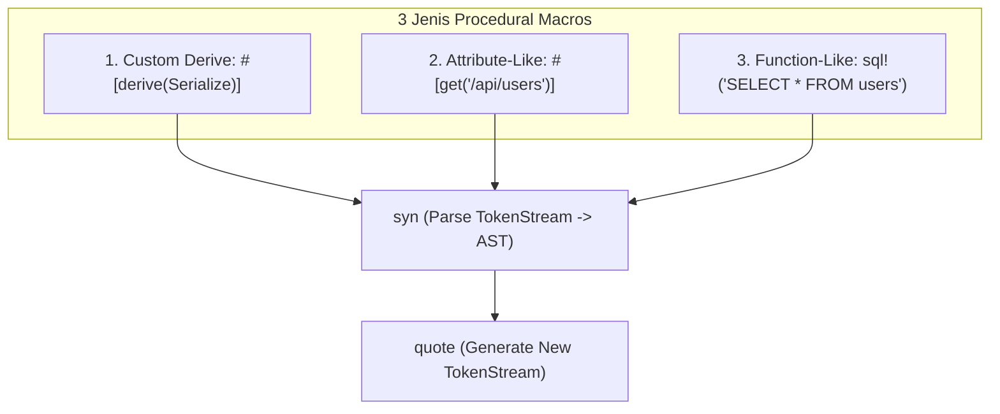

# 🦀 Rust - Modul 09: Metaprogramming: Declarative & Procedural Macros

Macro adalah mekanisme metaprogramming di Rust: **kode yang menulis kode lain saat masa kompilasi (*compile-time code generation*)**. Berbeda dengan macro C/C++ yang hanya melakukan substitusi teks liar, macro di Rust bersifat **Hygienic (Higienis)** dan divalidasi oleh AST (*Abstract Syntax Tree*).

---

## 1. Declarative Macros (`macro_rules!`)

Macro deklaratif mencocokkan pola sintaks dan menghasilkan ekspresi Rust yang valid. Sintaksnya mirip dengan blok `match`:

```rust
// Membuat macro 'my_vec!' mirip dengan bawaan vec!
#[macro_export]
macro_rules! my_vec {
    // Pola 1: Tanpa argumen (my_vec![]) -> Mengembalikan Vec baru kosong
    () => {
        Vec::new()
    };

    // Pola 2: Menerima elemen berulang dipisahkan koma
    // $( $x:expr ),* artinya: Nol atau lebih ekspresi yang dipisahkan tanda koma
    ( $( $x:expr ),* ) => {
        {
            let mut temp_vec = Vec::new();
            $(
                temp_vec.push($x);
            )*
            temp_vec
        }
    };
}

fn main() {
    let kosong: Vec<i32> = my_vec![];
    let isi = my_vec![1, 2, 3, 4, 5];
    println!("Vector hasil macro: {:?}", isi);
}
```

---

## 2. Tabel Designator Token Macro

Saat menulis `macro_rules!`, variabel diawali dengan `$` diikuti oleh tipe penanda (*designator*):

| Designator | Yang Dicocokkan | Contoh Masukan |
|---|---|---|
| **`$expr`** | Semua bentuk ekspresi matematika atau nilai | `1 + 2`, `hitung()`, `"teks"` |
| **`$ident`**| Nama identifier (nama variabel, nama fungsi, nama struct) | `user_name`, `HitungTotal` |
| **`$ty`** | Tipe data | `i32`, `Vec<String>`, `&str` |
| **`$path`** | Path modul atau namespace | `std::collections::HashMap` |
| **`$stmt`** | Sebuah statement lengkap | `let x = 5;` |
| **`$block`**| Blok kode di dalam kurung kurawal | `{ let a = 1; a + 2 }` |

---

## 3. Contoh Praktis: Macro Pembuat HashMap Instan

Di Rust tidak ada sintaks literal `{"a": 1, "b": 2}` untuk HashMap. Kita bisa membuatnya sendiri dengan macro deklaratif:

```rust
use std::collections::HashMap;

macro_rules! hashmap {
    ( $( $key:expr => $val:expr ),* $(,)? ) => {
        {
            let mut map = HashMap::new();
            $(
                map.insert($key, $val);
            )*
            map
        }
    };
}

fn main() {
    let skor = hashmap! {
        "Eka" => 98,
        "Budi" => 85,
        "Siti" => 92, // Trailing comma aman berkat $(,)?
    };

    println!("Skor Eka: {}", skor["Eka"]);
}
```

---

## 4. Procedural Macros: Metaprogramming Tingkat Lanjut

Procedural macro bekerja seperti fungsi compiler plugin: menerima stream token Rust (`TokenStream`), membedahnya menjadi pohon AST, lalu mengembalikan token Rust baru yang disisipkan ke binary.

Ada 3 jenis Procedural Macro:



### 1. Custom Derive Macro (`#[derive(...)]`)
Otomatis mengimplementasikan trait tertentu pada struct:
```rust
#[derive(Debug, Clone, Serialize, Deserialize)]
pub struct AkunBank {
    pub pemilik: String,
    pub saldo: u64,
}
```

### 2. Attribute-Like Macro
Digunakan secara masif pada framework web (Actix-web, Axum, Rocket):
```rust
#[get("/status/{id}")]
async fn get_status(path: web::Path<u32>) -> impl Responder {
    format!("Status ID: {}", path)
}
```

### 3. Function-Like Macro
Memvalidasi sintaks non-Rust saat kompilasi (misal: query SQL di SQLx yang memvalidasi skema database nyata saat `cargo build`!):
```rust
let record = sqlx::query!("SELECT id, nama FROM users WHERE id = $1", user_id)
    .fetch_one(&pool)
    .await?;
```

> [!TIP]
> Untuk membangun procedural macro sendiri, ekosistem Rust mengandalkan crate `syn` (untuk parsing AST) dan `quote` (untuk templating kode ekspansi).
