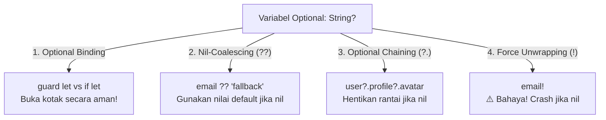

# 🍏 Swift - Modul 01: Sintaks Dasar & Optionals Terlengkap

Swift adalah bahasa pemrograman *type-safe* modern yang dirancang oleh Apple untuk membangun aplikasi di ekosistem iOS, macOS, watchOS, tvOS, dan server Linux. Swift menggabungkan performa kecepatan C/C++ dengan keanggunan sintaksis bahasa modern.

---

## 1. Deklarasi Konstanta & Variabel: `let` vs `var`

Di Swift, keselamatan data dimulai dari imutabilitas:

```swift
// 1. let (Konstanta / Immutable): Nilai dikunci mati setelah diisi
let namaAplikasi = "MyNotes"
// namaAplikasi = "NewApp" // ❌ COMPILE ERROR: Cannot assign to value: 'namaAplikasi' is a 'let' constant

// 2. var (Variabel / Mutable): Nilai bisa diubah sewaktu-waktu
var saldoPengguna: Double = 150000.0
saldoPengguna += 25000.0 // ✅ Diizinkan

// 3. Type Inference: Swift menebak tipe data secara otomatis
let versi = 2           // Bertipe Int
let rating = 4.8        // Bertipe Double
let isAktif = true      // Bertipe Bool
```

> [!TIP]
> **Filosofi Swift**: Selalu deklarasikan variabel dengan **`let`** terlebih dahulu. Xcode bahkan akan memberikan *warning* jika Anda menggunakan `var` padahal nilainya tidak pernah dimutasi di dalam fungsi!

---

## 2. String Interpolasi & Multiline Strings

```swift
let user = "Eka"
let kuota = 15

// 1. String Interpolasi menggunakan sintaks \(...)
let sapaan = "Halo, \(user)! Sisa kuota Anda: \(kuota * 2) GB."

// 2. Multiline String Literals (Tiga tanda kutip ganda)
let formatJson = """
{
  "user": "\(user)",
  "status": "ACTIVE",
  "login_count": \(kuota)
}
"""
```

---

## 3. Sistem Optionals di Balik Layar

Di Objective-C atau bahasa lama, mengakses pointer `nil` akan menyebabkan aplikasi crash seketika. Di Swift, variabel biasa **DILARANG KERAS bernilai `nil`**. 

Jika sebuah variabel bisa saja tidak memiliki nilai, variabel tersebut wajib dideklarasikan sebagai **Optional** bertanda tanya (`?`).

### Anatomi Sebenarnya: Optionals adalah `enum`!
Secara internal di compiler Swift, `String?` sebenarnya adalah sintaks pemanis (*syntactic sugar*) dari sebuah enum generic bawaan:
```swift
enum Optional<Wrapped> {
    case none
    case some(Wrapped)
}
```

```swift
var emailUser: String? = "eka@dev.local"
emailUser = nil // ✅ Aman diizinkan!
```

---

## 4. 4 Cara Membuka Nilai Optional (Unwrapping)

Karena nilai di dalam Optional terbungkus dalam `case some(...)`, kita tidak bisa menggunakannya secara langsung sebelum membukanya (*unwrapping*).



---

### A. `if let` (Scope Terbatas di Dalam Blok)
Membuka nilai optional hanya untuk digunakan di dalam kurung kurawal `if`:
```swift
let usernameInput: String? = "ekadev"

if let username = usernameInput {
    // Di dalam blok ini, username bertipe String biasa (Non-optional)
    println("Halo, \(username)")
} else {
    println("Username tidak diisi!")
}
```

---

### B. `guard let` (Golden Path & Early Exit)
Pola paling disukai di komunitas Swift! Nilai yang dibuka tetap bisa diakses di **seluruh baris fungsi di bawahnya**:
```swift
func prosesRegistrasi(email: String?, password: String?) {
    // Jika email atau password nil, langsung keluar seketika!
    guard let validEmail = email, let validPassword = password else {
        println("Validasi gagal: Email atau Password kosong!")
        return
    }

    // Di bawah baris ini, validEmail dan validPassword adalah String murni!
    println("Mendaftarkan akun: \(validEmail) dengan password \(validPassword.count) karakter")
}
```

---

### C. Operator Nil-Coalescing (`??`)
Menyediakan nilai cadangan (*fallback*) jika optional bernilai `nil`:
```swift
let fotoProfil: String? = nil
let urlAvatar = fotoProfil ?? "https://eka-dev.cloud/default-avatar.png"
println(urlAvatar) // Menggunakan URL default!
```

---

### D. Optional Chaining (`?.`)
Memanggil properti atau method bersarang. Jika salah satu mata rantai bernilai `nil`, seluruh evaluasi akan menghasilkan `nil` tanpa melempar crash:
```swift
class Mobil { var mesin: Mesin? }
class Mesin { var tenagaKuda: Int = 150 }

let mobilSaya: Mobil? = Mobil()
// Ambil tenaga kuda secara aman:
let hp: Int? = mobilSaya?.mesin?.tenagaKuda // Jika mobilSaya atau mesin nil, hp bernilai nil
```

---

### E. Force Unwrapping (`!`)
```swift
let dataMungkinNil: String? = "Ada isi"
let teksPasti: String = dataMungkinNil! // 💥 CRASH jika dataMungkinNil bernilai nil!
```
> [!CAUTION]
> Jangan pernah menggunakan tanda seru `!` untuk unwrap optional di kode produksi. Satu-satunya pengecualian adalah pada unit test (*XCTest*) di mana jika nil terjadi, test memang harus gagal.
