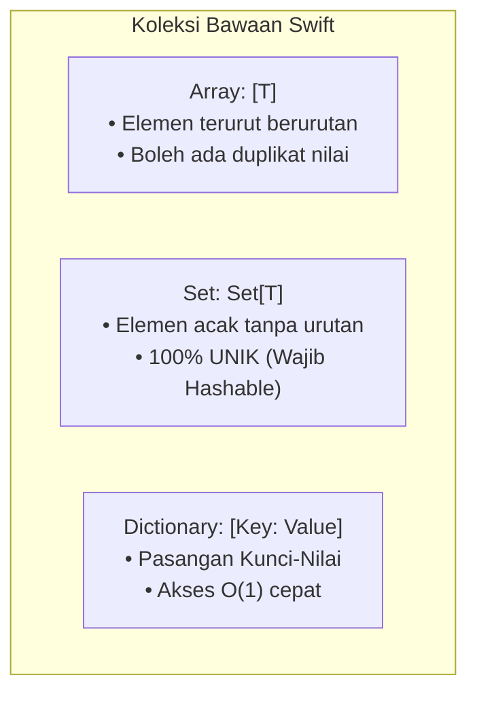

# 🍏 Swift - Modul 02: Koleksi, Control Flow & Pola Defer

Koleksi di Swift bersifat *type-safe* dan dioptimalkan secara mendalam di tingkat memori menggunakan teknik **Copy-on-Write (CoW)**. Mengontrol alur data dengan pattern matching dan menjaga pembersihan memori dengan `defer` adalah kebiasaan developer Swift profesional.

---

## 1. 3 Koleksi Inti Swift (Array, Set, Dictionary)



### A. Array (Daftar Berurutan)
```swift
var bahasa = ["Swift", "Kotlin", "Go"]

// Operasi dasar:
bahasa.append("Rust")
bahasa.insert("Python", at: 0)
let pertama = bahasa.first // Mengembalikan Optional: String?
let jumlah = bahasa.count

// Looping dengan Indeks dan Nilai:
for (index, item) in bahasa.enumerated() {
    print("Urutan ke-\(index + 1): \(item)")
}
```

### B. Set (Himpunan Unik Tanpa Duplikat)
Tipe data yang dimasukkan ke dalam `Set` **wajib mematuhi protokol `Hashable`**:
```swift
var tags: Set<String> = ["ios", "mobile", "swift", "ios"] // "ios" duplikat otomatis dibuang!
tags.insert("apple")

let tagFavorit: Set<String> = ["swift", "macos"]

// Operasi himpunan matematika:
let irisan = tags.intersection(tagFavorit)      // Hanya elemen yang ada di KEDUA set
let gabungan = tags.union(tagFavorit)           // Gabungkan semua elemen unik
let selisih = tags.subtracting(tagFavorit)       // Elemen di 'tags' yang TIDAK ada di 'tagFavorit'
```

### C. Dictionary (Kunci-Nilai)
Mengambil nilai dari Dictionary **selalu mengembalikan Optional**, karena kunci yang dicari belum tentu ada di dalam database dictionary!

```swift
var profil: [String: String] = [
    "nama": "Eka",
    "role": "Lead Engineer"
]

// 1. Mengakses nilai (Hasilnya bertipe String?):
if let nama = profil["nama"] {
    print("Nama pengguna: \(nama)")
}

// 2. Mengakses dengan nilai fallback default instan:
let lokasi = profil["kota", default: "Jakarta"] // Langsung mengembalikan String murni!
```

---

## 2. Operator Rentang (Ranges)

```swift
// 1. Closed Range (1...5): Dari 1 sampai 5 (1, 2, 3, 4, 5)
for i in 1...5 { print(i) }

// 2. Half-Open Range (0..<5): Dari 0 sampai sebelum 5 (0, 1, 2, 3, 4)
let itemArray = ["A", "B", "C"]
for i in 0..<itemArray.count {
    print("Index \(i) bernilai \(itemArray[i])")
}

// 3. One-Sided Range (Slicing Array)
let angka = [10, 20, 30, 40, 50]
let dariIndex2 = angka[2...] // [30, 40, 50]
let hinggaIndex2 = angka[...2] // [10, 20, 30]
```

---

## 3. Pattern Matching Sakti pada `switch`

Di Swift, statement `switch` **bersifat exhaustive** (harus mencakup semua kemungkinan) dan **tidak otomatis fallthrough** (tidak butuh keyword `break`).

### A. Pattern Matching dengan Tuples & Value Binding
```swift
let koordinat = (x: 10, y: 0)

switch koordinat {
case (0, 0):
    print("Titik pusat koordinat (Origin)")
case (let x, 0):
    print("Berada di garis horizontal sumbu X pada titik \(x)")
case (0, let y):
    print("Berada di garis vertikal sumbu Y pada titik \(y)")
case let (x, y):
    print("Berada di koordinat bebas (\(x), \(y))")
}
```

### B. Menyematkan Klausa `where` untuk Filter Ekstrem
```swift
let suhuCelsius = 38

switch suhuCelsius {
case ...0:
    print("Membeku!")
case 1...35:
    print("Suhu normal nyaman")
case let s where s > 35 && s <= 40:
    print("Peringatan: Panas demam (\(s)°C)!")
default:
    print("Kritis! Segera ke rumah sakit.")
}
```

---

## 4. Pembersihan Resource Terjamin dengan `defer`

Blok kode di dalam **`defer`** dijamin akan dieksekusi **tepat sebelum scope fungsi saat ini berakhir**, baik fungsi tersebut selesai secara normal, via `return`, maupun saat melempar error (`throw`).

```swift
func bacaFileDanProses(namaFile: String) {
    let fileHandle = bukaFile(namaFile)

    // Pasang defer tepat setelah resource dibuka:
    defer {
        // Blok ini 100% PASTI DIPANGGIL saat fungsi keluar!
        tutupFile(fileHandle)
        print("Resource file berhasil dibersihkan dari memori.")
    }

    guard let baris1 = fileHandle.bacaBaris() else {
        return // File ditutup otomatis oleh defer!
    }

    if baris1.contains("CORRUPT") {
        return // File juga tetap ditutup otomatis oleh defer!
    }

    print("Data baris: \(baris1)")
}
```

### Urutan Eksekusi Multiple `defer`: LIFO (Last-In, First-Out)
Jika terdapat beberapa blok `defer` dalam satu scope, eksekusinya berjalan secara terbalik (mirip tumpukan piring):
```swift
func demoDefer() {
    defer { print("1. Defer Pertama") }
    defer { print("2. Defer Kedua") }
    print("Eksekusi fungsi selesai.")
}

demoDefer()
// Output:
// Eksekusi fungsi selesai.
// 2. Defer Kedua
// 1. Defer Pertama
```
