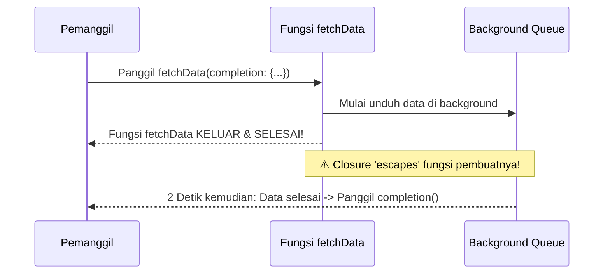

# 🍏 Swift - Modul 03: Fungsi, Closures & Memory Capture Lists

Closures (padanan lambda/anonymous function di Swift) adalah fondasi utama pengembangan iOS, mulai dari penanganan respons jaringan (*completion handlers*), event tombol, hingga deklarasi tampilan di SwiftUI.

---

## 1. Parameter Labels: External vs Internal

Di Swift, nama parameter dirancang agar panggilan fungsi terbaca seperti kalimat bahasa Inggris yang alami:

```swift
// 1. External Label 'to' dan Internal Name 'penerima'
func kirimPesan(teks: String, to penerima: String) {
    print("Mengirim: '\(teks)' ke \(penerima)")
}
kirimPesan(teks: "Halo!", to: "Eka") // Terbaca alami: kirimPesan teks to Eka

// 2. Menghapus External Label dengan Garis Bawah (_)
func tambah(_ a: Int, _ b: Int) -> Int {
    return a + b
}
let hasil = tambah(10, 20) // Tidak perlu mengetik nama parameter!

// 3. In-Out Parameter (Pass-by-Reference): Memodifikasi Variabel Luar
func tukarNilai(_ a: inout Int, _ b: inout Int) {
    let temp = a
    a = b
    b = temp
}

var x = 5
var y = 10
tukarNilai(&x, &y) // Wajib menggunakan ampersand (&)
print("x: \(x), y: \(y)") // x menjadi 10, y menjadi 5!
```

---

## 2. Evolusi Sintaks Closures

Perhatikan bagaimana Swift menyederhanakan kode dari penulisan formal hingga bentuk paling ringkas:

```swift
let angka = [5, 2, 8, 1, 9]

// Bentuk 1: Formal Lengkap
let terurut1 = angka.sorted(by: { (a: Int, b: Int) -> Bool in
    return a < b
})

// Bentuk 2: Type Inference (Compiler tahu a dan b adalah Int, output Bool)
let terurut2 = angka.sorted(by: { a, b in a < b })

// Bentuk 3: Shorthand Argument Names ($0, $1)
let terurut3 = angka.sorted(by: { $0 < $1 })

// Bentuk 4: Trailing Closure (Kurung kurawal di luar tanda kurung)
let terurut4 = angka.sorted { $0 < $1 }

// Bentuk 5: Operator Method Murni (Paling Sakti!)
let terurut5 = angka.sorted(by: <)
```

---

## 3. Escaping Closures (`@escaping`)

Secara default di Swift, semua closure bersifat **Non-Escaping** (closure dijamin selesai dieksekusi sebelum fungsi tempatnya berada kembali). Ini memungkinkan compiler melakukan optimasi alokasi memori stack.

Namun, jika closure akan **disimpan ke variabel luar** atau **dieksekusi secara asinkron di kemudian hari** (seperti callback network), closure tersebut **wajib ditandai dengan `@escaping`**!



```swift
class NetworkManager {
    // Fungsi menerima closure yang keluar dari siklus hidup fungsi:
    func ambilData(completion: @escaping (Result<String, Error>) -> Void) {
        DispatchQueue.global().asyncAfter(deadline: .now() + 2) {
            let dataSukses = "Payload dari server"
            completion(.success(dataSukses)) // Dipanggil setelah ambilData() selesai!
        }
    }
}
```

---

## 4. Bahaya Retain Cycle & Capture Lists (`[weak self]`)

Ketika closure mengakses properti atau method dari kelas pemiliknya, closure tersebut secara default **memegang referensi kuat (*Strong Reference*)** ke objek tersebut. 

Jika objek tersebut juga memegang closure tersebut, terciptalah **Retain Cycle** (kebocoran memori di mana objek tidak akan pernah bisa dihapus dari RAM!).

```mermaid
flowchart LR
    VM[ViewModel Class Instance] -->|Memegang Strong Reference| Clos[Closure Callback]
    Clos -->|Menangkap 'self' secara Kuat!| VM
    Note over VM, Clos: 💥 RETAIN CYCLE! Memori bocor selamanya!
```

### Solusi: Capture List `[weak self]`
Gunakan capture list di awal closure untuk mengubah referensi menjadi lemah (*Weak Reference*):

```swift
class ProfilViewModel {
    var nama: String = "Eka"
    var networkManager = NetworkManager()

    func fetchProfil() {
        // Pasang [weak self] agar closure tidak menyandera ViewModel di RAM:
        networkManager.ambilData { [weak self] result in
            // 'self' di dalam closure kini bertipe Optional (ProfilViewModel?)!
            guard let self = self else { 
                print("ViewModel sudah dibuang dari memori, abaikan respons.")
                return 
            }

            switch result {
            case .success(let data):
                self.nama = data
                print("Nama berhasil diperbarui: \(self.nama)")
            case .failure(let err):
                print("Gagal: \(err)")
            }
        }
    }

    deinit {
        print("✅ ProfilViewModel berhasil dihapus dari memori RAM (Deallocated)!")
    }
}
```

- **`[weak self]`**: `self` menjadi tipe Optional (`self?`). Jika ViewModel dihancurkan saat request berjalan, `self` otomatis berubah menjadi `nil`.
- **`[unowned self]`**: Menganggap `self` pasti tidak nil (non-optional). **Hati-hati**: jika objek ternyata sudah mati, aplikasi akan crash seketika! Selalu prioritaskan `weak self`.
