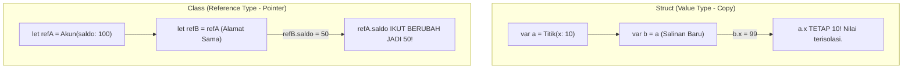

# 🍏 Swift - Modul 04: Struct, Class & Manajemen Memori ARC

Dalam arsitektur Swift modern, pepatah Apple yang paling terkenal adalah: **"Choose Struct by default"**. Memahami perbedaan antara *Value Type* dan *Reference Type* serta cara kerja **Automatic Reference Counting (ARC)** adalah kunci membangun aplikasi Apple yang hemat baterai dan bebas memory leak.

---

## 1. Perbandingan Mendalam: Struct vs Class

| Karakteristik | 🧱 **Struct** (*Value Type*) | 🏛️ **Class** (*Reference Type*) |
|---|---|---|
| **Penyimpanan Memori** | Memori **Stack** (Cepat, alokasi instan). | Memori **Heap** (Butuh alokasi pointer & reference counter). |
| **Pola Pengalihan Nilai** | **Copy** (Disalin utuh sebagai salinan baru independen). | **Reference** (Berbagi alamat pointer yang sama). |
| **Perbandingan Identitas** | Perbandingan nilai struktural (`==`). | Mendukung perbandingan alamat pointer (`===`). |
| **Inheritance (Pewarisan)**| ❌ Tidak mendukung pewarisan class (Hanya Protocol). | ✅ Mendukung pewarisan class tunggal (*Single Inheritance*). |
| **Deinitializer (`deinit`)** | ❌ Tidak ada (Dibersihkan seketika keluar scope). | ✅ Ada method `deinit` saat reference count mencapai 0. |
| **Thread Safety** | ✅ Sangat aman dari data race (Tiap thread punya copy sendiri). | ⚠️ Berbahaya jika diakses concurrent tanpa penguncian. |



---

## 2. Mutating Keyword & Copy-on-Write (CoW)

Secara default, properti di dalam `struct` tidak boleh diubah oleh method di dalamnya. Jika suatu method mengubah nilai properti, tandai dengan kata kunci **`mutating`**:

```swift
struct Dompet {
    var saldo: Double

    // Wajib 'mutating' karena memodifikasi properti 'saldo':
    mutating func tarikUang(nominal: Double) {
        saldo -= nominal
    }
}

var dompetSaya = Dompet(saldo: 100000)
dompetSaya.tarikUang(nominal: 20000) // saldo menjadi 80000
```

### Optimasi Copy-on-Write (CoW) di Swift
Jika `struct` disalin setiap kali di-passing ke fungsi, apakah menyalin Array 1.000.000 item akan membuat RAM meledak? **TIDAK**. 
Swift mengimplementasikan **Copy-on-Write**: Array salinan tetap merujuk pada blok memori yang sama persis, dan duplikasi fisik di RAM baru terjadi **hanya jika salah satu salinan melakukan modifikasi penulisan data**!

---

## 3. Automatic Reference Counting (ARC)

Swift **TIDAK memiliki Garbage Collector** yang berjalan berkala seperti JVM pada Java/Kotlin. Sebagai gantinya, Swift menggunakan **Automatic Reference Counting (ARC)** saat kompilasi.

- Setiap kali sebuah instance `class` dibuat, ARC menyiapkan blok memori untuk melacak berapa banyak referensi kuat (*Strong Reference*) yang menunjuk ke instance tersebut.
- Setiap kali ada variabel baru yang menunjuk ke instance tersebut $\to$ **Count bertambah $+1$**.
- Saat variabel keluar dari scope $\to$ **Count berkurang $-1$**.
- Begitu Reference Count mencapai **`0`**, method **`deinit`** dipanggil dan memori RAM langsung dibebaskan detik itu juga tanpa jeda (*Zero GC Pauses*).

---

## 4. Retain Cycles: Strong vs Weak vs Unowned

Masalah muncul jika dua objek saling memegang referensi kuat satu sama lain:

```mermaid
flowchart LR
    P[Objek Orang] -->|strong: apartemen| A[Objek Apartemen]
    A -->|strong: penyewa| P
    Note over P, A: 💥 RETAIN CYCLE! Reference count tidak pernah bisa 0!
```

### Solusi 1: `weak` Reference (Selalu `var` Optional)
Referensi lemah tidak menambah nilai hitungan ARC. Begitu objek target dihancurkan, referensi ini otomatis berubah menjadi `nil`:

```swift
class Orang {
    let nama: String
    var apartemen: Apartemen? // Strong reference
    init(nama: String) { self.nama = nama }
    deinit { print("Orang \(nama) dideallokasi!") }
}

class Apartemen {
    let unit: String
    // Pasang 'weak' agar tidak tercipta retain cycle:
    weak var penyewa: Orang? // Weak reference!
    init(unit: String) { self.unit = unit }
    deinit { print("Apartemen \(unit) dideallokasi!") }
}

var budi: Orang? = Orang(nama: "Budi")
var towerA: Apartemen? = Apartemen(unit: "12A")

budi?.apartemen = towerA
towerA?.penyewa = budi

// Saat kita lepas referensinya:
budi = nil    // Output: "Orang Budi dideallokasi!"
towerA = nil  // Output: "Apartemen 12A dideallokasi!" (Semua memori bersih 100%!)
```

### Solusi 2: `unowned` Reference (Non-Optional)
Gunakan `unowned` jika objek lain dijamin **selalu memiliki masa hidup yang sama atau lebih panjang**, dan variabel tersebut tidak boleh bernilai `nil`:

```swift
class KartuKredit {
    let nomor: String
    // Kartu kredit tidak mungkin ada tanpa pemilik nasabah:
    unowned let pemilik: Nasabah // Non-optional!
    init(nomor: String, pemilik: Nasabah) {
        self.nomor = nomor
        self.pemilik = pemilik
    }
}
```
