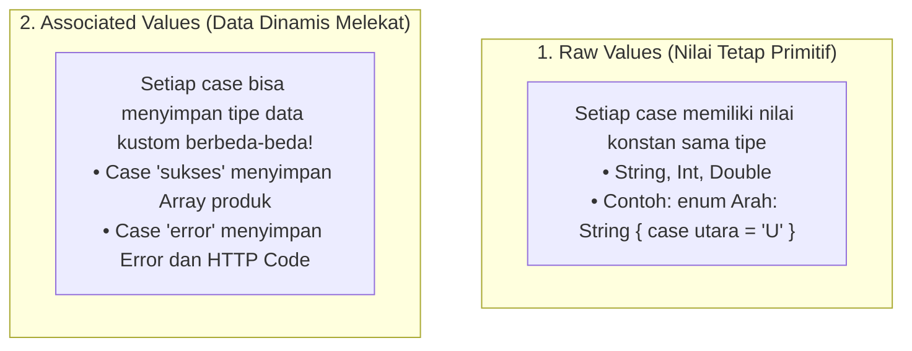

# 🍏 Swift - Modul 05: Enums, Associated Values & State Machines

Dalam banyak bahasa pemrograman (seperti C atau Java lama), `enum` hanyalah kumpulan angka integer yang diberi label. Di Swift, **`enum` adalah tipe data berdaya tinggi**: dapat memiliki computed properties, method, inisialisasi, mematuhi protokol, dan menyimpan data terikat dinamis (**Associated Values**).

---

## 1. Raw Values vs Associated Values



### A. Raw Values (Nilai Konstan Bawaan)
```swift
enum HttpMethod: String, CaseIterable {
    case get = "GET"
    case post = "POST"
    case put = "PUT"
    case delete = "DELETE"
}

// Inisialisasi dari Raw Value (Selalu mengembalikan Optional):
if let method = HttpMethod(rawValue: "POST") {
    print("Method valid: \(method)")
}

// Protokol CaseIterable: Otomatis mendapatkan daftar semua case!
print("Total HTTP method: \(HttpMethod.allCases.count)") // 4
```

---

## 2. Senjata Pamungkas: Associated Values (Memodelkan State UI)

Associated Values memungkinkan kita menyematkan data spesifik ke dalam setiap cabang enum. Ini adalah pola terbersih di iOS untuk mengelola status tampilan UI tanpa variabel boolean flags yang membingungkan:

```swift
enum ViewState {
    case idle
    case loading(pesan: String)
    case success(items: [String], totalHalaman: Int)
    case error(kodeHttp: Int, alasan: String)
}

// Penggunaan State:
var layarState: ViewState = .success(items: ["MacBook", "iPad", "iPhone"], totalHalaman: 3)

// Pattern Matching dengan Switch:
switch layarState {
case .idle:
    tampilkanPlaceholder()
case .loading(let pesan):
    tampilkanSpinner(teks: pesan)
case .success(let items, let total):
    print("Menampilkan \(items.count) item dari total \(total) halaman")
case .error(let kode, let alasan) where kode == 401:
    print("Sesi login kedaluwarsa, arahkan ke Login Screen!")
case .error(let kode, let alasan):
    print("Terjadi error \(kode): \(alasan)")
}
```

---

## 3. Shorthand Pattern: `if case let` & `guard case let`

Jika Anda hanya peduli pada **satu case spesifik** dan tidak ingin menulis seluruh blok `switch`:

```swift
let responseServer: ViewState = .error(kodeHttp: 500, alasan: "Database Down")

// Hanya ambil jika statusnya adalah .error:
if case let .error(kode, alasan) = responseServer {
    print("Tangani error spesifik: \(kode) - \(alasan)")
}
```

---

## 4. Recursive Enums (`indirect`)

Jika sebuah enum menyimpan instance dari dirinya sendiri (seperti struktur data Pohon Biner atau Evaluator Matematika), gunakan kata kunci **`indirect`** agar compiler menyiapkan pointer indirection:

```swift
// Pohon Evaluasi Aritmatika: (5 + 4) * 2
indirect enum EkspresiAritmatika {
    case angka(Int)
    case tambah(EkspresiAritmatika, EkspresiAritmatika)
    case kali(EkspresiAritmatika, EkspresiAritmatika)
}

func evaluasi(_ ekspresi: EkspresiAritmatika) -> Int {
    switch ekspresi {
    case .angka(let nilai):
        return nilai
    case .tambah(let kiri, let kanan):
        return evaluasi(kiri) + evaluasi(kanan)
    case .kali(let kiri, let kanan):
        return evaluasi(kiri) * evaluasi(kanan)
    }
}

let lima = EkspresiAritmatika.angka(5)
let empat = EkspresiAritmatika.angka(4)
let dua = EkspresiAritmatika.angka(2)
let penjumlahan = EkspresiAritmatika.tambah(lima, empat) // (5 + 4)
let total = EkspresiAritmatika.kali(penjumlahan, dua)    // (5 + 4) * 2

print("Hasil hitung: \(evaluasi(total))") // Output: 18
```
