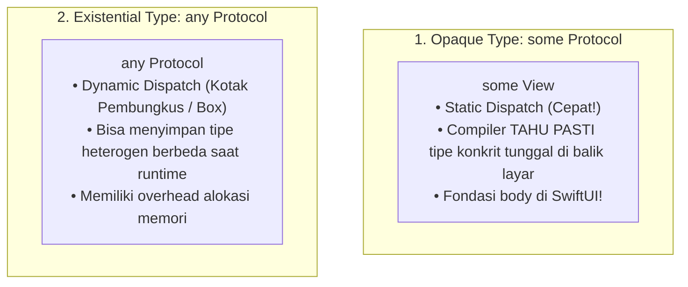

# 🍏 Swift - Modul 06: Protocols, Generics & Opaque Types (some vs any)

Apple memperkenalkan Swift di WWDC dengan moto: *"At its heart, Swift is Protocol-Oriented."* Dibandingkan mengandalkan hierarki pewarisan kelas (*Class Inheritance*) yang kaku, Swift mengedepankan **Protocol-Oriented Programming (POP)** yang fleksibel dan aman untuk *Value Types* (Struct).

---

## 1. Protocol-Oriented Programming (POP)

Protocol mendefinisikan sebuah kontrak kemampuan (*blueprint of methods & properties*).

```swift
protocol Beliable {
    var harga: Double { get }
    var diskonPersen: Double { get set }
    func hitungTotal() -> Double
}

// Struct mematuhi protokol:
struct Buku: Beliable {
    let judul: String
    var harga: Double
    var diskonPersen: Double = 0.0

    func hitungTotal() -> Double {
        return harga - (harga * diskonPersen / 100.0)
    }
}
```

---

## 2. Default Implementation via Extensions (Kekuatan Utama POP)

Anda dapat memberikan implementasi logika default langsung di dalam **`extension` protocol**. Kelas atau struct yang mematuhinya otomatis mewarisi method tersebut tanpa perlu menulis ulang!

```swift
protocol Validatable {
    var teksInput: String { get }
    func isValid() -> Bool
}

// Berikan implementasi default:
extension Validatable {
    func isValid() -> Bool {
        return !teksInput.trimmingCharacters(in: .whitespaces).isEmpty
    }
}

// Struct cukup mendefinisikan teksInput, isValid() diwarisi otomatis!
struct FormUsername: Validatable {
    var teksInput: String
}

let form = FormUsername(teksInput: "   ")
print("Valid? \(form.isValid())") // false
```

### Retroactive Modeling: Memperluas Tipe Bawaan Sistem
Anda bisa membuat tipe bawaan Apple (seperti `Int` atau `String`) mematuhi protokol kustom Anda:
```swift
extension Int {
    func rupiahFormatted() -> String {
        let formatter = NumberFormatter()
        formatter.numberStyle = .currency
        formatter.locale = Locale(identifier: "id_ID")
        return formatter.string(from: NSNumber(value: self)) ?? "Rp \(self)"
    }
}

let gaji = 15000000
print(gaji.rupiahFormatted()) // "Rp 15.000.000,00"
```

---

## 3. Generics & Associated Types

### A. Generics Sederhana
```swift
// Fungsi generic dengan constraint protokol Comparable:
func cariNilaiTerbesar<T: Comparable>(_ a: T, _ b: T) -> T {
    return a > b ? a : b
}

let maxAngka = cariNilaiTerbesar(10, 25)       // 25
let maxKata = cariNilaiTerbesar("Apel", "Zebra") // "Zebra"
```

### B. Protocol dengan `associatedtype`
Di dalam protocol, kita tidak menggunakan sintaks `<T>` biasa, melainkan **`associatedtype`**:

```swift
protocol Antrean {
    associatedtype Element // Tipe placeholder yang akan ditentukan oleh pengadopsi
    mutating func enqueue(_ item: Element)
    mutating func dequeue() -> Element?
}

struct AntreanTeks: Antrean {
    typealias Element = String // Menentukan tipe konkrit
    private var buffer = [String]()

    mutating func enqueue(_ item: String) { buffer.append(item) }
    mutating func dequeue() -> String? { buffer.isEmpty ? nil : buffer.removeFirst() }
}
```

---

## 4. Opaque Types (`some`) vs Existential Types (`any`)

Mulai Swift 5.7+, Apple mempertegas perbedaan antara kata kunci **`some`** dan **`any`**.



### A. Opaque Types (`some`) - Mengapa Dipakai di SwiftUI?
Di SwiftUI, kita selalu menulis:
```swift
struct MyView: View {
    var body: some View { // Mengapa 'some View'?
        VStack {
            Text("Halo")
            Button("Klik") { }
        }
    }
}
```
Jika tanpa `some`, tipe kembalian method di atas adalah:
`VStack<TupleView<(Text, Button<Text>)>>`. Jika tampilan UI Anda memiliki 20 elemen bersarang, tipe data generic-nya akan sepanjang 1 halaman! 

Dengan **`some View`**, kita memberitahu compiler: *"Fungsi ini mengembalikan SATU tipe konkrit yang mematuhi protokol View, sembunyikan tipe kompleks aslinya dari publik demi kerapian!"*.

### B. Kapan Menggunakan `any`?
Gunakan `any` jika Anda ingin menyimpan **berbagai tipe berbeda yang mematuhi protokol yang sama dalam satu Array**:
```swift
protocol SuaraHewan { func bersuara() }
struct Kucing: SuaraHewan { func bersuara() { print("Meong") } }
struct Anjing: SuaraHewan { func bersuara() { print("Guk") } }

// Array yang berisi tipe heterogen wajib menggunakan 'any':
let daftarHewan: [any SuaraHewan] = [Kucing(), Anjing(), Kucing()]

for hewan in daftarHewan {
    hewan.bersuara()
}
```
