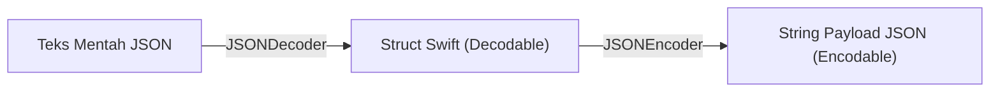

# 🍏 Swift - Modul 07: Error Handling, Result Type & Codable JSON

Menangani kegagalan jaringan (*Network Failure*) dan mem-parsing data JSON dari server REST API adalah pekerjaan sehari-hari developer iOS. Swift menyediakan sistem penanganan error yang bersih serta protokol **`Codable`** yang mengeliminasi kebutuhan parsing kamus JSON secara manual.

---

## 1. Pemodelan Error dengan Enum & LocalizedError

Di Swift, tipe error direpresentasikan melalui enum yang mematuhi protokol bawaan **`Error`**. Untuk memberikan pesan teks ramah pengguna, tambahkan protokol **`LocalizedError`**:

```swift
import Foundation

enum NetworkError: LocalizedError {
    case invalidURL
    case serverError(statusCode: Int)
    case decodingFailed(reason: String)
    case noInternetConnection

    // Properti pesan deskriptif yang ramah pengguna:
    var errorDescription: String? {
        switch self {
        case .invalidURL:
            return "Alamat URL tidak valid atau rusak."
        case .serverError(let code):
            return "Server mengalami gangguan internal (Kode: \(code))."
        case .decodingFailed(let reason):
            return "Gagal memproses data JSON: \(reason)"
        case .noInternetConnection:
            return "Tidak ada koneksi internet. Periksa sinyal Anda."
        }
    }
}
```

---

## 2. Penanganan Error: `throws`, `do-catch`, `try?` & `try!`

```swift
// Fungsi yang bisa melempar error (ditandai dengan keyword 'throws'):
func validasiKupon(kode: String) throws -> Double {
    guard !kode.isEmpty else {
        throw NetworkError.decodingFailed(reason: "Kode kupon tidak boleh kosong")
    }
    guard kode == "DISKON50" else {
        throw NetworkError.serverError(statusCode: 400)
    }
    return 0.5 // Diskon 50%
}
```

### A. Blok `do-catch` Lengkap
```swift
do {
    let diskon = try validasiKupon(kode: "DISKON50")
    print("Diskon aktif: \(diskon * 100)%")
} catch NetworkError.serverError(let code) {
    print("Error server spesifik: \(code)")
} catch {
    // Variable implisit 'error' otomatis tersedia:
    print("Error umum: \(error.localizedDescription)")
}
```

### B. `try?` (Ubah Menjadi Optional)
Jika Anda tidak peduli jenis error-nya dan hanya ingin hasil sukses atau `nil`:
```swift
let potonganDiskon: Double? = try? validasiKupon(kode: "KODE_SALAH")
// Jika gagal, potonganDiskon bernilai nil tanpa melempar crash!
```

### C. `try!` (Force Try - Bahaya!)
Hanya gunakan jika Anda yakin $100\%$ operasi tidak mungkin gagal (misal memuat file konfigurasi lokal dari app bundle):
```swift
let urlLokal = try! Bundle.main.url(forResource: "config", withExtension: "json")
```

---

## 3. Tipe `Result<Success, Failure>`

Tipe `Result` adalah enum bawaan Swift yang merepresentasikan salah satu dari dua kondisi: **`.success(Value)`** atau **`.failure(Error)`**.

```swift
func cekStatusUser(id: Int) -> Result<String, NetworkError> {
    if id > 0 {
        return .success("User Aktif")
    } else {
        return .failure(.serverError(statusCode: 404))
    }
}

// Konsumsi Result:
let hasil = cekStatusUser(id: 10)
switch hasil {
case .success(let data):
    print("Berhasil: \(data)")
case .failure(let err):
    print("Gagal: \(err.localizedDescription)")
}
```

---

## 4. Protokol Sakti `Codable`: Parsing JSON Tanpa Pusing

`Codable` adalah gabungan dari dua protokol: `Decodable` (JSON $\to$ Objek Swift) dan `Encodable` (Objek Swift $\to$ JSON).



### A. Model Data dengan `CodingKeys`
Seringkali backend menggunakan format `snake_case` (misal `user_email`), sedangkan di Swift standarnya adalah `camelCase` (`userEmail`). Gunakan **`enum CodingKeys`**:

```swift
struct UserProfile: Codable {
    let id: Int
    let nama: String
    let email: String
    let createdAt: Date
    let isVip: Bool? // Properti opsional (bisa null di JSON)

    // Pemetaan khusus properti ke nama key JSON server:
    enum CodingKeys: String, CodingKey {
        case id
        case nama = "full_name"
        case email = "user_email"
        case createdAt = "created_at"
        case isVip = "is_vip"
    }
}
```

### B. Eksekusi `JSONDecoder` Produksi
```swift
let jsonMentah = """
{
  "id": 101,
  "full_name": "Eka Dev",
  "user_email": "eka@dev.local",
  "created_at": "2026-11-20T10:00:00Z",
  "is_vip": true
}
""".data(using: .utf8)!

let decoder = JSONDecoder()
// Konfigurasi parser tanggal ISO 8601:
decoder.dateDecodingStrategy = .iso8601

do {
    let user: UserProfile = try decoder.decode(UserProfile.self, from: jsonMentah)
    print("User berhasil di-decode: \(user.nama) - Email: \(user.email)")
} catch {
    print("Gagal parsing JSON: \(error)")
}
```
> [!TIP]
> Jika seluruh key di JSON berupa snake_case, Anda bahkan tidak perlu membuat `CodingKeys` manual! Cukup pasang:
> `decoder.keyDecodingStrategy = .convertFromSnakeCase`. Swift akan mengonversi `created_at` menjadi `createdAt` secara otomatis!
