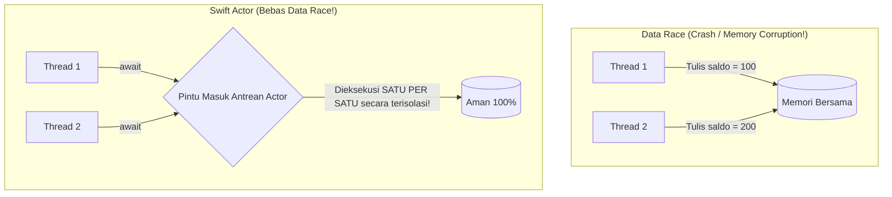

# 🍏 Swift - Modul 09: Swift 6 Concurrency, Actors & AsyncStream

Di era Swift 6, model konkurensi Apple mengalami revolusi total: **Compile-Time Data Race Safety**. Swift menjamin bahwa kesalahan sinkronisasi thread (*Data Race Bugs*) akan ditangkap dan digagalkan oleh compiler **sebelum aplikasi sempat di-compile**, bukan lagi menjadi bug hantu saat runtime!

---

## 1. Apa itu Data Race & Mengapa Swift 6 Ketat?

**Data Race** terjadi ketika dua thread berbeda mengakses blok memori yang sama secara bersamaan, di mana minimal salah satunya melakukan operasi penulisan (*Write*), tanpa mekanisme sinkronisasi.



---

## 2. Asynchronous Functions (`async` / `await`)

Sebuah fungsi yang ditandai dengan **`async`** dapat menangguhkan eksekusinya pada titik **`await`** tanpa memblokir thread sistem operasi:

```swift
func fetchUserProfile(id: String) async throws -> UserProfile {
    let url = URL(string: "https://api.eka-dev.cloud/users/\(id)")!

    // URLSession bawaan Apple sudah mendukung async/await:
    let (data, response) = try await URLSession.shared.data(from: url)

    guard let httpResponse = response as? HTTPURLResponse, httpResponse.statusCode == 200 else {
        throw NetworkError.serverError(statusCode: 500)
    }

    return try JSONDecoder().decode(UserProfile.self, from: data)
}
```

---

## 3. Eksekusi Paralel: `async let` & `TaskGroup`

### A. `async let` (Paralelisme Sederhana)
Jika Anda memiliki 2 request API yang independen, jalankan secara serentak agar total waktu tunggu tidak berlipat ganda:

```swift
func muatDashboard() async throws -> DashboardData {
    // Memulai kedua request secara paralel seketika!
    async let fetchUser = fetchUserProfile(id: "101")
    async let fetchNotifications = fetchUserNotifications(id: "101")

    // Tunggu keduanya selesai di baris ini:
    let (user, notifs) = try await (fetchUser, fetchNotifications)
    return DashboardData(user: user, notifications: notifs)
}
```

### B. `TaskGroup` (Paralelisme Dinamis untuk Banyak Item)
Mengunduh 10 gambar sekaligus secara paralel dengan batasan grup:

```swift
func unduhBanyakGambar(urls: [URL]) async -> [UIImage] {
    await withTaskGroup(of: UIImage?.self) { group in
        for url in urls {
            // Tambahkan setiap download sebagai child task independen:
            group.addTask {
                guard let (data, _) = try? await URLSession.shared.data(from: url) else { return nil }
                return UIImage(data: data)
            }
        }

        var hasil = [UIImage]()
        // Kumpulkan gambar seiring selesainya masing-masing task:
        for await gambar in group {
            if let g = gambar { hasil.append(g) }
        }
        return hasil
    }
}
```

---

## 4. Perlindungan State dengan `actor` & `@MainActor`

### A. Apa itu `actor`?
`actor` adalah tipe data referensi (mirip `class`), namun **seluruh properti dan method di dalamnya diisolasi secara otomatis**. Tidak ada dua thread yang diizinkan mengakses state internal actor di waktu yang sama!

```swift
actor BankAccount {
    private var saldo: Double = 1000.0

    func tarikUang(nominal: Double) -> Bool {
        if saldo >= nominal {
            saldo -= nominal
            return true
        }
        return false
    }

    func cekSaldo() -> Double {
        return saldo
    }
}

// Mengakses actor dari luar WAJIB menggunakan 'await':
let akun = BankAccount()
Task {
    let berhasil = await akun.tarikUang(nominal: 200.0) // Sinkronisasi aman!
    let sisa = await akun.cekSaldo()
    print("Sisa saldo: \(sisa)")
}
```

### B. Global Actor: `@MainActor` (Update Tampilan UI)
Semua update antarmuka pengguna di iOS/SwiftUI **wajib dieksekusi di Main Thread**. Beri anotasi `@MainActor` pada ViewModel atau fungsi UI:

```swift
@MainActor
class OrderViewModel: ObservableObject {
    @Published var statusText: String = "Idle"

    func submitOrder() async {
        statusText = "Memproses..." // Berjalan di Main Thread
        
        let hasil = await apiService.checkout() // Pindah ke background thread
        
        statusText = hasil.pesan // Otomatis kembali ke Main Thread dengan aman!
    }
}
```

---

## 5. Streaming Data Berkelanjutan: `AsyncStream`

Bagaimana jika kita ingin mengalirkan data berulang kali (seperti GPS location atau paket WebSocket) ke dalam loop `for await`:

```swift
import CoreLocation

func streamLokasi() -> AsyncStream<CLLocation> {
    AsyncStream { continuation in
        let manager = LocationListener()

        manager.onLocationUpdated = { lokasi in
            continuation.yield(lokasi) // Pancarkan lokasi baru
        }

        continuation.onTermination = { _ in
            manager.stopUpdating() // Bersihkan resource saat stream berhenti
        }
    }
}

// Konsumsi Data di UI / ViewModel:
Task {
    for await lokasi in streamLokasi() {
        print("Koordinat baru: \(lokasi.coordinate.latitude), \(lokasi.coordinate.longitude)")
    }
}
```
