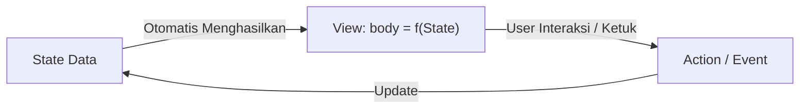
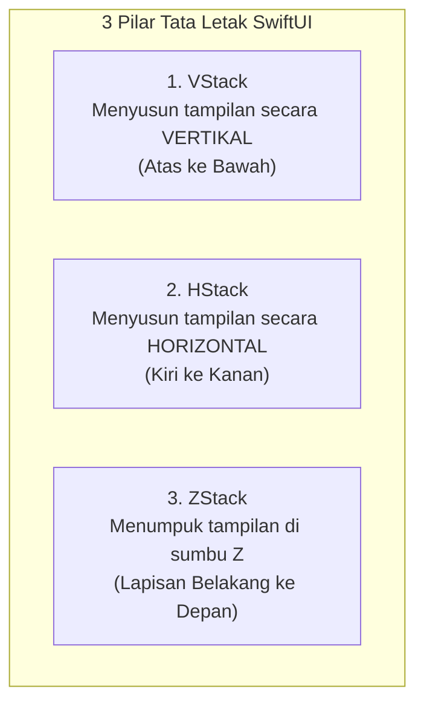
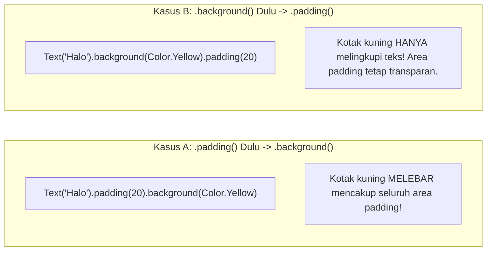

# 🍎 SwiftUI - Modul 01: Mental Model, ViewBuilder & Tata Letak Dasar

SwiftUI adalah framework deklaratif modern dari Apple untuk membangun antarmuka pengguna di seluruh platform: **iOS, macOS, watchOS, tvOS, dan visionOS** menggunakan satu paradigma bahasa yang terpadu.

---

## 1. Pergeseran Paradigma: UIKit (Imperatif) vs SwiftUI (Deklaratif)

Di era UIKit lama, kita membuat UI secara imperatif: membuat `UILabel`, mengatur autolayout constraints dengan kode panjang, lalu manual memanggil `label.text = "..."`. 

Di SwiftUI, **UI adalah fungsi dari State**:

$$\mathbf{UI} = f(\mathbf{State})$$



Anda tidak pernah memanipulasi elemen UI secara langsung. Anda hanya mengubah data State, dan SwiftUI akan **menghitung perbedaan (*diffing*) pohon UI dan meng-update layar secara instan**!

---

## 2. Anatomi View: Mengapa `struct` Bukan `class`?

Di UIKit, setiap `UIView` adalah objek `class` yang berat di memori. Di SwiftUI, **semua View adalah `struct` ringan (*Value Type*)**.

```swift
import SwiftUI

struct ProfilCardView: View {
    let nama: String
    let jabatan: String

    // Protokol View mewajibkan SATU properti komputasi: 'body'
    var body: some View {
        VStack(alignment: .leading, spacing: 8) {
            Text(nama)
                .font(.headline)
            Text(jabatan)
                .font(.subheadline)
                .foregroundStyle(.secondary)
        }
        .padding()
        .background(Color(.systemGray6))
        .clipShape(RoundedRectangle(cornerRadius: 12))
    }
}
```

### Mengapa `struct` Sangat Cepat?
Membuat 1.000 struct View di SwiftUI hampir tidak memakan biaya alokasi memori heap. SwiftUI dapat menghancurkan dan membuat ulang ribuan struct View setiap detik tanpa memicu lag atau frame drop!

---

## 3. Komponen Penampung Inti: VStack, HStack & ZStack



### A. Alignment & Spacing pada Stacks
```swift
HStack(alignment: .center, spacing: 16) {
    Image(systemName: "person.circle.fill")
        .resizable()
        .frame(width: 48, height: 48)
        .foregroundStyle(.blue)

    VStack(alignment: .leading, spacing: 4) {
        Text("Eka Dev")
            .font(.title3)
            .bold()
        Text("Online")
            .font(.caption)
            .foregroundStyle(.green)
    }

    Spacer() // Mendorong konten ke kiri, mengisi sisa ruang kanan!

    Image(systemName: "chevron.right")
        .foregroundStyle(.tertiary)
}
.padding()
```

### B. ZStack untuk Tampilan Berlapis (Overlay)
```swift
ZStack(alignment: .bottomTrailing) {
    // 1. Lapisan Belakang: Foto Profil
    Image("avatar")
        .resizable()
        .frame(width: 80, height: 80)
        .clipShape(Circle())

    // 2. Lapisan Depan: Titik Hijau Status Online
    Circle()
        .fill(Color.green)
        .frame(width: 20, height: 20)
        .overlay(Circle().stroke(Color.white, lineWidth: 3))
}
```

---

## 4. Aturan Mutlak Modifier Chaining (Urutan Sangat Menentukan!)

Di SwiftUI, setiap kali Anda memanggil modifier (seperti `.padding()` atau `.background()`), SwiftUI **tidak memodifikasi view asli**, melainkan **membungkus view tersebut ke dalam view baru**!



### Perhatikan Urutan Frame & Background:
```swift
// 1. Menentukan ukuran dulu, baru mewarnai (Optimal):
Text("Tombol Lebar")
    .frame(maxWidth: .infinity) // 1. Melebarkan ukuran penuh
    .padding()                  // 2. Beri jarak dalam
    .background(Color.blue)     // 3. Warna biru melebar penuh!
    .foregroundStyle(.white)
    .clipShape(Capsule())

// 2. Memasang Border dan Corner Radius yang Benar:
Text("Kotak Bergaris")
    .padding()
    .background(Color.white)
    .clipShape(RoundedRectangle(cornerRadius: 12))
    .overlay(
        RoundedRectangle(cornerRadius: 12)
            .stroke(Color.blue, lineWidth: 2) // Garis border rapi di pinggir kurva!
    )
```
