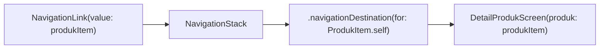

# 🍎 SwiftUI - Modul 03: List, NavigationStack Modern & Modals

Menampilkan daftar data berulang dan berpindah antar layar (*Navigation*) adalah kebutuhan paling fundamental dalam pembuatan aplikasi iOS. Mulai iOS 16+, Apple memensiunkan `NavigationView` lama dan menggantinya dengan **`NavigationStack`** berbasis data yang type-safe dan stabil.

---

## 1. Menampilkan Data Berulang: `List` & `ForEach`

`List` di SwiftUI setara dengan `UITableView` di UIKit, yang otomatis menangani *cell recycling* di memori RAM dan gaya tampilan khas iOS.

```swift
// Model data wajib mematuhi Identifiable:
struct ProdukItem: Identifiable, Hashable {
    let id: UUID = UUID()
    let nama: String
    let harga: Double
}

struct DaftarProdukView: View {
    @State private var items = [
        ProdukItem(nama: "MacBook Air M3", harga: 18500000),
        ProdukItem(nama: "iPad Air M2", harga: 11000000),
        ProdukItem(nama: "AirPods Pro 2", harga: 3800000)
    ]
    @State private var searchText = ""

    var body: some View {
        List {
            ForEach(items) { item in
                HStack {
                    Text(item.nama)
                    Spacer()
                    Text("Rp \(Int(item.harga))")
                        .foregroundStyle(.secondary)
                }
                // Custom Swipe Action (Geser Kiri/Kanan):
                .swipeActions(edge: .trailing, allowsFullSwipe: true) {
                    Button(role: .destructive) {
                        hapusItem(item)
                    } label: {
                        Label("Hapus", systemImage: "trash")
                    }
                }
            }
            .onDelete(perform: hapusBaris) // Geser untuk hapus bawaan
        }
        // Pull to Refresh bawaan:
        .refreshable {
            await muatUlangData()
        }
        // Search Bar bawaan iOS:
        .searchable(text: $searchText, prompt: "Cari produk...")
    }

    func hapusBaris(at offsets: IndexSet) {
        items.remove(atOffsets: offsets)
    }

    func hapusItem(_ item: ProdukItem) {
        items.removeAll { $0.id == item.id }
    }

    func muatUlangData() async {
        try? await Task.sleep(nanoseconds: 1_000_000_000)
    }
}
```

---

## 2. Navigasi Modern: `NavigationStack` (iOS 16+)

Lupakan `NavigationView` yang sering memicu bug *double pop* saat navigasi kembali! `NavigationStack` menggunakan pendekatan berbasis data (*Data-Driven Navigation*):



```swift
struct AppNavView: View {
    let daftarProduk: [ProdukItem] = [...]

    var body: some View {
        NavigationStack {
            List(daftarProduk) { produk in
                // 1. Oper OBJEK DATA ke NavigationLink:
                NavigationLink(value: produk) {
                    Text(produk.nama)
                }
            }
            .navigationTitle("Katalog Toko")
            // 2. Tangkap tipe data ProdukItem dan petakan ke layarnya:
            .navigationDestination(for: ProdukItem.self) { produkTerpilih in
                DetailProdukView(produk: produkTerpilih)
            }
        }
    }
}

struct DetailProdukView: View {
    let produk: ProdukItem

    var body: some View {
        VStack(spacing: 20) {
            Text(produk.nama).font(.largeTitle).bold()
            Text("Harga: Rp \(Int(produk.harga))")
        }
        .navigationTitle("Detail")
        .navigationBarTitleDisplayMode(.inline)
    }
}
```

### Navigasi Terprogram (Kembali ke Halaman Pertama Seketika):
Gunakan **`NavigationPath`** untuk berpindah layar melalui kode (seperti tombol *"Selesai Belanja"* yang langsung melompat kembali ke halaman Home):

```swift
struct RootNavScreen: View {
    @State private var path = NavigationPath()

    var body: some View {
        NavigationStack(path: $path) {
            Button("Buka Halaman 1") {
                path.append("Layar1")
            }
            .navigationDestination(for: String.self) { namaLayar in
                VStack {
                    Text("Sedang di: \(namaLayar)")
                    Button("Reset Kembali ke Home (Pop to Root)") {
                        path.removeLast(path.count) // Kosongkan path stack seketika!
                    }
                }
            }
        }
    }
}
```

---

## 3. Menampilkan Modals: Sheets & Alerts

### A. Bottom Sheet dengan Ukuran Dinamis (`presentationDetents`)
```swift
struct LayarDenganSheet: View {
    @State private var showSheet = false

    var body: some View {
        Button("Buka Filter Pencarian") {
            showSheet = true
        }
        .sheet(isPresented: $showSheet) {
            VStack {
                Text("Opsi Filter").font(.headline)
                Button("Tutup") { showSheet = false }
            }
            .padding()
            // Mengatur ukuran sheet (Setengah layar atau layar penuh):
            .presentationDetents([.medium, .fraction(0.8), .large])
            .presentationDragIndicator(.visible) // Indikator garis tarik di atas
        }
    }
}
```

### B. Dialog Konfirmasi (`alert`)
```swift
struct LayarDenganAlert: View {
    @State private var showAlert = false

    var body: some View {
        Button("Hapus Akun", role: .destructive) {
            showAlert = true
        }
        .alert("Konfirmasi Tindakan", isPresented: $showAlert) {
            Button("Batal", role: .cancel) { }
            Button("Hapus Sekarang", role: .destructive) {
                // Jalankan proses hapus...
            }
        } message: {
            Text("Tindakan ini permanen dan tidak dapat dibatalkan.")
        }
    }
}
```
