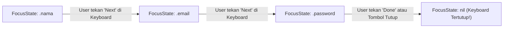

# 🍎 SwiftUI - Modul 04: Form, Input Controls & Manajemen Fokus Keyboard

Membangun layar formulir registrasi atau menu pengaturan di iOS sangat mudah menggunakan komponen **`Form`**. Ditambah dengan wrapper **`@FocusState`**, Anda dapat mengontrol pergerakan kursor dan menutup keyboard virtual tanpa kode boilerplate yang rumit.

---

## 1. Membangun Formulir dengan `Form` & `Section`

`Form` otomatis menerapkan gaya visual standar iOS (seperti di aplikasi *Settings* iPhone) dengan pengelompokan menggunakan `Section`:

```swift
import SwiftUI

struct FormRegistrasiView: View {
    @State private var nama = ""
    @State private var email = ""
    @State private var password = ""
    @State private var rolePilihan = "USER"
    @State private var tanggalLahir = Date()
    @State private var bersediaMenerimaEmail = true
    @State private var levelPengalaman = 2.0

    let daftarRole = ["USER", "DEVELOPER", "ADMIN"]

    var body: some View {
        NavigationStack {
            Form {
                // Section 1: Informasi Pribadi
                Section(header: Text("Informasi Akun")) {
                    TextField("Nama Lengkap", text: $nama)
                        .autocorrectionDisabled()

                    TextField("Alamat Email", text: $email)
                        .keyboardType(.emailAddress)
                        .textInputAutocapitalization(.never)

                    SecureField("Kata Sandi", text: $password)
                }

                // Section 2: Pilihan & Pengaturan
                Section(header: Text("Preferensi & Peran")) {
                    // Dropdown Picker:
                    Picker("Peran Akun", selection: $rolePilihan) {
                        ForEach(daftarRole, id: \.self) { role in
                            Text(role).tag(role)
                        }
                    }
                    .pickerStyle(.menu)

                    // DatePicker Tanggal Lahir:
                    DatePicker("Tanggal Lahir", selection: $tanggalLahir, displayedComponents: .date)

                    // Toggle Switch:
                    Toggle("Berlangganan Newsletter", isOn: $bersediaMenerimaEmail)

                    // Stepper / Slider:
                    VStack(alignment: .leading) {
                        Text("Pengalaman: \(Int(levelPengalaman)) Tahun")
                        Slider(value: $levelPengalaman, in: 0...10, step: 1)
                    }
                }

                // Section 3: Tombol Submit
                Section {
                    Button("Kirim Pendaftaran") {
                        submitForm()
                    }
                    .frame(maxWidth: .infinity)
                    .foregroundStyle(.blue)
                }
            }
            .navigationTitle("Pendaftaran")
        }
    }

    func submitForm() {
        print("Data dikirim: \(nama) - \(email)")
    }
}
```

---

## 2. Manajemen Fokus Keyboard dengan `@FocusState`

Salah satu masalah paling umum pada form mobile adalah keyboard yang menutupi input dan sulitnya menutup keyboard saat user selesai mengetik. 

SwiftUI memecahkan masalah ini dengan elegan menggunakan **`@FocusState`**:



```swift
struct LayarLoginDenganFokus: View {
    // 1. Definisikan enum field yang bisa menerima fokus:
    enum FieldFokus: Hashable {
        case username
        case password
    }

    @State private var username = ""
    @State private var password = ""

    // 2. Buat variabel @FocusState:
    @FocusState private var fieldAktif: FieldFokus?

    var body: some View {
        VStack(spacing: 20) {
            TextField("Username", text: $username)
                .textFieldStyle(.roundedBorder)
                // 3. Kaitkan fokus ke enum:
                .focused($fieldAktif, equals: .username)
                .submitLabel(.next) // Tombol keyboard bertuliskan 'Next'
                .onSubmit {
                    fieldAktif = .password // Pindah kursor ke password!
                }

            SecureField("Password", text: $password)
                .textFieldStyle(.roundedBorder)
                .focused($fieldAktif, equals: .password)
                .submitLabel(.done) // Tombol keyboard bertuliskan 'Done'
                .onSubmit {
                    fieldAktif = nil // Tutup keyboard!
                    login()
                }

            Button("Masuk") {
                fieldAktif = nil // Tutup keyboard saat tombol diklik
                login()
            }
        }
        .padding()
        // 4. Tambahkan Toolbar 'Selesai' di atas Keyboard:
        .toolbar {
            ToolbarItemGroup(placement: .keyboard) {
                Spacer() // Geser tombol ke kanan
                Button("Selesai") {
                    fieldAktif = nil // Menutup keyboard virtual seketika!
                }
            }
        }
        .onAppear {
            // Otomatis buka keyboard di field username saat halaman muncul:
            fieldAktif = .username
        }
    }

    func login() {
        print("Login dieksekusi...")
    }
}
```
