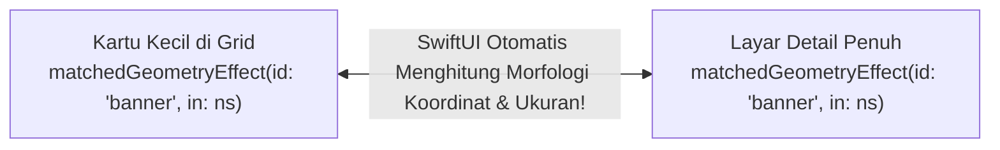

# 🍎 SwiftUI - Modul 05: Animasi, Transisi & matchedGeometryEffect

Salah satu alasan developer dan pengguna mencintai iOS adalah kehalusan animasinya. Di SwiftUI, membuat animasi tidak lagi memerlukan kalkulasi frame manual: animasi didefinisikan secara deklaratif dan dijalankan oleh mesin grafis Apple Metal pada kecepatan **60fps hingga 120fps (ProMotion)**.

---

## 1. Animasi Eksplisit (`withAnimation`) vs Implisit (`.animation`)

### A. Animasi Eksplisit dengan `withAnimation` (Sangat Disarankan!)
Memberitahu SwiftUI bahwa perubahan state di dalam kurung kurawal harus dianimasikan:

```swift
struct TombolAnimasiView: View {
    @State private var isBesar = false

    var body: some View {
        Button {
            // Bungkus mutasi state dengan withAnimation:
            withAnimation(.spring(response: 0.4, dampingFraction: 0.6)) {
                isBesar.toggle()
            }
        } label: {
            Image(systemName: "heart.fill")
                .font(.system(size: isBesar ? 80 : 40))
                .foregroundStyle(isBesar ? .red : .gray)
                .rotationEffect(.degrees(isBesar ? 360 : 0))
        }
    }
}
```

---

### B. Animasi Implisit dengan Modifier `.animation`
Memasang animasi langsung ke view yang akan terpicu jika parameter `value` berubah:

```swift
RoundedRectangle(cornerRadius: isBesar ? 30 : 10)
    .fill(isBesar ? Color.purple : Color.blue)
    .frame(width: isBesar ? 200 : 100, height: 100)
    // Pantau perubahan variabel isBesar:
    .animation(.easeInOut(duration: 0.3), value: isBesar)
```

> [!WARNING]
> Jangan pernah menulis `.animation(.default)` tanpa parameter `value:`. Sintaks tanpa `value` telah didepresiasi karena memicu animasi liar pada setiap perubahan state apa pun di layar!

---

## 2. Transisi Masuk & Keluar (`transition`)

Ketika sebuah view muncul atau hilang dari layar (misal di dalam blok `if`), gunakan modifier **`.transition`**:

```swift
struct NotifikasiBannerView: View {
    @State private var tampilkan = false

    var body: some View {
        VStack {
            Button("Toggle Banner") {
                withAnimation(.spring()) {
                    tampilkan.toggle()
                }
            }

            if tampilkan {
                HStack {
                    Image(systemName: "checkmark.circle.fill")
                    Text("File berhasil diunggah!")
                }
                .padding()
                .background(Color.green)
                .foregroundStyle(.white)
                .clipShape(Capsule())
                // Transisi Asimetris: Masuk dari atas, keluar memudar mengecil:
                .transition(
                    .asymmetric(
                        insertion: .move(edge: .top).combined(with: .opacity),
                        removal: .scale.combined(with: .opacity)
                    )
                )
            }
        }
    }
}
```

---

## 3. Efek Hero Animasi: `matchedGeometryEffect`

Fitur paling memukau di SwiftUI: mengubah kartu kecil di dalam list menjadi layar detail penuh secara mulus tanpa jeda (*Hero Animation / Zoom Transition*), mirip animasi di App Store Apple!



```swift
struct HeroAnimationDemo: View {
    @Namespace private var heroNamespace // 1. Buat namespace bersama
    @State private var isDetail = false

    var body: some View {
        ZStack {
            if !isDetail {
                // Tampilan Kartu Ringkas di Daftar:
                VStack(alignment: .leading) {
                    RoundedRectangle(cornerRadius: 16)
                        .fill(Color.blue)
                        // 2. Hubungkan geometri background ke ID yang sama:
                        .matchedGeometryEffect(id: "bg_kartu", in: heroNamespace)
                        .frame(width: 150, height: 100)

                    Text("MacBook Pro M3")
                        .matchedGeometryEffect(id: "judul_kartu", in: heroNamespace)
                        .font(.headline)
                }
                .onTapGesture {
                    withAnimation(.spring(response: 0.5, dampingFraction: 0.8)) {
                        isDetail = true
                    }
                }
            } else {
                // Tampilan Detail Layar Penuh:
                VStack(spacing: 20) {
                    RoundedRectangle(cornerRadius: 0)
                        .fill(Color.blue)
                        .matchedGeometryEffect(id: "bg_kartu", in: heroNamespace)
                        .frame(maxWidth: .infinity, maxHeight: 350)

                    Text("MacBook Pro M3")
                        .matchedGeometryEffect(id: "judul_kartu", in: heroNamespace)
                        .font(.largeTitle)
                        .bold()

                    Text("Laptop bertenaga tinggi untuk developer profesional.")
                        .padding()

                    Spacer()

                    Button("Tutup Detail") {
                        withAnimation(.spring(response: 0.5, dampingFraction: 0.8)) {
                            isDetail = false
                        }
                    }
                    .padding()
                }
                .ignoresSafeArea(edges: .top)
            }
        }
    }
}
```
SwiftUI secara otomatis menganimasikan interpolasi koordinat, ukuran sudut kurva, dan dimensi view antara kedua kondisi secara instan!
