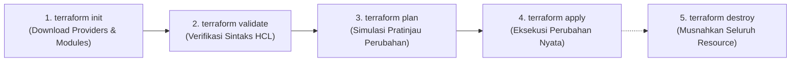

# ☁️ Terraform - Modul 01: Commands, Workflow & Arsitektur Deklaratif

HashiCorp Terraform adalah alat **Infrastructure as Code (IaC)** deklaratif standar industri untuk mengotomatisasi penyediaan (*provisioning*), modifikasi, dan manajemen siklus hidup infrastruktur cloud (AWS, GCP, Azure, Kubernetes, Cloudflare).

---

## 1. Paradigma Deklaratif: Mengapa Bukan Script Bash?

- **Imperatif (Bash / Python script)**: Kamu menulis *langkah-langkah* pembuatan (*"Jalankan VM, lalu pasang IP, lalu tunggu 30 detik..."*). Sangat rawan error jika dijalankan ulang (*not idempotent*).
- **Deklaratif (Terraform HCL)**: Kamu hanya mendefinisikan **status akhir yang kamu inginkan (*Desired State*)**. Terraform yang bertanggung jawab menghitung selisih perbedaan (*delta graph*) antara infrastruktur nyata saat ini dengan status akhir tersebut.

---

## 2. Lima Perintah Alur Kerja Wajib (The Core Workflow)



### 1. `terraform init`
Perintah pertama yang wajib dijalankan di direktori proyek:
- Mengunduh binary plugin provider dari Terraform Registry (misal: `hashicorp/aws`, `hashicorp/google`).
- Menginisialisasi backend penyimpanan state file.
- Mengunci versi provider di `.terraform.lock.hcl`.

### 2. `terraform validate`
Memeriksa kebenaran sintaks HCL (*HashiCorp Configuration Language*), konsistensi tipe variabel, dan nama argumen tanpa perlu terhubung ke cloud API:
```bash
terraform validate
```

### 3. `terraform plan`
Melakukan *dry-run* simulasi:
- Membaca infrastruktur nyata di cloud via API.
- Membandingkannya dengan kode HCL lokal.
- Menampilkan pratinjau perubahan:
  - `+ create` (Resource baru yang akan dibuat).
  - `~ update in-place` (Resource yang akan diubah propertinya).
  - `- destroy` (Resource yang akan dihapus).
  - `- / + replace` (Resource yang terpaksa dihancurkan lalu dibuat ulang).

```bash
# Simpan plan ke file biner untuk dieksekusi di pipeline CI/CD:
terraform plan -out=tfplan.binary
```

### 4. `terraform apply`
Mengeksekusi perubahan nyata ke API penyedia cloud:
```bash
# Eksekusi manual interaktif (Meminta konfirmasi ketik 'yes'):
terraform apply

# Eksekusi otomatis tanpa prompt konfirmasi (Wajib untuk CI/CD pipeline):
terraform apply -auto-approve

# Menerapkan plan yang sudah disetujui sebelumnya:
terraform apply tfplan.binary
```

### 5. `terraform destroy`
Menghapus seluruh infrastruktur yang terdaftar di dalam state file proyek (berguna untuk lingkungan testing/sandbox agar tidak boros biaya):
```bash
terraform destroy -auto-approve
```

---

## 3. Flag-Flag Penyelamat di Produksi

- **`-target` (Operasi Parsial Darurat)**:
  Jika kamu hanya ingin menerapkan perubahan pada 1 resource tertentu tanpa menyentuh ratusan resource lain:
  ```bash
  terraform apply -target=aws_security_group.allow_http
  ```
- **`-var-file` (Memuat Konfigurasi Lingkungan)**:
  ```bash
  terraform apply -var-file="production.tfvars"
  ```
- **`terraform fmt` (Auto-Format Kode HCL)**:
  Merapikan spasi, indentasi, dan penataan kurung kurawal secara rekursif:
  ```bash
  terraform fmt -recursive
  ```
